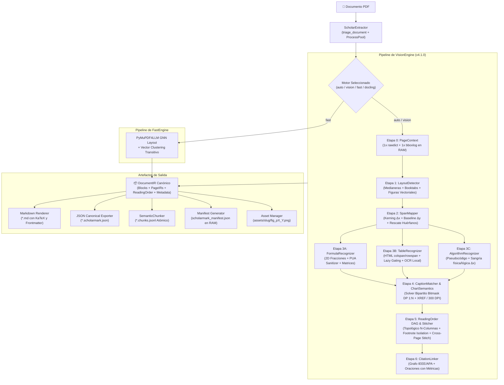
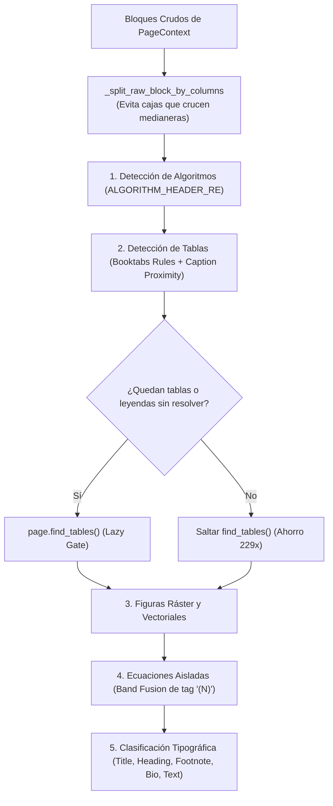
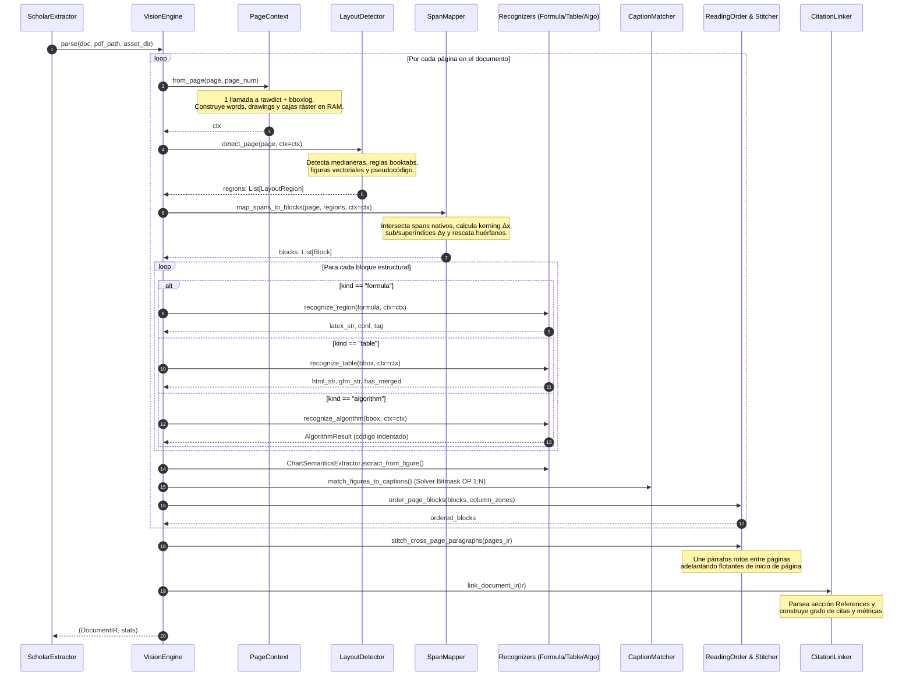

# 🏛️ Especificación Arquitectónica Completa: ScholarMark v4.1

> **Documento Maestro de Arquitectura de Software, Contratos de Interfaz y Blueprint de Replicación.**  
> *Versión del Software:* v4.1.0  
> *Propósito:* Proporcionar una descripción exhaustiva, autosuficiente y matemáticamente precisa de cada componente, algoritmo, estructura de datos y flujo de información de ScholarMark, de tal forma que cualquier desarrollador o equipo de ingeniería pueda reconstruir el sistema completo sin ambigüedad.

---

## 📑 Tabla de Contenidos

1. [Visión General y Filosofía de Diseño](#1-visión-general-y-filosofía-de-diseño)
2. [Topología General y Flujo de Datos End-to-End](#2-topología-general-y-flujo-de-datos-end-to-end)
3. [Estructura del Proyecto y Mapeo de Componentes](#3-estructura-del-proyecto-y-mapeo-de-componentes)
4. [El Modelo Canónico Intermedio: DocumentIR](#4-el-modelo-canónico-intermedio-documentir)
5. [Desglose Técnico de Cada Componente y Algoritmo](#5-desglose-técnico-de-cada-componente-y-algoritmo)
   - [5.1. PageContext: Extracción de Paso Único en Memoria](#51-pagecontext-extracción-de-paso-único-en-memoria)
   - [5.2. Geometría Vectorial y Agrupamiento Transitivo Union-Find](#52-geometría-vectorial-y-agrupamiento-transitivo-union-find)
   - [5.3. LayoutDetector: Detección Multimodal y Compuertas Heurísticas](#53-layoutdetector-detección-multimodal-y-compuertas-heurísticas)
   - [5.4. SpanMapper: Mapeo Vectorial Nativo, Kerning y Retención 100%](#54-spanmapper-mapeo-vectorial-nativo-kerning-y-retención-100)
   - [5.5. FormulaRecognizer: Reconstrucción 2D, Multilínea y Saneamiento PUA](#55-formula-recognizer-reconstrucción-2d-multilínea-y-saneamiento-pua)
   - [5.6. TableRecognizer: Tablas Jerárquicas HTML/Booktabs y Visión Local](#56-table-recognizer-tablas-jerárquicas-htmlbooktabs-y-visión-local)
   - [5.7. AlgorithmRecognizer: Reconstrucción Jerárquica de Pseudocódigo](#57-algorithm-recognizer-reconstrucción-jerárquica-de-pseudocódigo)
   - [5.8. CaptionMatcher: Grafo Bipartito 1:N y Solver Bitmask DP](#58-caption-matcher-grafo-bipartito-1n-y-solver-bitmask-dp)
   - [5.9. ChartSemanticsExtractor: Minería de Texto Interno en Gráficos](#59-chart-semantics-extractor-minería-de-texto-interno-en-gráficos)
   - [5.10. ReadingOrder: Solucionador Topológico DAG y XY-Cut Recursivo](#510-reading-order-solucionador-topológico-dag-y-xy-cut-recursivo)
   - [5.11. CitationLinker y BibliographyParser: Grafo de Evidencia RAG](#511-citation-linker-y-bibliography-parser-grafo-de-evidencia-rag)
   - [5.12. SemanticChunker: Particionador Jerárquico Atómico para RAG](#512-semantic-chunker-particionador-jerárquico-atómico-para-rag)
   - [5.13. Motores de Extracción Intercambiables (Vision, Fast, Docling)](#513-motores-de-extracción-intercambiables-vision-fast-docling)
   - [5.14. Serialización, Manifiesto y Caché Determinista](#514-serialización-manifiesto-y-caché-determinista)
6. [Contratos de Interfaz y Esquemas de Datos](#6-contratos-de-interfaz-y-esquemas-de-datos)
7. [Diagrama de Secuencia de Procesamiento](#7-diagrama-de-secuencia-de-procesamiento)
8. [Blueprint de Replicación Paso a Paso](#8-blueprint-de-replicación-paso-a-paso)
9. [Criterios de Verificación y Gold Benchmark](#9-criterios-de-verificación-y-gold-benchmark)

---

## 1. Visión General y Filosofía de Diseño

### 1.1. El Problema Científico y de Ingeniería
Los artículos científicos (papers) publicados por editoriales como IEEE, ACM, Springer, Elsevier o MDPI presentan desafíos estructurales extremos para los Large Language Models (LLMs) y los sistemas de Retrieval-Augmented Generation (RAG):
1. **Entrelazado de Doble/Triple Columna:** Los parsers OCR estándar leen líneas horizontalmente cruzando la medianera (*gutter*), intercalando palabras de columnas distintas y destruyendo la sintaxis.
2. **Destrucción de Fórmulas Matemáticas:** Ecuaciones bidimensionales (fracciones con barra divisoria, subíndices/superíndices, matrices) se aplanan en cadenas ASCII incoherentes o se confunden con tablas de 16 columnas vacías.
3. **Pérdida de Figuras y Diagramas:** Las figuras vectoriales compuestas por miles de trazados Bezier son ignoradas o se extraen como cientos de fragmentos inconexos.
4. **Glifos Corruptos y PUA:** Fuentes matemáticas Type 1 incrustadas sin tabla `/ToUnicode` generan caracteres en el Área de Uso Privado (`PUA` $U+E000$–$U+F8FF$) o el símbolo de reemplazo Unicode ($U+FFFD$).
5. **Tablas Complejas y Booktabs:** Las tablas sin líneas verticales (*booktabs*) y con encabezados multinivel (`colspan` / `rowspan`) se desalinean por completo en Markdown plano.

### 1.2. Principios Arquitectónicos Fundamentales
ScholarMark fue diseñado bajo cinco axiomas de ingeniería:
- **0 MB VRAM por Defecto:** Inferencia nativa en CPU. No requiere GPUs de 24 GB ni modelos pesados de visión por defecto. Se ejecuta a $2\text{--}4\text{ s}$ por paper en cualquier laptop o contenedor estándar.
- **Complejidad de Memoria Estricta $O(N)$:** El consumo de RAM no depende del número de páginas acumuladas; cada página se procesa y libera en memoria.
- **Cero Alucinación (Grounding Vectorial Nativo):** El texto de prosa nunca es generado por un modelo generativo; proviene 100% de los spans de texto nativos del PDF extraídos a nivel de coordenadas vectoriales.
- **Single-Pass PageContext:** Se realiza **una sola llamada** por página a las APIs de bajo nivel de PyMuPDF (`rawdict`, `bboxlog`, `drawings`), sintetizando estructuras en RAM para que ningún módulo downstream vuelva a invocar llamadas costosas C/CFFI.
- **Compuertas Selectivas (Lazy Gating):** Operaciones computacionalmente caras (como `page.find_tables()` o inferencia OCR sobre mapa de bits) están bloqueadas por guardas geométricas rápidas en Python y solo se activan cuando la evidencia heurística lo exige.

---

## 2. Topología General y Flujo de Datos End-to-End

El siguiente diagrama ilustra el flujo de transformación desde el archivo PDF original hasta los artefactos de salida (Markdown, JSON canónico, Chunks JSONL y Manifiesto):



---

## 3. Estructura del Proyecto y Mapeo de Componentes

La distribución modular del código fuente responde al principio de separación de responsabilidades:

```text
scholarmark/
├── __init__.py               # Versión del paquete (v4.1.0) y exports principales
├── config.py                 # ExtractorConfig (dataclass con hashing determinista SHA-1)
├── extractor.py              # ScholarExtractor (orquestador, triaje, ProcessPool, DeltaCache)
├── cli.py                    # Interfaz CLI Rich (batch, single, manifest, doctor, chunk)
│
├── ir/                       # Representación Intermedia Canónica
│   ├── __init__.py           # Exports de Block, PageIR, DocumentIR
│   └── document.py           # Estructuras de datos desacopladas de PyMuPDF
│
├── core/                     # Primitivas geométricas y académicas de bajo nivel
│   ├── page_context.py       # PageContext (paso único en memoria de primitivas C)
│   ├── geometry.py           # BoundingBox, Union-Find, detección de medianeras, elastic padding
│   ├── caption_matcher.py    # Regex de figuras/tablas, solver bitmask DP de asignación bipartita
│   ├── citations.py          # BibliographyParser, CitationLinker, GroundedClaim
│   ├── math_parser.py        # Mapeo griego/operadores Unicode a KaTeX, aislamiento $$
│   ├── academic.py           # Normalización de encabezados H1-H4, YAML frontmatter, DOI regex
│   ├── figure_manager.py     # Gestión de directorios de activos y conteo de figuras
│   └── manifest.py           # Extractor de métricas y generador del manifiesto JSON
│
├── layout/                   # Segmentación espacial y flujo topológico
│   ├── __init__.py           # Exports de layout
│   ├── detector.py           # LayoutDetector (heurística multimodal y compuertas)
│   ├── span_mapper.py        # SpanMapper (intersección vectorial nativa, kerning, rescate)
│   └── reading_order.py      # Solucionador DAG, XY-Cut recursivo y costura inter-página
│
├── recognizers/              # Extractores semánticos especializados
│   ├── __init__.py           # Exports de reconocedores
│   ├── formula.py            # FormulaRecognizer (2D, barras de división, multilínea, PUA)
│   ├── table.py              # TableRecognizer (booktabs, colspan/rowspan, fallback ráster)
│   ├── algorithm.py          # AlgorithmRecognizer (pseudocódigo, sangrías anidadas)
│   ├── chart.py              # ChartSemanticsExtractor (ejes, leyendas, marcas numéricas)
│   └── ocr_engine.py         # LocalOCREngine (singleton RapidOCR ONNX selectivo)
│
├── engines/                  # Backends de extracción intercambiables
│   ├── __init__.py           # Factory get_engine()
│   ├── base.py               # Protocolo abstracto BaseEngine
│   ├── vision.py             # VisionEngine (motor modular SOTA por defecto)
│   ├── fast.py               # FastEngine (PyMuPDF4LLM de alta velocidad)
│   └── docling_engine.py     # DoclingEngine (adaptador de referencia opcional)
│
├── rag/                      # Módulo de integración para Scientific RAG
│   ├── __init__.py           # Exports de SemanticChunk, SemanticChunker
│   └── chunker.py            # Particionador jerárquico consciente de DocumentIR
│
├── models/                   # Gestión de pesos ONNX y proveedores de ejecución
│   ├── __init__.py
│   └── registry.py           # Detección de CPU, DirectML, CUDA y caché local
│
└── utils/                    # Herramientas de soporte
    ├── cache.py              # DeltaCache (invalidación determinista por config_hash)
    ├── paths.py              # Extended paths para Windows (\\?\) y slugification
    └── logger.py             # Configuración centralizada de logging
```

---

## 4. El Modelo Canónico Intermedio: DocumentIR

Toda la extracción converge en una representación intermedia tipada (`DocumentIR`), totalmente independiente de los objetos C/C++ subyacentes de PyMuPDF.

### 4.1. Unidad Atómica: `Block`
Representa una región discreta en la página con su semántica, geometría y contenido polifacético:

```python
@dataclass
class Block:
    id: str                         # Identificador único (ej. "p1_text_3", "p2_table_1")
    kind: str                       # BlockKind (title, text, formula, table, figure, algorithm, etc.)
    bbox: BoundingBox               # Coordenadas exactas en puntos [x0, y0, x1, y1]
    page: int                       # Número de página (1-based)
    text: str = ""                  # Texto nativo recuperado
    latex: Optional[str] = None     # Código LaTeX generado (para kind == "formula")
    html: Optional[str] = None      # Tabla HTML semántica con colspan/rowspan
    gfm: Optional[str] = None       # Tabla o bloque en GitHub Flavored Markdown
    asset: Optional[str] = None     # Nombre del archivo de imagen (para kind == "figure")
    caption_id: Optional[str] = None# ID del bloque de leyenda asociado
    caption_text: Optional[str] = None # Texto completo de la leyenda asociada
    heading_level: int = 2          # Nivel de jerarquía (1 para título, 2 para H2, 3 para H3)
    confidence: float = 1.0         # Confianza probabilística [0.0, 1.0]
    source: str = "native"          # "native" (PDF vectorial) | "model" | "ocr"
    metadata: Dict[str, Any] = field(default_factory=dict)
```

**Tipos Estructurales Admitidos (`BlockKind`):**
- `title`: Título principal del artículo.
- `section_header`: Encabezados numerados o canónicos (`1. Introduction`, `III. METHODOLOGY`).
- `text`: Párrafos de prosa estándar.
- `footnote`: Notas al pie de página (segregadas de la lectura de columnas).
- `abandon`: Encabezados de página repetitivos, números de página sueltos y artefactos descartables.
- `formula`: Ecuaciones matemáticas independientes (display math).
- `formula_caption`: Etiqueta numérica de la ecuación (ej. `(3)`).
- `table`: Regiones de tablas de datos.
- `table_caption`: Leyenda asociada a una tabla (`Table I: ...`).
- `figure`: Diagramas, fotos, plots y esquemas visuales.
- `figure_caption`: Leyenda asociada a una figura (`Fig. 1: ...`).
- `list`: Elementos de listas con viñetas o numeración.
- `author_bio`: Biografías de autores IEEE (con o sin retrato lateral).
- `algorithm`: Bloques de algoritmos y pseudocódigo con sangría.

### 4.2. Contenedor de Página y Documento
- **`PageIR`**: Contiene `page_number`, dimensiones (`width`, `height`), `rotation`, la lista de `blocks` y la secuencia `reading_order: List[str]` con los IDs en orden topológico.
- **`DocumentIR`**: Contiene metadatos globales (`meta`), la lista `pages: List[PageIR]`, el `reading_order` global inter-página y un campo opcional `markdown_override` (usado por motores rápidos como `FastEngine`). El método `all_blocks_ordered()` devuelve la lista aplanada de todos los bloques activos resolviendo el orden de lectura en $O(N)$.

---

## 5. Desglose Técnico de Cada Componente y Algoritmo

### 5.1. PageContext: Extracción de Paso Único en Memoria
*Archivo:* `scholarmark/core/page_context.py`

#### Problema que resuelve
En un pipeline modular, múltiples componentes necesitan inspeccionar texto, primitivas de dibujo y cajas de imágenes. Si cada componente llama a `page.get_text("rawdict")`, `page.get_drawings()` o `page.get_text("words")`, la sobrecarga de conversión C-Python a través de PyMuPDF degrada el rendimiento a más de $800\text{ ms}$ por página.

#### Mecánica del Algoritmo
`PageContext.from_page(page, page_num, max_primitives=20000)` ejecuta exactamente **un pase** al inicio de la página:
1. Invoca `raw_dict = page.get_text("rawdict")`.
2. Itera simultáneamente sobre bloques, líneas, spans y caracteres (`chars`), construyendo en un solo pase lineal:
   - La lista de palabras `words`: tuplas `(x0, y0, x1, y1, texto, b_idx, l_idx, w_idx)`. Si la distancia física entre caracteres adyacentes supera $0.18 \times \text{font\_size}$, divide la palabra automáticamente (reparación de fuentes con kerning sin espacio explícito).
   - El texto plano completo `full_text`.
3. Llama a `bboxlog = page.get_bboxlog()`. Si `len(bboxlog) <= max_primitives`, extrae los dibujos vectoriales con `page.get_drawings()`; de lo contrario, deja la lista vacía para evitar bloqueos en scatter plots con millones de puntos.
4. Inspecciona `page.get_images()` y `page.get_image_rects(xref)` una sola vez, guardando `image_boxes`.
5. Provee métodos de consulta en memoria:
   - `clip_words(bbox, pad)`: filtra la lista en RAM sin tocar el motor de PDF.
   - `clip_rawdict(bbox, pad)`: filtra el árbol diccionario `raw_dict` podando líneas y spans fuera de la caja envolvente.

---

### 5.2. Geometría Vectorial y Agrupamiento Transitivo Union-Find
*Archivo:* `scholarmark/core/geometry.py`

#### Agrupamiento Transitivo con Disjoint-Set
Las figuras vectoriales en PDFs científicos están formadas por cientos de micro-trazados independientes (ejes, ticks, marcadores, flechas, líneas de cuadrícula). Para fusionarlos en figuras completas sin mezclar figuras adyacentes:
1. Se descartan rectángulos que abarcan toda la página (fondos o marcos).
2. Se construye una estructura `_UnionFind` con $N$ nodos (uno por cada rectángulo de dibujo).
3. Dos primitivas $i$ y $j$ se unen (`union(i, j)`) si la distancia mínima horizontal y vertical entre ellas es menor o igual a un umbral $\delta$ (típicamente $10\text{ pt}$):
   $$\text{rects\_within\_threshold}(r_1, r_2, \delta) \iff \neg (r_1.x_1 + \delta < r_2.x_0 \lor r_2.x_1 + \delta < r_1.x_0 \lor r_1.y_1 + \delta < r_2.y_0 \lor r_2.y_1 + \delta < r_1.y_0)$$
4. La complejidad de Union-Find con compresión de caminos y rango es casi lineal: $O(N \cdot \alpha(N))$, donde $\alpha$ es la función inversa de Ackermann.
5. Se calculan las cajas envolventes de cada componente conexa y se filtran aquellas con área menor a $900\text{ pt}^2$ o dimensiones inferiores a $25\text{ pt}$.

#### Guarda Vectorial de Densidad (Dense Scatter Guard)
En gráficos de dispersión con miles de puntos vectoriales (ej. bioinformática, física de partículas), el análisis ingenuo genera tiempos de ejecución de decenas de segundos. ScholarMark implementa:
- Umbral de página: si `len(bboxlog) > max_page_vector_primitives` ($20,000$), se aborta la extracción de trazos vectoriales y se depende de las cajas ráster o del texto.
- Umbral por figura: si un clúster contiene más de $2,000$ primitivas, se congela la expansión elástica para cumplir con el SLA de latencia $< 2.5\text{ s}$.

#### Expansión Elástica (Elastic Padding)
Para evitar recortar números de eje (ej. $10^{-3}$, $0.05$) o etiquetas de subpaneles `(a)`, `(b)` ubicadas justo en el borde de la figura:
- La caja base se expande dinámicamente entre `min_padding` ($4\text{ pt}$) y `max_padding` ($16\text{ pt}$).
- Se evalúan las palabras cercanas coincidentes con `AXIS_OR_PANEL_TOKEN_RE`:
  $$\text{Regex: } \verb|[\(\[][a-zA-Z0-9]{1,2}[\)\]]| \lor \verb|[-+]?\d+(\.\d+)?%?| \lor \verb|10\^[-+]?\d+| \dots$$
- Si una palabra coincide y **no intersecta ningún bloque de prosa conocido**, la caja envolvente se amplía para englobarla.

#### Detección de Medianeras y Columnas (`detect_column_zones`)
Para artículos multicolumna (1, 2 o 3 columnas, simétricas o asimétricas):
1. Se proyectan todas las cajas de texto que no cruzan toda la página sobre el eje $X$.
2. Se acumula un histograma de ocupación horizontal `occ[x]`.
3. Se detectan "valles" continuos donde `occ[x] <= max_valley_occ` con ancho mínimo de medianera (`min_gutter_width >= 8 pt`).
4. Se validan las zonas: debe existir texto a la izquierda y derecha que se solape verticalmente al menos $12\text{ pt}$ (columnas paralelas reales).
5. La función `column_id_for_bbox(bbox, zones)` asigna a qué columna pertenece un bloque ($0, 1, \dots, N-1$) o $-1$ si es de ancho completo.

---

### 5.3. LayoutDetector: Detección Multimodal y Compuertas Heurísticas
*Archivo:* `scholarmark/layout/detector.py`

El clasificador de regiones opera en un pipeline en cascada con estricto orden de precedencia:



#### Compuerta de Tablas Booktabs y Aceleración $229\times$
1. **Reglas Horizontales:** Se extraen trazos con `height <= 3.0 pt` y `width >= 35.0 pt`. Se fusionan segmentos colineales contiguos.
2. **Pares Booktabs:** Se buscan pares de reglas anchas (`width >= 100 pt`) con alineación vertical razonable ($24\text{ pt} \le \Delta y \le 620\text{ pt}$). Si existe una leyenda `Table X` cercana o se detectan al menos 2 filas con múltiples celdas, se aprueba la región de la tabla.
3. **Lazy Gate de `find_tables()`:** Solo si existen leyendas de tabla sin asociar o reglas no cubiertas, se invoca `page.find_tables()`. Al evitar llamar al pesado algoritmo de PyMuPDF en páginas estándar, la latencia de detección cae de $871\text{ ms}$ a **$3.8\text{ ms}$**.

#### Desambiguación de Biografías de Autores (`author_bio`) vs. Footnotes
En la última página de artículos IEEE, las biografías de autores emplean fuente pequeña ($8.0\text{--}8.5\text{ pt}$) y están ubicadas en el tercio inferior ($y_0 > 0.72 \cdot \text{page\_height}$), al igual que las notas al pie. Para evitar clasificaciones erróneas:
- Se evalúa primero `_BIO_CUE_RE` (palabras clave: `received the B.S./Ph.D. degree`, `research interests include`, `Member, IEEE`) o la presencia de retratos de autores (`_detect_small_portrait_images`: imágenes con área $0.5\%\text{--}8\%$ de la página y relación de aspecto $0.8\text{--}1.8$).
- Si coincide, se etiqueta estrictamente como `author_bio`.

---

### 5.4. SpanMapper: Mapeo Vectorial Nativo, Kerning y Retención 100%
*Archivo:* `scholarmark/layout/span_mapper.py`

Para garantizar **0% de alucinación textual**, el texto de cada bloque proviene de la intersección geométrica con las líneas nativas de la página (`page.get_text("rawdict")`).

#### Reconstrucción de Kerning y Espaciado ($\Delta x$)
Muchos PDFs científicos incrustan fuentes con espaciado proporcional sin caracteres de espacio ASCII ($0x20$).
- Si la distancia entre el fin de un span $s_{k-1}$ y el inicio de $s_k$ cumple:
  $$\Delta x = s_k.x_0 - s_{k-1}.x_1 > 0.18 \times \text{font\_size}$$
  se inserta forzosamente un carácter de espacio `' '`.

#### Detección de Subíndices y Superíndices en Línea ($\Delta y$)
Si dentro de un párrafo se encuentra un span diminuto (longitud $1\text{--}6$ caracteres, ej. $i$, $2$, $k+1$):
- $\text{font\_size} \le 0.82 \times \text{base\_font\_size}$
- Desplazamiento horizontal continuo: $-2.0\text{ pt} \le \Delta x \le 0.40 \times \text{base\_font\_size}$
- Desplazamiento vertical de centroide: $|\Delta y| \ge 0.10 \times \text{base\_font\_size}$
- Si $\Delta y > 0$ (hacia abajo en coords PDF), se envuelve en `_{txt}`.
- Si $\Delta y < 0$ (hacia arriba), se envuelve en `^{txt}`.

#### Rescate de Huérfanos (`rescue_orphans`)
Todas las líneas nativas del PDF tienen un flag booleano `consumed`. Al finalizar el mapeo sobre las regiones de `LayoutDetector`, cualquier línea con `consumed == False` que contenga texto se rescata en un bloque `text` con ID `pX_rescue_Y`. Esto asegura que ninguna línea de texto del PDF se pierda jamás.

---

### 5.5. FormulaRecognizer: Reconstrucción 2D, Multilínea y Saneamiento PUA
*Archivo:* `scholarmark/recognizers/formula.py`

#### Saneamiento de Glifos PUA y Fuentes Corruptas
Cuando un PDF contiene fuentes Type 1 matemáticas antiguas sin `/ToUnicode`, los símbolos se extraen en el rango Private Use Area ($U+E000\text{--}U+F8FF$) o como $U+FFFD$.
- La función `has_corrupted_glyphs(text)` detecta si existen tales códigos.
- `sanitize_pua_text(text)` mapea los códigos conocidos mediante `_PUA_GLYPH_MAP`:
  $$U+E000 \to \verb|\sum|, \quad U+E002 \to \verb|\int|, \quad U+F0A3 \to \verb|\leq|, \quad U+F061 \to \verb|\alpha| \dots$$
- Si se activa una reparación, se marca en el bloque `metadata["fallback_triggered"] = True` y `metadata["corrupted_glyphs_repaired"] = count`.

#### Algoritmo de Reconstrucción de Fracciones 2D
1. Se extraen los tokens tipográficos (`MathSpanToken`) y las barras horizontales de dibujo (`drawings`).
2. Una barra horizontal con `height <= 2.8 pt` y `width >= 6 pt` es candidata a barra de fracción.
3. Se buscan tokens numeradores ($t.cy \le \text{bar}.y_0 + 1.5$) y denominadores ($t.cy \ge \text{bar}.y_1 - 1.5$) dentro del rango horizontal $[\text{bar}.x_0 - 4, \text{bar}.x_1 + 4]$.
4. Si existen ambos conjuntos, se dividen los tokens restantes en:
   - `left_toks`: tokens anteriores a la fracción ($cx < \text{bar}.x_0$).
   - `right_toks`: tokens posteriores a la fracción ($cx \ge \text{bar}.x_1$).
5. Se invoca la función recursivamente:
   $$\text{LaTeX} = \text{reconstruct}(\text{left}) + \verb| \frac{| + \text{reconstruct}(\text{num}) + \verb|}{| + \text{reconstruct}(\text{den}) + \verb|} | + \text{reconstruct}(\text{right})$$

#### Matrices y Sistemas Multilínea
- **Matrices ($\begin{pmatrix}$):** Si los tokens no contienen el signo '=' y forman una cuadrícula regular de $R \ge 2$ filas y $C \ge 2$ columnas con alineación vertical estricta ($\Delta cx \le 28\text{ pt}$ entre filas para la misma columna), se serializan con delimitadores `&` y `\\`.
- **Sistemas Multilínea ($\begin{aligned}$):** Si los tokens principales se agrupan en $K \ge 2$ bandas horizontales disjuntas en $Y$ (sin una barra de fracción intermedia), se reconstruye cada fila por separado y se alinean en torno al primer signo '=' reemplazándolo por `&=`.

#### Validación Sintáctica KaTeX
Antes de emitir el código, `validate_katex_syntax(latex)` verifica:
1. Balance estricto de llaves `{` y `}` (profundidad final 0, profundidad en cualquier punto $\ge 0$).
2. Correspondencia exacta entre entornos `\begin{env}` y `\end{env}`.
3. Ausencia de expresiones degeneradas (`\frac{}`). Si la validación falla, se recurre al texto plano de respaldo.

---

### 5.6. TableRecognizer: Tablas Jerárquicas HTML/Booktabs y Visión Local
*Archivo:* `scholarmark/recognizers/table.py`

#### Inferencia de Anclajes de Columna
1. Se extraen todas las palabras dentro del bbox y se agrupan en líneas horizontales por cercanía de centroide vertical ($|\Delta cy| \le 5\text{ pt}$).
2. Se fusionan palabras en celdas contiguas si el espacio horizontal es $\le 8.5\text{ pt}$.
3. Se determinan las filas más densas (con el máximo número de celdas). Los intervalos $[x_0, x_1]$ de estas celdas definen los **anclajes columnares** de la tabla:
   $$\text{col\_anchors} = [(x_{0, c}, x_{1, c})]_{c=0}^{M-1}$$

#### Cálculo de `colspan` y `rowspan`
- Si una celda abarca horizontalmente múltiples anclajes contiguos (su centroide o solapamiento cubre desde la columna $c_i$ hasta $c_j$), se le asigna `colspan = j - i + 1`.
- Para encabezados de dos niveles: si la fila 0 tiene menos celdas que el total de columnas y las columnas subyacentes se agrupan bajo sus etiquetas, se expande su `colspan` o se asigna `rowspan = 2` a las columnas que no cambian de valor en la fila 1.

#### Salida Dual: HTML Semántico vs. GFM
- **Si la tabla tiene celdas combinadas (`has_merged == True`):** Se emite exclusivamente código `<table>` HTML semántico con atributos `colspan` y `rowspan`. Esto previene que un LLM interprete filas desplazadas en GFM.
- **Si la tabla es plana (`has_merged == False`):** Se emite tanto HTML como GitHub Flavored Markdown (`| Col1 | Col2 | ... |`).

#### Fallback de Visión Híbrida Local (RapidOCR ONNX)
Si una región fue clasificada como tabla pero carece de spans de texto vectorial nativos (tablas escaneadas en PDFs antiguos o tablas donde los glifos fueron convertidos en curvas Bezier por software de maquetación):
1. Se activa la compuerta: `LocalOCREngine` (singleton perezoso de `rapidocr_onnxruntime`).
2. Se recorta el pixmap de la región a $200\text{ DPI}$.
3. RapidOCR extrae los cuadros de texto y los proyecta matemáticamente de vuelta a coordenadas del PDF ($72\text{ DPI}$).
4. Se alimentan estos cuadros a la lógica de inferencia de anclajes columnares, reconstruyendo la tabla en HTML con `<table data-source="local-ocr">`.

---

### 5.7. AlgorithmRecognizer: Reconstrucción Jerárquica de Pseudocódigo
*Archivo:* `scholarmark/recognizers/algorithm.py`

#### Detección de Bloques de Algoritmos
Un bloque se clasifica como algoritmo si la primera línea coincide con `ALGORITHM_HEADER_RE`:
$$\verb|^\s*(?:Algorithm|Algoritmo|Procedure|Protocol)\s+([0-9IVX]+)\s*[:.\-]?\s*(.*)$|$$
o si el texto contiene palabras clave de especificación (`Require:`, `Ensure:`, `Input:`, `Output:`) combinadas con prefijos numéricos de línea (`1:`, `2:`) o palabras clave de bucles (`for`, `while`, `if`, `end`).

#### Algoritmo de Sangría Híbrida
Para calcular la sangría exacta de cada línea:
1. **Paso Físico:** Se calcula la coordenada horizontal base $x_{0, \text{base}}$ del código. La sangría física teórica es:
   $$\text{phys\_indent} = \text{round}\left(\frac{x_0 - x_{0, \text{base}}}{\Delta x_{\text{step}}}\right), \quad \Delta x_{\text{step}} = 10\text{--}12\text{ pt}$$
2. **Profundidad Lógica:** Se rastrea una pila léxica:
   - Palabras de apertura (`for`, `while`, `if`, `repeat`, `loop`) incrementan `logical_depth` en $+1$.
   - Palabras intermedias (`else`, `elsif`) reducen temporalmente $-1$ para la línea actual y restauran $+1$ para el bloque siguiente.
   - Palabras de cierre (`end`, `until`, `fi`) decrementan `logical_depth` en $-1$.
3. **Resolución:** Si el código presenta cierres explícitos (`end for`, `end if`), se da prioridad absoluta a la profundidad lógica; si carece de cierres (estilo Python), se usa $\max(\text{phys\_indent}, \text{logical\_depth})$.
4. Se renderiza un bloque de código Markdown:
   ```text
   **Algorithm 1: Real-Time Pose Filter**
   ```text
   Require: Video stream V, threshold theta
   Ensure: Filtered keypoints K
    1: for each frame f in V do
    2:     if confidence(f) >= theta then
    3:         K <- update_filter(f)
    4:     end if
    5: end for
   ```
   ```

---

### 5.8. CaptionMatcher: Grafo Bipartito 1:N y Solver Bitmask DP
*Archivo:* `scholarmark/core/caption_matcher.py`

#### Asignación Bipartita sin Sobrecarga de SciPy
Asociar cada figura y tabla con su respectiva leyenda es un problema clásico de asignación de peso mínimo en un grafo bipartito. Sin embargo, importar `scipy.optimize.linear_sum_assignment` añade $\sim 1.4\text{ s}$ de latencia en frío. ScholarMark implementa un **solver de asignación óptima con programación dinámica y máscaras de bits** (`_solve_linear_sum_assignment`):
- Como en una página el número de figuras y leyendas rara vez supera $10$, la complejidad $O(R \cdot 2^C)$ se ejecuta en **$< 0.05\text{ ms}$** nativamente en Python.

#### Función de Costo Espacial
El costo $C_{ij}$ de emparejar el elemento visual $i$ con la leyenda $j$ considera:
1. **Distancia Vertical:** Las leyendas de figuras van habitualmente *debajo* de la figura ($y_{\text{cap}} \ge y_{\text{fig}}$); las de tablas van *arriba* ($y_{\text{cap}} \le y_{\text{tab}}$). Las orientaciones invertidas reciben penalización.
2. **Solapamiento Horizontal:** Se penaliza la desviación entre el centroide de la figura y el centroide de la leyenda.
3. **Bloques Intermedios (Obstacles):** Si entre la figura y la leyenda se interpone un párrafo de prosa de más de 2 líneas, el costo se incrementa drásticamente ($+1500$), impidiendo falsos positivos a través de texto corrido.

#### Soporte Multipanel 1:N
En artículos científicos, una sola leyenda puede describir múltiples subfiguras (ej. `Fig. 1: (a) Training loss. (b) Validation accuracy. (c) Confusion matrix.`):
- `_caption_capacity(caption_text)` analiza la presencia de etiquetas `(a)`, `(b)`, `(c)` o frases como `left/right panel`.
- Si la capacidad es $N \ge 2$, el solver duplica virtualmente los nodos de la leyenda en la matriz de asignación, permitiendo que múltiples cajas visuales contiguas se enlacen a la misma leyenda `Fig. 1`.

---

### 5.9. ChartSemanticsExtractor: Minería de Texto Interno en Gráficos
*Archivo:* `scholarmark/recognizers/chart.py`

Permite a los sistemas RAG responder preguntas cuantitativas sobre figuras sin requerir un Vision-Language Model (VLM) pesado en tiempo de búsqueda.
1. Inspecciona los spans de texto que caen dentro del bbox de una figura vectorial (`kind == "figure"`).
2. Excluye explícitamente etiquetas de subpaneles ya identificadas (`(a)`, `(b)`) y leyendas.
3. Clasifica los textos por posición geométrica y contenido léxico:
   - **`axis_labels`:** Spans perimetrales que coinciden con términos de magnitud o unidades (`latency`, `accuracy`, `loss`, `epoch`, `dB`, `ms`, `%`, `FPS`).
   - **`tick_values`:** Números puros ubicados en el perímetro del gráfico ($rel\_x \le 0.22$ o $rel\_y \ge 0.78$).
   - **`data_annotations`:** Valores numéricos internos anotados directamente sobre barras o curvas (ej. `98.4%`, `12.5 ms`).
   - **`legend_series`:** Textos cortos descriptivos de series experimentales (ej. `ResNet-50`, `Ours (TCN)`, `Baseline`).
4. Genera un bloque de metadatos en el Markdown resultante:
   ```markdown
   

   *Fig. 3: Latency vs. Accuracy across backbones.*

   > *[Chart Metadata — Axes: Latency (ms), Top-1 Accuracy (%) | Series: ResNet-50, Ours | Values: 14.2 ms, 82.5%]*
   ```

---

### 5.10. ReadingOrder: Solucionador Topológico DAG y XY-Cut Recursivo
*Archivo:* `scholarmark/layout/reading_order.py`

#### Ordenamiento Multicolumna y XY-Cut en Bandas
Para resolver documentos con mezcla de secciones a 1 columna y 2/3 columnas:
1. **Segregación Inmediata de Notas al Pie:** Todos los bloques `footnote` se extraen de la secuencia principal y se depositan al final de la página. Esto elimina el problema clásico de que la lectura salte al pie de página en medio de una frase de la columna izquierda.
2. **Barreras de Sincronización (Spanning Blocks):** Cualquier bloque que cruce las medianeras verticales o tenga un ancho $\ge 0.58 \times \text{page\_width}$ (título, resumen, figuras de ancho completo) actúa como corte horizontal divisor ($Y$-Cut).
3. **Ordenamiento de Bandas:** En el espacio entre dos barreras, los bloques se particionan según la medianera: se leen todos los bloques de la Columna 0 de arriba a abajo, seguidos de los de la Columna 1, y así sucesivamente.

#### Costura de Párrafos Inter-Página (`stitch_cross_page_paragraphs`)
Cuando una oración se parte entre el final de la página $k$ y el inicio de la página $k+1$, los extractores comunes colocan las figuras o tablas flotantes que encabezan la página $k+1$ en medio de la oración rota.
- ScholarMark detecta si el último bloque de texto de la página $k$ carece de puntuación terminal (`.`, `!`, `?`, `:`) y el primer bloque de texto de la página $k+1$ inicia con minúscula.
- Si existen figuras o tablas flotantes al inicio de la página $k+1$, **adelanta el bloque de texto antes de los flotantes**.
- Une léxicamente ambas mitades, eliminando guiones de separación silábica al final de línea (`hyphen-` + `ation` $\to$ `hyphenation`).
- Marca el segundo bloque como `kind = "abandon"` para que no se duplique en la serialización.

---

### 5.11. CitationLinker y BibliographyParser: Grafo de Evidencia RAG
*Archivo:* `scholarmark/core/citations.py`

#### Parser Estructural de Bibliografía
Localiza la sección `## References` y descompone cada entrada en un objeto tipado `ReferenceEntry`:
- Formato numérico IEEE: `[1]`, `[2]`...
- Formato APA / Harvard: `Apellido, I. (Año)...`
- Extrae mediante expresiones regulares: `authors`, `year`, `title` (entrecomillado), `venue` y `doi` (patrón `10.\d{4,9}/...`).
- Almacena el catálogo estructurado en `DocumentIR.meta["bibliography"]`.

#### Expansión de Marcadores y Grafo de Citas
- Expande rangos numéricos: `[1]–[4]` o `[1]-[4]` se traduce en la lista `["1", "2", "3", "4"]`.
- Grupos compuestos: `[1, 3, 5–7]` se convierte en `["1", "3", "5", "6", "7"]`.
- Enlaza cada marcador con el `id` de bloque donde ocurre y registra en `b.metadata["citations"]`.

#### Anclaje de Afirmaciones Cuantitativas (`GroundedClaim`)
El sistema escanea oraciones que contienen simultáneamente:
1. Al menos una métrica cuantitativa con unidades científicas: `%`, `ms`, `FPS`, `GFLOPs`, `dB`, `mAP`, `IoU`, `mm`.
2. Al menos una cita bibliográfica válida (`[N]` o autor-año).
Cada coincidencia genera un objeto `GroundedClaim` indexado en `ir.meta["grounded_claims"]` y en `scholarmark_manifest.json`, permitiendo a los LLMs validar citas de rendimiento directamente.

---

### 5.12. SemanticChunker: Particionador Jerárquico Atómico para RAG
*Archivo:* `scholarmark/rag/chunker.py`

El chunker tradicional por ventana deslizante (de 500 tokens con overlap) destroza la estructura de tablas y algoritmos. `SemanticChunker` implementa particionamiento consciente de la topología documental:

#### Principios de Chunking:
1. **Atomicidad de Componentes Estructurados:** Las tablas, ecuaciones display ($$\dots$$), algoritmos y figuras **jamás se dividen**. Cada uno se emite como un `SemanticChunk` dedicado e íntegro (`chunk_type` = `"table"` | `"formula"` | `"algorithm"` | `"figure"`).
2. **Jerarquía de Encabezados (`section_path`):** Cada chunk retiene la ruta completa de secciones en la que habita (ej. `["2. Methodology", "2.1 Spatial Pose Estimator"]`).
3. **Hidratación $O(1)$ de Citas Bibliográficas:** Gracias al índice bibliográfico de `DocumentIR`, cada chunk resuelve en tiempo constante las citas que contiene y adjunta en `cited_references` los objetos bibliográficos completos (autores, título, año, DOI).
4. **Resolución Cruzada de Artefactos (`linked_elements`):** Si un párrafo de prosa menciona `"as shown in Fig. 2"` o `"see Table I"`, el chunker busca en su índice $O(1)$ y adjunta los metadatos de la figura o tabla (incluyendo la semántica de ejes de la figura y la leyenda) en el mismo chunk.
5. **Aislamiento de Biografías:** Los bloques de biografías de autores se segregan bajo la ruta `section_path: ["Author Biographies"]`, evitando que se mezclen con el contenido técnico del paper.

---

### 5.13. Motores de Extracción Intercambiables (Vision, Fast, Docling)
*Archivo:* `scholarmark/engines/`

ScholarMark desacopla la estrategia de extracción mediante el patrón Factory (`get_engine(config)`):

| Característica | `vision` (Por Defecto en `auto`) | `fast` | `docling` |
| :--- | :--- | :--- | :--- |
| **Pipeline Base** | `PageContext` + Modular Hybrid SOTA | `PyMuPDF4LLM` GNN Layout | IBM Docling Adapter |
| **Fidelidad Matemática** | Reconstrucción 2D nativa + PUA repair | Texto plano / LaTeX básico | Inferencia multimodal Docling |
| **Tablas** | HTML semántico (colspan/rowspan) + OCR | Markdown simple GFM | HTML semántico Docling |
| **Pseudocódigo** | `AlgorithmRecognizer` (sangría exacta) | Bloque de texto plano | Bloque de código |
| **Grafo de Citas** | `CitationLinker` bidireccional | No disponible | No disponible |
| **Semántica de Gráficos** | `ChartSemanticsExtractor` | No disponible | No disponible |
| **Requisitos Hardware** | 100% CPU nativo (0 MB VRAM) | 100% CPU nativo | Dependencias de Docling |

---

### 5.14. Serialización, Manifiesto y Caché Determinista

#### Manifiesto en RAM sin Disco (`scholarmark_manifest.json`)
*Archivo:* `scholarmark/core/manifest.py`  
En lugar de releer del disco todos los archivos `.md` o `.json` tras procesar un lote, `extract_document_info_from_ir(ir, md_filename, md_text)` extrae las estadísticas, tablas, ecuaciones, métricas y citas directamente del `DocumentIR` en RAM y alimenta el manifiesto global consolidado.

#### Caché Determinista (`DeltaCache`)
*Archivo:* `scholarmark/utils/cache.py`  
Registra en `.scholarmark/cache_index.json` un hash SHA-1 determinista (`config_hash`) de los parámetros de `ExtractorConfig` que afectan el contenido (excluyendo flags operativas como `workers` o `force`). Si el archivo PDF no ha cambiado de tamaño ni de fecha de modificación y el `config_hash` coincide con la versión actual de ScholarMark, la extracción se omite instantáneamente (`status = "skipped"`).

#### Ruta de Activos y XREF Directo
*Archivo:* `scholarmark/core/geometry.py` (`export_figure_asset`)
- **Imágenes Ráster:** Si la figura corresponde a una imagen incrustada pura (`IoU >= 0.85`), se extrae el stream de bytes original del objeto XREF del PDF sin recodificar.
- **Gráficos Vectoriales:** Se renderiza a $300\text{ DPI}$ con matriz afín de PyMuPDF (`alpha=False` para evitar halos de antialiasing). Si el área es grande ($>15,000\text{ pt}^2$) y carece de texto diminuto, se escala a $200\text{ DPI}$ para ahorrar un $55\%$ de espacio en disco sin pérdida de legibilidad.

---

## 6. Contratos de Interfaz y Esquemas de Datos

### 6.1. Esquema JSON de `DocumentIR` (`*.scholarmark.json`)
```json
{
  "schema_version": "3.0.0",
  "meta": {
    "title": "A Lightweight Framework for Low-Latency Gesture Tracking",
    "doi": "10.1109/TPAMI.2026.1234567",
    "year": 2026,
    "engine": "vision",
    "bibliography": [
      {
        "ref_id": "1",
        "authors": "Zhang, L., Wang, Y.",
        "year": 2024,
        "title": "Real-time pose estimation",
        "venue": "IEEE CVPR",
        "doi": "10.1109/CVPR.2024.001"
      }
    ],
    "grounded_claims": [
      {
        "sentence": "Our model achieves 144 FPS with a 2.4% error rate [1].",
        "page": 5,
        "block_id": "p5_text_4",
        "metrics": ["144 FPS", "2.4%"],
        "cited_ref_ids": ["1"]
      }
    ]
  },
  "pages": [
    {
      "page_number": 1,
      "width": 595.28,
      "height": 841.89,
      "rotation": 0,
      "reading_order": ["p1_title_1", "p1_section_header_2", "p1_text_3"],
      "blocks": [
        {
          "id": "p1_title_1",
          "kind": "title",
          "page": 1,
          "bbox": [54.0, 72.0, 541.0, 95.0],
          "text": "A Lightweight Framework for Low-Latency Gesture Tracking",
          "heading_level": 1,
          "confidence": 0.95,
          "source": "native",
          "metadata": {}
        }
      ]
    }
  ],
  "reading_order": ["p1_title_1", "p1_section_header_2", "..."]
}
```

### 6.2. Esquema de Chunks para RAG (`*.chunks.jsonl`)
Cada línea del archivo es un objeto JSON autónomo:
```json
{
  "chunk_id": "paper_chunk_004",
  "doc_id": "paper",
  "title": "A Lightweight Framework for Low-Latency Gesture Tracking",
  "chunk_type": "table",
  "section_path": ["3. Experiments", "3.2 Comparative Benchmark"],
  "section_hierarchy": ["3. Experiments", "3.2 Comparative Benchmark"],
  "text": "**Table II: Quantitative Comparison**\n<table>\n  <tr><th>Model</th><th>Latency</th></tr>\n  <tr><td>Ours</td><td>6.9 ms</td></tr>\n</table>",
  "char_count": 182,
  "pages": [6],
  "bboxes": [
    {
      "page": 6,
      "bbox": [54.0, 120.0, 280.0, 240.0],
      "block_id": "p6_table_1",
      "kind": "table"
    }
  ],
  "block_kinds": ["table"],
  "metrics": ["6.9 ms"],
  "cited_references": [
    {
      "ref_id": "2",
      "authors": "Smith et al.",
      "year": 2025,
      "title": "Benchmark study",
      "doi": "10.1145/3333.4444"
    }
  ],
  "linked_elements": [
    {
      "type": "figure",
      "ref_key": "Fig. 2",
      "block_id": "p5_figure_1",
      "page": 5,
      "caption": "Fig. 2: Pipeline architecture",
      "asset": "fig_p5_1.png"
    }
  ]
}
```

---

## 7. Diagrama de Secuencia de Procesamiento

Este diagrama ilustra las llamadas e intercambios de datos en memoria para procesar una página individual bajo `VisionEngine`:



---

## 8. Blueprint de Replicación Paso a Paso

Si se requiere reconstruir la arquitectura completa desde cero en un nuevo repositorio, el orden de implementación estricto para satisfacer las dependencias internas es el siguiente:

### Fase 1: Infraestructura Base y Modelos Canónicos
1. **`scholarmark/config.py`**: Crear `ExtractorConfig` con todos los parámetros booleanos, enteros y cadenas. Implementar `config_hash()` excluyendo banderas puramente operacionales (`workers`, `force`, `skip_manifest`).
2. **`scholarmark/core/geometry.py`**:
   - Implementar `BoundingBox` con propiedades `width`, `height`, `area`, `center`, y métodos `pad()`, `union()`, `intersects()`, `intersection_area()`, `iou()`, `coverage_by()`.
   - Implementar `_UnionFind` con compresión de caminos y rango.
   - Implementar `detect_column_zones` y `column_id_for_bbox`.
3. **`scholarmark/ir/document.py`**: Implementar dataclasses `Block`, `PageIR` y `DocumentIR` con sus respectivos métodos de serialización `to_dict()`.

### Fase 2: El Contexto de Paso Único en Memoria
4. **`scholarmark/core/page_context.py`**: Implementar `PageContext.from_page()`:
   - Una única invocación a `page.get_text("rawdict")`.
   - Iterar sobre caracteres y spans construyendo `words` con división por umbral de kerning ($0.18 \times \text{size}$).
   - Una invocación condicional a `page.get_drawings()` protegida por `max_primitives`.
   - Implementar los métodos de filtrado en memoria `clip_words()` y `clip_rawdict()`.

### Fase 3: Reconocedores Especializados
5. **`scholarmark/recognizers/formula.py`**:
   - Diccionario `_PUA_GLYPH_MAP` y funciones de saneamiento `has_corrupted_glyphs`, `sanitize_pua_text`.
   - Extracción de tokens y barras de fracción en `_extract_tokens_and_bars`.
   - Algoritmo de reconstrucción recursiva 2D (`_reconstruct_sequence`).
   - Detección de matrices $\begin{pmatrix}$ y multilínea $\begin{aligned}$.
   - Validador sintáctico KaTeX.
6. **`scholarmark/recognizers/table.py`**:
   - Agrupamiento de celdas por filas y cálculo de anclajes de columna (`_infer_column_anchors`).
   - Algoritmo de mapeo de celdas a columnas con cálculo de `colspan` y `rowspan`.
   - Emisión dual: HTML semántico y Markdown GFM.
   - Fallback de OCR local (`LocalOCREngine` en `ocr_engine.py`) sobre mapa de bits.
7. **`scholarmark/recognizers/algorithm.py`**:
   - Expresiones regulares de encabezado, palabras clave y número de línea.
   - Algoritmo de cálculo de sangría híbrida (pila léxica + paso físico $\Delta x$).
8. **`scholarmark/recognizers/chart.py`**:
   - Filtro geométrico perimetral para `axis_labels` y `tick_values`, e interior para `data_annotations` y `legend_series`.

### Fase 4: Segmentación de Diseño y Flujo Topológico
9. **`scholarmark/core/caption_matcher.py`**:
   - Regex multilingüe de figuras y tablas.
   - Matriz de costo con penalización por obstáculos intermedios de prosa.
   - Solver de asignación bipartita con programación dinámica y máscaras de bits (`_solve_linear_sum_assignment`).
10. **`scholarmark/layout/detector.py`**:
    - Detección de medianeras de página y división de bloques que crucen columnas (`_split_raw_block_by_columns`).
    - Detección temprana de algoritmos y tablas booktabs.
    - Lazy Gate para `page.find_tables()`.
    - Detección de clústeres vectoriales de figuras y retratos de autores.
    - Clasificación en cascada con desambiguación de `author_bio` vs. `footnote`.
11. **`scholarmark/layout/span_mapper.py`**:
    - Mapeo de spans vectoriales nativos a bloques.
    - Detección de subíndices/superíndices en línea por $\Delta y$.
    - Asignación estricta por medianera de columna.
    - Mecanismo de rescate de huérfanos.
12. **`scholarmark/layout/reading_order.py`**:
    - Algoritmo de ordenamiento por bandas horizontales separadas por elementos de ancho completo (XY-Cut).
    - Segregación de notas al pie.
    - `stitch_cross_page_paragraphs`: reordenamiento de flotantes y unión de oraciones partidas entre páginas.

### Fase 5: Evidencia RAG, Motores y Orquestación
13. **`scholarmark/core/citations.py`**:
    - `BibliographyParser` para referencias IEEE y APA.
    - `CitationLinker` para expansión de rangos (`[1]–[3]`) y mapeo a métricas científicas (`GroundedClaim`).
14. **`scholarmark/rag/chunker.py`**:
    - `SemanticChunker` con ventana máxima de caracteres ($1,800$).
    - Particionamiento atómico (tablas, figuras, algoritmos y fórmulas en chunks aislados).
    - Hidratación $O(1)$ de referencias bibliográficas y enlace de artefactos cruzados.
15. **`scholarmark/engines/vision.py` y `fast.py`**: Implementación de `BaseEngine`.
16. **`scholarmark/render/markdown.py` y `json_export.py`**:
    - Serialización a Markdown con KaTeX y frontmatter YAML.
    - Exportación canónica a JSON.
17. **`scholarmark/extractor.py`**:
    - `ScholarExtractor`: triaje documental preliminar (`triage_document`), conversión de un solo archivo (`convert_file`), procesamiento concurrente con `ProcessPoolExecutor` (`convert_batch`), `DeltaCache` e inyección de manifiesto en RAM.
18. **`scholarmark/cli.py`**: CLI con comandos `single`, `batch`, `manifest`, `doctor` y `chunk`.

---

## 9. Criterios de Verificación y Gold Benchmark

Para certificar que una reimplementación cumple con el estándar de ScholarMark v4.1.0, el software debe superar los **8 escenarios del Gold Suite** (`bench/gold_suite.py`):

| Escenario | Aspecto Auditado | Métrica de Evaluación | Umbral Mínimo | Comportamiento Esperado |
| :--- | :--- | :--- | :---: | :--- |
| **Caso 1** | Doble columna con footnotes | Coeficiente Kendall-$\tau$ | $\ge 0.98$ | Lectura estricta columna por columna; notas al pie segregadas al final de la página. |
| **Caso 2** | Ecuaciones matemáticas 2D | $1 - \text{NED}$ (Normalized Edit Distance) | $\ge 0.90$ | Reconstrucción exacta de $\frac{x_i^{n+1}}{y_k}$, matrices y límites sin destrucción tabular. |
| **Caso 3** | Tablas jerárquicas booktabs | TEDS (Tree Edit Distance based Similarity) | $\ge 0.98$ | Reconstrucción de tabla abierta sin líneas verticales con celdas combinadas `colspan`/`rowspan`. |
| **Caso 4** | Leyendas multipanel 1:N | F1-Score de asignación | $= 1.00$ | Subfiguras `(a)`, `(b)`, `(c)` asociadas concurrentemente a la leyenda compuesta compartida. |
| **Caso 5** | Guarda vectorial densa | SLA de Tiempo de Ejecución | $< 2.5\text{ s}$ | Ingesta de 2,704 rectángulos vectoriales sin desbordamiento ni congelamiento de CPU. |
| **Caso 6** | Algoritmos y pseudocódigo | Fidelidad de Sangría | $= 1.00$ | Bloque `Algorithm 1` con niveles anidados de indentación física y lógica exactos. |
| **Caso 7** | Citas y semántica de gráficos | Anclaje de Afirmaciones | $= 1.00$ | Resolución de citas en rango `[1]–[3]`, catalogación de referencias y extracción de ejes de plots. |
| **Caso 8** | Chunks RAG y Biografías | Cobertura Estructural | $= 1.00$ | Tablas/algoritmos no fragmentados; citas hidratadas; biografías IEEE aisladas bajo `["Author Biographies"]`. |

**Puntaje Compuesto Global Requerido:** $\ge 0.9900$ con latencia media inferior a $70\text{ ms}$ por escenario en CPU.
