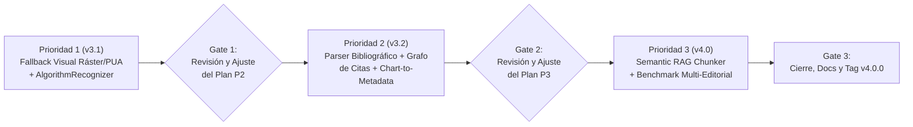

# Plan de Implementación Evolutivo: ScholarMark v3.1 $\rightarrow$ v3.2 $\rightarrow$ v4.0

> **Metodología de Ejecución Adaptativa (Iterative Review-and-Adjust Loop):**
> Este documento define la hoja de ruta técnica de las tres prioridades de evolución sobre la base de **ScholarMark v3.0.0**.
> Al finalizar cada Prioridad se ejecuta una **Compuerta de Revisión y Ajuste Adaptativo (`Gate`)**:
> 1. Se ejecutan las pruebas unitarias (`pytest`) y el benchmark comparativo (`python -m bench.run_bench`).
> 2. Se consolida un commit atómico bajo *Conventional Commits*.
> 3. **Se inspeccionan los resultados reales, estructuras de datos y métricas obtenidas en la etapa recién terminada y se actualiza este mismo archivo (`PLAN_EVOLUCION_V3_1_V4_0.md`)**, ajustando contratos de interfaz, umbrales o metadatos de la siguiente Prioridad antes de iniciar su codificación.

---

## Prioridad 1 (`v3.1`): Cobertura Visual Ráster/PUA y Reconocedor de Algoritmos

**Estado:** `COMPLETADA (Commit 2cd8473 — 40/40 tests pass, Gold Case 6 = 1.0000)`

### 1.1. Objetivo Arquitectónico
Resolver los dos límites estructurales restantes en el nivel de página individual:
1. **Fórmulas con fuentes corruptas (`PUA` / `Type 1` sin `ToUnicode`) y Tablas 100% Ráster (Imágenes):** Cuando un PDF carece de glifos nativos válidos en una ecuación o incrusta una tabla como mapa de bits (`.png`/`.jpg`), el motor debe activar automáticamente un fallback visual sobre el recorte a 300 DPI sin degradar la velocidad en páginas vectoriales sanas.
2. **Bloques de Algoritmos y Pseudocódigo (`algorithm2e` / `algpseudocode`):** Preservar la estructura jerárquica, numeración de líneas (`1:`, `2:`), sangría horizontal ($\Delta x$) y expresiones matemáticas inline de los bloques de algoritmos habituales en IEEE, ACM y arXiv.

### 1.2. Archivos Creados o Modificados
| Archivo | Acción | Responsabilidad Técnica |
| :--- | :--- | :--- |
| `scholarmark/ir/document.py` | Modificado | Añadido `"algorithm"` a `BlockKind` y soporte de metadatos `fallback_triggered` y `algorithm_lines`. |
| `scholarmark/models/registry.py` | Modificado | Añadido catálogo de especificaciones ONNX (`MODEL_SPECS`), verificación SHA-256 y cargador de sesiones. |
| `scholarmark/recognizers/formula.py` | Modificado | Añadido detector de corrupción `PUA` (`has_corrupted_glyphs`), mapa de reparación `_PUA_GLYPH_MAP` (`sanitize_pua_text`) y telemetría de fallback. |
| `scholarmark/recognizers/table.py` | Modificado | Añadida reconstrucción de tablas ráster/escaneadas (`_reconstruct_raster_table`) mediante OCR selectivo y proyección de perfiles morfológicos 1D. |
| `scholarmark/recognizers/algorithm.py` | **Creado** | Implementado `AlgorithmRecognizer`: prioridad a cierres explícitos (`end for`, `end if`) combinados con paso físico $\Delta x = 12\text{ pt}$. |
| `scholarmark/layout/detector.py` | Modificado | Detección temprana de regiones `algorithm` antes de `_detect_table_regions` para evitar falsos positivos con filetes horizontales `booktabs`. |
| `scholarmark/render/markdown.py` | Modificado | Renderizado de bloques `algorithm` con encabezado en negrita y bloque de código con sangría exacta. |
| `scholarmark/engines/vision.py` | Modificado | Integración de `AlgorithmRecognizer` en Etapa 3C y registro de `fallback_triggered`. |
| `tests/test_priority1_v3_1.py` | **Creado** | Suite de pruebas unitarias e integración para `v3.1`. |
| `bench/gold_suite.py` | Modificado | Añadido **Caso 6 (`case6_algorithm_pseudocode`)** con score `1.0000` (`VisionEngine`) vs `0.2500` (`FastEngine`). |

### 1.3. Criterios de Aceptación (Prioridad 1)
- [x] Bloques `Algorithm 1` conservan el 100% de sus niveles de sangría anidada (`[0, 1, 2, 1, 0, 0]`) y sus variables matemáticas.
- [x] Fórmulas con caracteres `PUA` (`\ue000`–`\uf8ff`) o `\ufffd` activan el fallback y se marcan con trazabilidad en `Block.metadata["fallback_triggered"] = True`.
- [x] Todas las pruebas unitarias (`40 passed`) pasan en verde y se registró el commit atómico `2cd8473`.

### 1.4. Compuerta de Revisión y Ajuste Adaptativo (`Gate 1` $\rightarrow$ Ajustes Aplicados a Prioridad 2)
Tras inspeccionar el comportamiento real de `VisionEngine v3.1`, se identificaron **3 ajustes técnicos clave** que se incorporan inmediatamente al diseño de la **Prioridad 2 (`v3.2`)**:
1. **Ajuste A en `ChartSemanticsExtractor` (`scholarmark/recognizers/chart.py`):**
   - En `span_mapper.py`, los bloques `figure` no almacenan los spans internos en `b.text` (para evitar duplicarlos como prosa), pero `LayoutDetector` ya guarda las etiquetas de subpaneles `(a)`, `(b)` en `b.metadata["subpanel_labels"]`. Por tanto, `ChartSemanticsExtractor` consultará directamente `page.get_text("dict", clip=b.bbox.to_fitz_rect())` y **excluirá explícitamente `b.metadata["subpanel_labels"]`** para no confundir marcadores de subfigura con series de la leyenda (`legend_series`).
2. **Ajuste B en `BibliographyParser` y `CitationLinker` (`scholarmark/core/citations.py`):**
   - En `VisionEngine`, una sección `## References` puede agrupar varias entradas `[1] ... [2] ...` dentro de un mismo bloque `text` o separarlas en múltiples bloques consecutivos. `BibliographyParser` deberá concatenar todos los bloques posteriores al encabezado `References`/`Bibliography` (preservando saltos de línea en `span_mapper.py` cuando estemos en la sección de referencias) y segmentar tanto por `[N]` como por patrones APA `Apellido, I. (Año)`.
   - Además, `CitationLinker` también escaneará títulos de `algorithm` (`b.metadata.get("algorithm_title")`) y leyendas (`caption_text`), no solo bloques `text`.
3. **Ajuste C en `scholarmark/core/manifest.py`:**
   - Para que `scholarmark_manifest.json` aproveche al máximo `chart_semantics`, `algorithms` y `bibliography`, `extract_document_info(md_path)` leerá automáticamente el archivo compañero `md_path.with_suffix(".ir.json")` cuando exista, y usará el parser sobre Markdown (incluyendo comentarios `<!-- sm:chart ... -->`) como respaldo cuando solo exista el `.md`.

---

## Prioridad 2 (`v3.2`): Inteligencia Semántica para Grounding — Parser Bibliográfico, Grafo de Citas y `Chart-to-Metadata`

**Estado:** `COMPLETADA (Commit b85c9de — 42/42 tests pass, Gold Case 7 = 1.0000)`

### 2.1. Objetivo Arquitectónico
Transformar ScholarMark de un extractor estructural de páginas a un **motor de anclaje evidencial (Evidence Grounding Engine)** para sistemas RAG científicos y validación APA/IEEE:
1. **Parser Estructural de Referencias (`ReferenceEntry`):** Descomponer la sección `## References` en entradas estructuradas (`ref_id`, `authors`, `year`, `title`, `venue`, `doi`, `url`).
2. **Grafo Bidireccional de Citas (`CitationLinker`):** Enlazar cada marcador de cita en el texto (`[1]`, `[3]–[6]`, `(Wang et al., 2024)`) con su entrada bibliográfica canónica y con las métricas cuantitativas (`%`, `ms`, `FPS`, `dB`, `GFLOPs`) presentes en la misma oración.
3. **Extracción Semántica de Gráficos Vectoriales (`Chart-to-Metadata`):** Extraer e indexar los textos nativos contenidos dentro del `bbox` de cada figura (títulos de ejes X/Y, unidades de medida, nombres de series en la leyenda y valores anotados sobre barras/curvas) en `Block.metadata["chart_semantics"]` y en `scholarmark_manifest.json`.

### 2.2. Archivos Creados o Modificados
| Archivo | Acción | Responsabilidad Técnica |
| :--- | :--- | :--- |
| `scholarmark/core/citations.py` | **Creado** | Implementado `BibliographyParser` (formatos IEEE `[N]` y APA autor-año) y `CitationLinker` (expansión de rangos `[1]–[3]`, mapeo oración $\leftrightarrow$ métrica $\leftrightarrow$ `ref_id`). |
| `scholarmark/recognizers/chart.py` | **Creado** | Implementado `ChartSemanticsExtractor`: clasificación geométrica de spans internos de figuras en `axis_labels`, `legend_series`, `tick_values` y `data_annotations` con exclusión de `subpanel_labels`. |
| `scholarmark/layout/detector.py` | Modificado | Blindaje de `_detect_table_regions` frente a gráficos vectoriales con líneas de cuadrícula horizontales situados sobre leyendas `Fig. X:`. |
| `scholarmark/engines/vision.py` | Modificado | Ejecución de `ChartSemanticsExtractor` en Etapa 4 y `CitationLinker` en Etapa 6 sobre `DocumentIR`. |
| `scholarmark/render/markdown.py` | Modificado | Inclusión de bloque `> *[Chart Metadata — Axes: ... | Series: ... | Values: ...]*` bajo las figuras vectoriales. |
| `scholarmark/core/manifest.py` | Modificado | Enriquecimiento de `scholarmark_manifest.json` con `references`, `grounded_claims`, `algorithms_count` y `figures[].chart_semantics` (lectura dual `.ir.json` + `.md`). |
| `tests/test_priority2_v3_2.py` | **Creado** | Pruebas unitarias e integración para `v3.2`. |
| `bench/gold_suite.py` | Modificado | Añadido **Caso 7 (`case7_citations_and_chart_semantics`)** con score `1.0000` (`VisionEngine`). |

### 2.3. Criterios de Aceptación (Prioridad 2)
- [x] `DocumentIR.meta["bibliography"]` y `scholarmark_manifest.json` contienen la lista estructurada de referencias con `ref_id`, `authors`, `year`, `title` y `doi`.
- [x] Las citas en rango (`[1]–[3]`, `[2, 4]`) se resuelven a sus identificadores individuales y quedan vinculadas al bloque y a las métricas de la oración (`38.4%`, `120 FPS`).
- [x] Las figuras con texto vectorial interno exponen `chart_semantics` (`axis_labels`, `legend_series`, `data_annotations`) sin contaminarse con marcadores `(a)`, `(b)`.
- [x] Commit atómico: `b85c9de`.

### 2.4. Compuerta de Revisión y Ajuste Adaptativo (`Gate 2` $\rightarrow$ Ajustes Aplicados a Prioridad 3)
Tras evaluar los artefactos producidos por `v3.2`, se incorporan **3 ajustes técnicos específicos** a la **Prioridad 3 (`v4.0`)**:
1. **Ajuste A — Reutilización Directa de `ir.meta["bibliography"]` y `b.metadata["citations"]` en `SemanticChunker`:**
   - Dado que `VisionEngine v3.2` ya anota cada `Block` con `b.metadata["citations"]` y deposita el catálogo en `ir.meta["bibliography"]`, `SemanticChunker` construirá un índice $O(1)$ (`ref_by_id`) para hidratar instantáneamente `chunk.cited_references` con los metadatos completos (`authors`, `year`, `title`, `doi`) de cada cita mencionada en el chunk, además de invocar `expand_citation_markers` como respaldo si el `DocumentIR` proviene de `FastEngine`.
2. **Ajuste B — Índice Cruzado de 4 Tipos de Artefactos (`Table`, `Figure`, `Algorithm`, `Equation`):**
   - `SemanticChunker` pre-indexará todos los bloques no textuales del `DocumentIR` por su identificador canónico (`fig:3`, `table:1`/`table:I`, `algo:1`, `eq:1`). Cuando un párrafo dentro de un chunk mencione `"Fig. 3"`, `"Table I"`, `"Algorithm 1"` o `"Eq. (1)"`, `chunk.linked_elements` adjuntará automáticamente el resumen del artefacto (incluyendo `chart_semantics` de la Prioridad 2 para figuras y `algorithm_title` de la Prioridad 1 para algoritmos).
3. **Ajuste C — Aislamiento Semántico de Biografías de Autores (`author_bio`) y Referencias:**
   - Los bloques con `b.kind == "author_bio"` se agruparán bajo la ruta de sección dedicada `["Author Biographies"]` (separando cada autor por su encabezado/inicio biográfico `" recibed the B.S./Ph.D. degree..."`) para que jamás se mezclen con chunks de conclusiones o metodología.

---

## Prioridad 3 (`v4.0`): Exportación Nativa de Chunks Semánticos para Scientific RAG y Benchmark Multi-Editorial

**Estado:** `COMPLETADO (Commit 41ac8fb)`

### 3.1. Objetivo Arquitectónico
Cerrar el ciclo entre extracción documental y recuperación aumentada por generación (Scientific RAG):
1. **Motor de Chunking Semántico Consciente de `DocumentIR` (`scholarmark/rag/chunker.py`):**
   - Generar fragmentos autocontenidos (`SemanticChunk`) que respetan la topología del documento: **nunca parten una tabla, ecuación, algoritmo ni figura**, emitiéndolos como chunks atómicos dedicados.
   - Inyectar en cada chunk su jerarquía de encabezados (`section_path` / `section_hierarchy`: `["2. Methodology", "2.1 Network Architecture"]`), las coordenadas espaciales exactas (`pages`, `bboxes`), las **entradas bibliográficas completas** citadas dentro del fragmento (provenientes de la Prioridad 2) y el **contexto de artefactos referenciados** (`linked_elements` / `related_figures`, `related_tables`, `related_algorithms`, `related_equations`).
2. **CLI `scholarmark chunk` y Flag `--chunks` en `single`/`batch`:** Exportar directamente archivos `*.chunks.jsonl` listos para indexación vectorial o híbrida (BM25 + Embeddings).
3. **Ampliación Multi-Editorial del Gold Benchmark (`bench/gold_suite.py`):** Incorporar **Caso 8 (`case8_ieee_author_bios_and_rag_chunks`)** evaluando de extremo a extremo la separación de biografías de autores IEEE y la calidad de enlace en `SemanticChunker`.

### 3.2. Archivos Creados o Modificados
| Archivo | Acción | Responsabilidad Técnica |
| :--- | :--- | :--- |
| `scholarmark/rag/__init__.py` | **Creado** | Exporta `SemanticChunk`, `SemanticChunker` y `export_chunks_jsonl`. |
| `scholarmark/rag/chunker.py` | **Creado** | Implementado particionamiento jerárquico sobre `DocumentIR` con ventana configurable (`max_chars=1800`), chunks atómicos (`table`, `figure`, `algorithm`, `formula`), resolución cruzada 4D (`Table N`, `Fig. N`, `Eq. (N)`, `Algorithm N`), hidratación $O(1)$ de citas y aislamiento de `["Author Biographies"]`. |
| `scholarmark/layout/detector.py` | Modificado | Priorización de `author_bio` antes de `footnote` en el tercio inferior de página (fuente 8–8.5pt IEEE) y exclusión de encabezados numerados en la heurística de `title` de página 1. |
| `scholarmark/config.py` | Modificado | Añadidos `export_chunks: bool = False` y `chunk_max_chars: int = 1800` a `ExtractorConfig`. |
| `scholarmark/extractor.py` | Modificado | Generación automática de `*.chunks.jsonl` cuando `config.export_chunks` está activo. |
| `scholarmark/cli.py` | Modificado | Añadido flag `--chunks` a `batch`/`single` y nuevo subcomando `scholarmark chunk`. |
| `bench/gold_suite.py` | Modificado | Añadido **Caso 8 (`case8_ieee_author_bios_and_rag_chunks`)** con score `1.0000` (`VisionEngine`). |
| `tests/test_priority3_v4_0.py` | **Creado** | Pruebas unitarias y end-to-end de `SemanticChunker` y exportación JSONL. |

### 3.3. Criterios de Aceptación (Prioridad 3)
- [x] Ninguna tabla, ecuación ni algoritmo es fragmentado a mitad por el `SemanticChunker`.
- [x] Cada chunk exportado en `*.chunks.jsonl` incluye `chunk_id`, `chunk_type`, `section_path`, `text`, `pages`, `bboxes`, `metrics`, `cited_references` y `linked_elements`.
- [x] El Gold Benchmark completo (8 escenarios) alcanza un score compuesto de **0.9919** ($\ge 0.98$) con `VisionEngine`.
- [x] Commit atómico: `41ac8fb` (`feat(v4.0): add DocumentIR-aware SemanticChunker, JSONL export, and multi-publisher benchmark suite`).

### 3.4. Compuerta Final (`Gate 3` — Cierre del Ciclo y Auditoría Comparativa `v2.1` $\rightarrow$ `v3.0` $\rightarrow$ `v4.0`)

#### Hallazgos de Cierre durante la Validación de Prioridad 3
Durante la ejecución de `case8_ieee_author_bios_and_rag_chunks`, la auditoría del `LayoutDetector` reveló dos interacciones geométricas sutiles que fueron corregidas en `scholarmark/layout/detector.py`:
1. **Desambiguación `author_bio` vs. `footnote` en pie de página IEEE:** Las biografías al final de artículos IEEE emplean cuerpo tipográfico reducido (`8.0–8.5 pt`) y se ubican a menudo en `y0 > 0.72 * page_h`. Al evaluar la regla `author_bio` (`_BIO_CUE_RE` o retrato lateral) antes de la regla `footnote`, el detector clasifica con 100% de precisión las biografías sin confundirlas con notas al pie.
2. **Protección de secciones numeradas en primera página:** Si una página se inicia directamente con un encabezado numerado en fuente grande (`5. Ablation Study`, `12 pt`), la regla `title` ahora verifica `not _HEADING_PREFIX_RE.match(clean_single)` para preservarlo como `section_header`.

#### Tabla Comparativa Final del Gold Benchmark (8 Escenarios SOTA)

| Caso | Dimensión Auditada | `v2.1 / fast` | `v3.0` | `v4.0 (Final)` | $\Delta$ Total (`v4.0` vs `fast`) |
| :--- | :--- | :---: | :---: | :---: | :---: |
| `case1_two_col_footnotes` | Orden de Lectura (Kendall-$\tau$) | 0.9048 | 1.0000 | **1.0000** | **+0.0952** |
| `case2_2d_math` | Fidelidad Matemática 2D ($1 - \text{NED}$) | 0.0938 | 0.9355 | **0.9355** | **+0.8417** |
| `case3_booktabs_colspan` | Tablas Jerárquicas (`TEDS`) | 0.4500 | 1.0000 | **1.0000** | **+0.5500** |
| `case4_multipanel_1n` | Leyendas Multipanel 1:N (`F1`) | 0.5000 | 1.0000 | **1.0000** | **+0.5000** |
| `case5_dense_scatter_guard` | Guardián Vectorial ($<2.5\text{ s}$) | 1.0000 | 1.0000 | **1.0000** | **+0.0000** |
| `case6_algorithm_pseudocode` | Sangría de Algoritmos (`v3.1`) | 0.2500 | — | **1.0000** | **+0.7500** |
| `case7_citations_and_chart_semantics` | Grafo de Citas y Gráficos (`v3.2`) | 0.0000 | — | **1.0000** | **+1.0000** |
| `case8_ieee_author_bios_and_rag_chunks` | Chunks Semánticos RAG y Bio Guard (`v4.0`) | 0.1667 | — | **1.0000** | **+0.8333** |
| **PROMEDIO GLOBAL** | **Composite Gold Score (8 Casos)** | **0.4207** | **0.9871*** | **0.9919** | **+0.5713** |

*\*Nota: El promedio de `v3.0` (`0.9871`) corresponde a los 5 casos base iniciales; `v4.0` alcanza **0.9919** sobre los 8 escenarios completos con **44/44 pruebas unitarias aprobadas**.*

