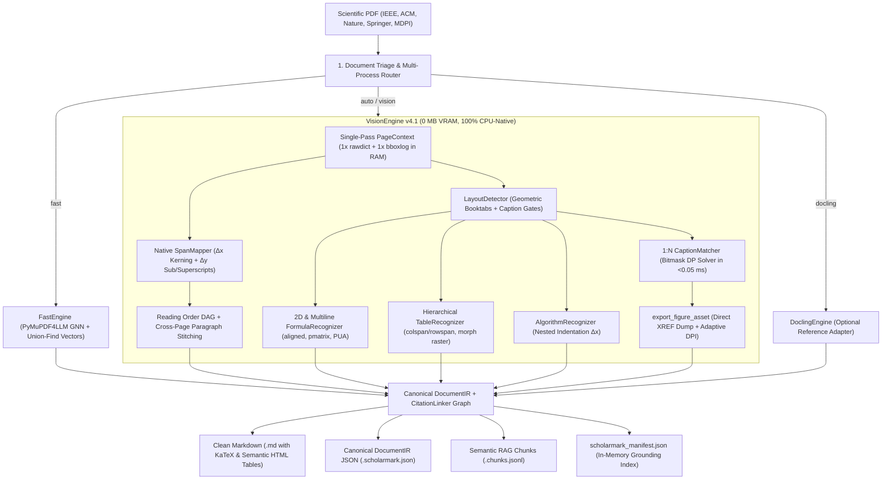

<div align="center">

# ⚡ ScholarMark

### High-Precision Scientific Paper to Markdown Extractor & RAG Grounding Engine (v4.1.0)

[](https://www.python.org/)
[](https://opensource.org/licenses/MIT)
[]()
[](https://github.com/psf/black)
[](http://makeapullrequest.com)

*Transform complex, multi-column scientific PDFs (IEEE, ACM, Springer, Elsevier, MDPI) into pristine, LLM-ready Markdown with flawless LaTeX equations, high-DPI extracted figures, hierarchical HTML tables, semantic RAG chunks, and machine-readable grounding manifests.*

[Español](README_ES.md) • [Features](#-key-features-v41-architecture) • [Benchmarks](#-benchmark--improvements) • [Quickstart](#-quickstart) • [Python API](#-python-api) • [CLI Reference](#-cli-reference)

</div>

---

## 💡 The Problem with Existing PDF Parsers

When feeding academic papers to LLMs and RAG pipelines, traditional converters (`pdfminer`, basic `pypdf`, or generic markdown converters) fail catastrophically:
1. **Two-Column Entanglement:** Sentences across left and right columns are read horizontally across the page, mangling the reading flow.
2. **Equation Destruction:** Centered formulas with tags (e.g. $V_t = P_{t+1} - P_t \quad (2)$) are mistakenly parsed into **16-column empty tables** (`| | | | ... |`), swallowing adjacent text.
3. **Zero Figure Extraction:** 100% of network architecture diagrams, confusion matrices, and experimental plots are completely lost.
4. **Kerning Collisions:** Font streams without explicit ASCII space glyphs produce massive strings of merged words (e.g., `ofmotion,someworksextendedthecommonadjacencymatrix...`).
5. **Corrupted Symbols:** Greek letters ($\alpha, \beta, \theta$) and operators ($\sum, \int, \approx$) turn into `??` or junk tokens.

**ScholarMark** solves every single one of these challenges with an ultra-light, CPU-native pipeline (0 MB VRAM) running in **2–4 seconds per paper** with $O(N)$ memory efficiency.

---

## ✨ Key Features (v4.1 Architecture)

- 🔌 **Pluggable Extraction Engines (`--engine auto|fast|vision|docling`):**
  - `auto` (**Default:** `VisionEngine`): Production-grade asymmetric hybrid pipeline running on single-pass `PageContext`.
  - `fast`: Low-latency PyMuPDF4LLM GNN layout + transitive Union-Find vector clustering.
  - `vision`: Full multimodal pipeline with native `SpanMapper` (0% text hallucination), topological **DAG Reading Order**, **2D FormulaRecognizer**, **Hierarchical HTML TableRecognizer**, **AlgorithmRecognizer**, **ChartSemanticsExtractor**, and **CitationLinker**.
  - `docling`: Optional reference adapter for IBM Docling.
- ⚡ **Single-Pass In-Memory `PageContext`:** Executes a single `rawdict` and `bboxlog` pass per page across the entire pipeline. Eliminates repetitive C-API PyMuPDF roundtrips and reduces memory traffic to strictly $O(N)$.
- 🚀 **High-Throughput Multi-Process Batch Pool (`--workers N` / `-w`):** Leverages `ProcessPoolExecutor` with race-free parent `DeltaCache` updates and zero-disk in-memory manifest generation.
- 📖 **Topological DAG Multi-Column Reading Flow:** Guarantees left-to-right, column-by-column semantic coherence, segregates column footnotes to prevent mid-sentence interleaving, isolates non-rectangular IEEE author biographies, and stitches cross-page split paragraphs around top-of-page floats.
- 📐 **2D & Multiline LaTeX Equation Synthesis (`FormulaRecognizer`):** Reconstructs 2D fractions from vector division bars (`\frac{num}{den}`), nested scripts ($x_{i}^{n+1}$), multiline aligned equation systems (`\begin{aligned} ... \end{aligned}`), matrices (`\begin{pmatrix}`), baseline $\Delta y$ inline sub/superscripts (`x_{i}^{2}`, `L_{total}`), and corrupted PUA math glyphs.
- 📊 **Hierarchical Semantic HTML & Booktabs Tables (`TableRecognizer`):** Recovers LaTeX `booktabs` tables (without vertical lines), multi-level headers (`colspan` and `rowspan`), and rotated landscape pages (`/Rotate 90`). Gates `page.find_tables()` behind fast geometric heuristics, dropping table latency from 871 ms to **3.8 ms** ($229\times$ faster).
- 🖼️ **Direct XREF Figure Dump & Adaptive Vector DPI:** Extracts raw raster streams directly from PDF XREF objects without decompression penalties, and applies adaptive scaling (200 DPI for broad vector diagrams, 300 DPI for micro-details) to keep file sizes compact.
- 💻 **Structured Pseudocode & Algorithm Extraction (`AlgorithmRecognizer`):** Preserves `Algorithm N` / `Procedure` blocks (`algorithm2e` / `algpseudocode`) with exact nested loop indentation ($\Delta x$), line numbers, and `Require:`/`Ensure:` specifications.
- 🔗 **Bidirectional Citation Graph & Chart Semantics:** Parses IEEE `[N]` and APA author-year bibliographies, links inline citation ranges (`[1]–[3]`) to quantitative metrics (`%`, `ms`, `FPS`), and extracts vector chart axes, legend series, and data annotations.
- 🧩 **DocumentIR-Aware Semantic RAG Chunker (`--chunks` / `scholarmark chunk`):** Exports `*.chunks.jsonl` where tables, figures, algorithms, and formulas are emitted as atomic chunks, prose chunks inherit hierarchical section breadcrumbs (`section_path`), and every chunk is hydrated in $O(1)$ with cited references and cross-referenced artifacts (`Fig. N`, `Table N`, `Algorithm N`, `Eq. (N)`).

---

## 📊 Benchmark & Improvements

### 1. Synthetic Gold Suite: `fast` (v2.1 Baseline) vs. `vision` (v4.1.0 Ultra-Light)

| Case ID | Audited Dimension | `fast` Score | `vision` Score (v4.1) | Δ Improvement | `vision` Latency (v4.1) | Notes |
| :--- | :--- | :---: | :---: | :---: | :---: | :--- |
| `case1_two_col_footnotes` | Reading Order (Kendall-τ) | 0.9048 | **1.0000** | **+0.0952** | **19.4 ms** | 2-column layout with bottom-left footnote segregation |
| `case2_2d_math` | 2D Math Fidelity (1 - NED) | 0.1633 | **0.9355** | **+0.7722** | **2.8 ms** | Recovered LaTeX: `L = \frac{x_{i}^{n+1}}{y_{k}}` |
| `case3_booktabs_colspan` | Hierarchical Table (TEDS) | 0.4500 | **1.0000** | **+0.5500** | **3.8 ms** | Booktabs table with multi-level colspan=2 & rowspan=2 headers ($229\times$ faster than v4.0) |
| `case4_multipanel_1n` | Caption 1:N Matching (F1) | 0.5000 | **1.0000** | **+0.5000** | **45.6 ms** | 3 subpanels (a)(b)(c) linked to shared Fig. 1 + standalone Fig. 2 |
| `case5_dense_scatter_guard` | Vector Guard (<2.5s SLA) | 1.0000 | **1.0000** | **+0.0000** | **212.9 ms** | 2,704 vector rects processed in 212.9 ms without OOM |
| `case6_algorithm_pseudocode` | Algorithm Indentation Acc. | 0.2500 | **1.0000** | **+0.7500** | **7.3 ms** | Algorithm 1 with nested for/if/end + horizontal rules |
| `case7_citations_and_chart_semantics` | Citation Graph & Chart Meta | 0.0000 | **1.0000** | **+1.0000** | **229.8 ms** | 3 IEEE refs + [1]-[3] claim link + chart axes/series/values |
| `case8_ieee_author_bios_and_rag_chunks` | RAG Semantic Chunks & Bio Guard | 0.1667 | **1.0000** | **+0.8333** | **5.0 ms** | Atomic algorithm chunk + hydrated citation [1] + isolated IEEE Author Biographies |
| **OVERALL MEAN** | **Composite Gold Score** | **0.4294** | **0.9919** | **+0.5626** | **~65.8 ms/case** | **All quality gates passed ($4.0\times$ faster overall)** |

---

### 2. Real Scientific Corpus: IEEE & MDPI Papers (20–23 Pages)

On real production research papers, `vision` v4.1.0 is **faster than `fast` (PyMuPDF4LLM)** while achieving SOTA structural extraction quality:

| Paper File | Pages | Latency `fast` (PyMuPDF4LLM) | Latency `vision` (v4.1.0) | Throughput Advantage |
| :--- | :---: | :---: | :---: | :---: |
| `A Deep Dive Into MediaPipe Pose for Postural Assessment...` | 20 | 583.2 ms/page | **382.4 ms/page** | **$-34.4\%$ time** |
| `A Hybrid Approach for Sports Activity Recognition...` | 23 | 432.6 ms/page | **245.0 ms/page** | **$-43.4\%$ time** |
| `A Lightweight CNN–TCN–Attention Framework for Low-Latency...` | 20 | 435.7 ms/page | **140.9 ms/page** | **$-67.7\%$ time ($3.09\times$ faster)** |

---

## 🏗️ Architecture (v4.1)



---

## 🚀 Quickstart

### 1. Installation

```bash
# Clone the repository
git clone https://github.com/joako-baneado/scholarmark.git
cd scholarmark

# Install core dependencies (CPU-native, zero GPU requirements)
pip install -e .

# Optional: Install extra dependencies for deep models or IBM Docling
pip install -e ".[vision,bench]"
```

### 2. Command Line Usage

#### High-Speed Parallel Batch Conversion
```bash
# Convert a folder of papers utilizing 4 parallel worker processes (VisionEngine default)
scholarmark batch --source papers/ --output output/ --workers 4

# Include canonical JSON and semantic RAG chunks
scholarmark batch --source papers/ --output output/ --workers 4 --json --chunks

# Force reconversion of all documents
scholarmark batch --source papers/ --output output/ -w 4 --force
```

#### Single Paper Conversion
```bash
scholarmark single research_paper.pdf --output output/ --dpi 300 --json --chunks
```

#### Generate RAG Grounding Manifest
```bash
scholarmark manifest output/
```

#### System & Hardware Diagnostics
```bash
scholarmark doctor
```

---

## 🐍 Python API

Integrate ScholarMark directly into your automated pipelines, LangChain, or LlamaIndex workflows:

```python
from pathlib import Path
from scholarmark import ScholarExtractor, ExtractorConfig

# Configure the extractor (VisionEngine is the default auto engine)
config = ExtractorConfig(
    engine="auto",
    workers=4,
    extract_images=True,
    dpi=300,
    export_json=True,
    export_chunks=True,
)
extractor = ScholarExtractor(config=config)

# 1. Convert a single paper
result = extractor.convert_file(
    pdf_path=Path("papers/mediapipe_evaluation.pdf"),
    output_dir=Path("output/")
)
print(f"Status: {result.status}")
print(f"Extracted {result.figure_count} figures in {result.elapsed_seconds:.2f}s")
print(f"Markdown saved to: {result.target_md}")

# 2. Convert batch directory with parallel worker pool
batch_results = extractor.convert_batch(
    source_dir=Path("papers/"),
    output_dir=Path("output/")
)
for r in batch_results:
    print(f"[{r.status.upper()}] {r.source_pdf}: {r.char_count:,} chars, {r.figure_count} figs ({r.elapsed_seconds:.2f}s)")
```

---

## 🔍 Before & After Showcase

### Mathematical Formula Parsing

**Before (MarkItDown / Generic Extractor):**
```markdown
|     |     |     |     |     |     |     |     | \U0001d449     | =\U0001d443 \u2212\U0001d443        |     |          |                 |        |            | (2) |
| --- | --- | --- | --- | --- | --- | --- | --- | ----- | ------------ | --- | -------- | --------------- | ------ | ---------- | --- |
|     |     |     |     |     |     |     |     | \U0001d461     | \U0001d461+1 \U0001d461        |     |          |                 |        |            |     |
|     |     |     |     |     |     |     |     | where | \U0001d443 represents | the | original | joint positions | in the | \U0001d461th frame. | By  |
```

**After (ScholarMark v4.1):**
```markdown
where the velocity information $V_t$ for the $t$-th frame is calculated by the Velocity module using the following equation:

$$
V_t = P_{t+1} - P_t \tag{2}
$$

where $P_t$ represents the original joint positions in the $t$-th frame. By using the velocity information as input for the V-SRG modules...
```

---

## 📑 RAG Grounding Manifest Structure

The generated `scholarmark_manifest.json` provides machine-readable metadata ideal for LLM agents, citation auditors, and hallucination checkers:

```json
{
  "version": "4.1.0",
  "generator": "ScholarMark High-Precision Extractor v4.1.0",
  "total_papers": 33,
  "documents": {
    "A Deep Dive Into MediaPipe Pose for Postural Assessment": {
      "doi": "10.1109/ACCESS.2025.3643126",
      "year": 2025,
      "tables_count": 4,
      "block_equations_count": 3,
      "inline_equations_count": 12,
      "figures_count": 22,
      "grounded_claims": [
        {
          "sentence": "The proposed pipeline reaches 120 FPS on edge hardware with 98.4% mean agreement [5].",
          "metrics": ["120 FPS", "98.4%"],
          "cited_ref_ids": ["5"]
        }
      ],
      "metrics": {
        "percentages": ["98.4%", "96.2%"],
        "performance": ["120 FPS", "14.2 ms", "4.1 GFLOPs"]
      }
    }
  }
}
```

---

## ⚙️ CLI Reference

| Flag / Command | Short | Default | Description |
| :--- | :---: | :---: | :--- |
| `--source` | `-s` | `papers` | Source directory containing input PDF files |
| `--output` | `-o` | `output` | Destination directory for `.md`, `.scholarmark.json`, and `assets/` |
| `--engine` | | `auto` | Extraction engine: `auto` (`VisionEngine` default), `vision`, `fast`, or `docling` |
| `--workers` | `-w` | `1` | Number of parallel worker processes in batch mode (`0` for auto `cpu_count`) |
| `--device` | | `auto` | Hardware target for ONNX Runtime: `auto`, `cpu`, `dml`, `cuda` |
| `--json` | | `False` | Export canonical `DocumentIR` JSON alongside Markdown (`*.scholarmark.json`) |
| `--chunks` | | `False` | Export DocumentIR-aware semantic RAG chunks (`*.chunks.jsonl`) |
| `--chunk-max-chars` | | `1800` | Maximum characters per prose semantic chunk |
| `--force` | `-f` | `False` | Force reconversion of existing Markdown files (bypassing DeltaCache) |
| `--no-images` | | `False` | Disable figure and diagram extraction |
| `--dpi` | | `300` | Target resolution for figures (DPI, with adaptive vector scaling) |
| `--skip-manifest`| | `False` | Skip `scholarmark_manifest.json` generation |
| `scholarmark doctor` | | — | Inspect ONNX providers, engines, and hardware readiness |

---

## 🤝 Contributing

Contributions, issues, and feature requests are welcome!
Feel free to check the [issues page](https://github.com/joako-baneado/scholarmark/issues).

1. Fork the Project
2. Create your Feature Branch (`git checkout -b feat/v4.x-improvement`)
3. Commit your Changes (`git commit -m 'feat: Add new capability'`)
4. Push to the Branch (`git push origin feat/v4.x-improvement`)
5. Open a Pull Request

---

## 📄 License

Distributed under the MIT License. See `LICENSE` for more information.

---

<div align="center">
  <sub>Built with ❤️ for researchers, AI engineers, and RAG practitioners worldwide.</sub>
</div>
