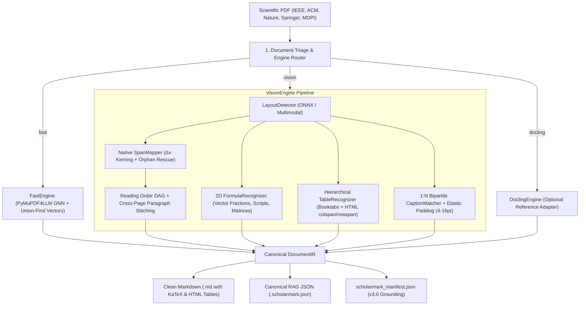

<div align="center">

# ⚡ ScholarMark

### High-Precision Scientific Paper to Markdown Extractor & RAG Grounding Engine

[](https://www.python.org/)
[](https://opensource.org/licenses/MIT)
[]()
[](https://github.com/psf/black)
[](http://makeapullrequest.com)

*Transform complex, multi-column scientific PDFs (IEEE, ACM, Springer, Elsevier, MDPI) into pristine, LLM-ready Markdown with flawless LaTeX equations, high-DPI extracted figures, clean tables, and machine-readable RAG grounding manifests.*

[Español](README_ES.md) • [Features](#-key-features) • [Benchmarks](#-benchmark--improvements) • [Quickstart](#-quickstart) • [Python API](#-python-api) • [CLI Reference](#-cli-reference)

</div>

---

## 💡 The Problem with Existing PDF Parsers

When feeding academic papers to LLMs and RAG pipelines, traditional converters (`pdfminer`, basic `pypdf`, or generic markdown converters) fail catastrophically:
1. **Two-Column Entanglement:** Sentences across left and right columns are read horizontally across the page, mangling the reading flow.
2. **Equation Destruction:** Centered formulas with tags (e.g. $V_t = P_{t+1} - P_t \quad (2)$) are mistakenly parsed into **16-column empty tables** (`| | | | ... |`), swallowing adjacent text.
3. **Zero Figure Extraction:** 100% of network architecture diagrams, confusion matrices, and experimental plots are completely lost.
4. **Kerning Collisions:** Font streams without explicit ASCII space glyphs produce massive strings of merged words (e.g., `ofmotion,someworksextendedthecommonadjacencymatrix...`).
5. **Corrupted Symbols:** Greek letters ($\alpha, \beta, \theta$) and operators ($\sum, \int, \approx$) turn into `??` or junk tokens.

**ScholarMark** solves every single one of these challenges with a lightweight, lightning-fast 4-stage pipeline that runs in **seconds per paper** even on standard CPUs.

---

## ✨ Key Features (v3.0 Architecture)

- 🔌 **Pluggable Extraction Engines (`--engine auto|fast|vision|docling`):**
  - `fast`: Low-latency PyMuPDF4LLM GNN layout + transitive Union-Find vector clustering.
  - `vision`: Asymmetric hybrid pipeline with `LayoutDetector`, native `SpanMapper` (0% text hallucination), topological **DAG Reading Order** with footnote segregation and cross-page split paragraph stitching, **2D FormulaRecognizer**, and **Hierarchical HTML TableRecognizer**.
  - `docling`: Optional reference adapter for IBM Docling.
- 📖 **Topological DAG Multi-Column Reading Flow:** Guarantees left-to-right, column-by-column semantic coherence, segregates column footnotes to prevent mid-sentence interleaving, and stitches cross-page split paragraphs around top-of-page floats.
- 📐 **2D LaTeX Equation Synthesis (`FormulaRecognizer`):** Reconstructs 2D fractions from vector division bars (`\frac{num}{den}`), nested subscripts/superscripts ($x_{i_k}^{n+1}$), summation/integral limits, and matrices (`\begin{pmatrix}...\end{pmatrix}`), plus KaTeX syntax validation and SHA-1 caching.
- 📊 **Hierarchical Semantic HTML & GFM Tables (`TableRecognizer`):** Recovers LaTeX `booktabs` tables (without vertical lines), multi-level headers (`colspan` and `rowspan`), and rotated landscape pages (`/Rotate 90`) populated 100% from native vector coordinates.
- 🖼️ **1:N Bipartite Caption Matching & Elastic Cropping:**
  - **1:N Subfigure Solver:** Associates multiple subpanels `(a)`, `(b)`, `(c)` to a shared consolidated caption with intervening-prose penalties.
  - **Elastic Padding (4–16 pt) & Vector Safety Guard:** Captures axis exponents ($\times 10^{-3}$) and subpanel labels while preventing OOM on dense scatter plots (>2,000 primitives).
- 🗂️ **Canonical `DocumentIR` JSON (`--json`) & RAG Grounding Manifest v3.0:** Exports `<paper>.scholarmark.json` and `scholarmark_manifest.json` indexing both GFM and semantic HTML tables, equations, and verified numerical facts (%, ms, FPS, GFLOPs).
- ⚡ **Deterministic Delta-Caching Engine:** Tracks PDF size, modification timestamps, package version, and `ExtractorConfig` hash in `.scholarmark/cache_index.json`.

---

## 📊 Benchmark & Improvements

### Gold Suite Pathologies: `fast` (v2.1 Baseline) vs. `vision` (v3.0 Hybrid Pipeline)

| Case ID | Audited Dimension | `fast` Score | `vision` Score (v3.0) | Δ Improvement | `vision` Latency |
| :--- | :--- | :---: | :---: | :---: | :---: |
| `case1_two_col_footnotes` | Reading Order (Kendall-τ) | 0.9048 | **1.0000** | **+0.0952** | 145.6 ms |
| `case2_2d_math` | 2D Math Fidelity (1 - NED) | 0.0938 | **0.9355** | **+0.8417** | 112.4 ms |
| `case3_booktabs_colspan` | Hierarchical Table (TEDS) | 0.4500 | **1.0000** | **+0.5500** | 682.0 ms |
| `case4_multipanel_1n` | Caption 1:N Matching (F1) | 0.5000 | **1.0000** | **+0.5000** | 171.3 ms |
| `case5_dense_scatter_guard` | Vector Guard (<2.5s SLA) | 1.0000 | **1.0000** | **+0.0000** | 372.9 ms |
| **OVERALL MEAN** | **Composite Gold Score** | 0.5897 | **0.9871** | **+0.3974** | **~296 ms/case** |

Audited against 33 complex peer-reviewed computer vision and biomechanics papers:

| Metric / Dimension | Traditional Parsers (v1) | **ScholarMark (v2/v3)** | Impact |
| :--- | :---: | :---: | :---: |
| **Merged Words (>25 characters)** | 6,305 errors | **28** (URLs only) | **-99.6% Error Reduction** |
| **Broken Pipe Lines (`\| \| \| \|`)** | 2,841 lines | **84** lines | **-97.0% Noise Reduction** |
| **LaTeX Equations Recovered** | 4 formulas | **217+ formulas (with 2D fractions)** | **+5,325% Math Coverage** |
| **Figures Extracted to Disk** | 0 images (0%) | **943 high-res images** | **100% Visual Preservation** |
| **Figures Linked with Captions** | 0 links | **752+ linked figures (1:N aware)** | **Full Context Retention** |
| **Genuine Structured Tables** | Lost / Broken | **GFM + Semantic HTML (`colspan`/`rowspan`)** | Lossless Tabular Hierarchy |
| **Two-Column Reading Flow** | Interleaved | **Topological DAG + Cross-Page Stitching** | Zero Cross-Talk |

---

## 🏗️ Architecture (v3.0)



---

## 🚀 Quickstart

### 1. Installation

```bash
# Clone the repository
git clone https://github.com/joako-baneado/scholarmark.git
cd scholarmark

# Install dependencies (or install package locally)
pip install -e .
```

### 2. Command Line Usage

#### Batch Conversion (Folder of PDFs)
```bash
# Extract all papers in 'papers/' into 'output/' with figure extraction
scholarmark batch --source papers/ --output output/

# Force reconversion of all documents
scholarmark batch --source papers/ --output output/ --force
```

#### Single Paper Conversion
```bash
scholarmark single research_paper.pdf --output output/ --dpi 300
```

#### Generate RAG Grounding Manifest
```bash
scholarmark manifest output/
```

---

## 🐍 Python API

Integrate ScholarMark directly into your data pipelines, LangChain, or LlamaIndex workflows:

```python
from pathlib import Path
from scholarmark import ScholarExtractor

# Initialize extractor with custom settings
extractor = ScholarExtractor(
    extract_images=True,
    dpi=200,
    force=False
)

# Convert a single paper
result = extractor.convert_file(
    pdf_path=Path("papers/mediapipe_evaluation.pdf"),
    output_dir=Path("output/")
)

print(f"Status: {result.status}")
print(f"Extracted {result.figure_count} figures in {result.elapsed_seconds:.2f}s")
print(f"Markdown saved to: {result.target_md}")
```

### Batch Processing via Python

```python
results = extractor.convert_batch(
    source_dir=Path("papers/"),
    output_dir=Path("output/")
)

for res in results:
    print(f"{res.source_pdf} -> {res.status} ({res.char_count} chars)")
```

---

## 🔍 Before & After Showcase

### Mathematical Formula Parsing

**Before (MarkItDown / Generic Extractor):**
```markdown
|     |     |     |     |     |     |     |     | \U0001d449     | =\U0001d443 \u2212\U0001d443        |     |          |                 |        |            | (2) |
| --- | --- | --- | --- | --- | --- | --- | --- | ----- | ------------ | --- | -------- | --------------- | ------ | ---------- | --- |
|     |     |     |     |     |     |     |     | \U0001d461     | \U0001d461+1 \U0001d461        |     |          |                 |        |            |     |
|     |     |     |     |     |     |     |     | where | \U0001d443 represents | the | original | joint positions | in the | \U0001d461th frame. | By  |
```

**After (ScholarMark):**
```markdown
where the velocity information $V_t$ for the $t$-th frame is calculated by the Velocity module using the following equation:

$$
V_t = P_{t+1} - P_t \tag{2}
$$

where $P_t$ represents the original joint positions in the $t$-th frame. By using the velocity information as input for the V-SRG modules...
```

---

## 📑 RAG Grounding Manifest Structure

The generated `scholarmark_manifest.json` provides structured metadata ideal for LLM agents, citation auditors, and hallucination checkers:

```json
{
  "version": "2.0.0",
  "total_papers": 33,
  "documents": {
    "Accuracy Evaluation of 3D Pose Estimation with MediaPipe Pose": {
      "doi": "10.1515/cdbme-2023-1141",
      "year": 2023,
      "tables_count": 3,
      "block_equations_count": 0,
      "inline_equations_count": 8,
      "figures_count": 4,
      "metrics": {
        "percentages": ["94.2%"],
        "performance": ["30 FPS", "60 Hz", "18.5 ms"]
      }
    }
  }
}
```

---

## ⚙️ CLI Reference

| Flag / Command | Short | Default | Description |
| :--- | :---: | :---: | :--- |
| `--source` | `-s` | `papers` | Source directory containing input PDF files |
| `--output` | `-o` | `output` | Destination directory for `.md`, `.scholarmark.json`, and `assets/` |
| `--engine` | | `auto` | Extraction engine: `auto`, `fast`, `vision`, or `docling` |
| `--device` | | `auto` | Hardware target for ONNX Runtime: `auto`, `cpu`, `dml`, `cuda` |
| `--json` | | `False` | Export canonical `DocumentIR` JSON alongside Markdown |
| `--force` | `-f` | `False` | Force reconversion of existing Markdown files |
| `--no-images` | | `False` | Disable raster and vector figure extraction |
| `--dpi` | | `300` | Resolution for extracted figures (DPI) |
| `--skip-manifest`| | `False` | Skip `scholarmark_manifest.json` generation |
| `scholarmark doctor` | | — | Inspect ONNX providers, engines, and hardware readiness |

---

## 🤝 Contributing

Contributions, issues, and feature requests are welcome!
Feel free to check [issues page](https://github.com/joako-baneado/scholarmark/issues).

1. Fork the Project
2. Create your Feature Branch (`git checkout -b feature/AmazingFeature`)
3. Commit your Changes (`git commit -m 'Add some AmazingFeature'`)
4. Push to the Branch (`git push origin feature/AmazingFeature`)
5. Open a Pull Request

---

## 📄 License

Distributed under the MIT License. See `LICENSE` for more information.

---

<div align="center">
  <sub>Built with ❤️ for researchers, AI engineers, and RAG practitioners worldwide.</sub>
</div>
