Received 17 November 2025, accepted 8 December 2025, date of publication 11 December 2025, date of current version 18 December 2025.

Digital Object Identifier 10.1109/ACCESS.2025.3643126

# A Deep Dive Into MediaPipe Pose for Postural Assessment: A Comparative Investigation

1, GIANLUCA AMPRIMO CLAUDIA FERRARIS 5, AND VERONICA CIMOLIN 3,4 LUCA VISMARA

1Institute of Electronic, Computer, and Telecommunication Engineering, National Research Council, 10129 Turin, Italy 3Department of Electronics, Information, and Bioengineering, Politecnico di Milano, 20133 Milan, Italy 2Department of Control and Computer Engineering, Politecnico di Torino, 10129 Turin, Italy

4IRCCS Istituto Auxologico Italiano, San Giuseppe Hospital, 28824 Piancavallo, Italy 5Department of Neuroscience, Università degli Studi di Torino, 10100 Turin, Italy

Corresponding author: Claudia Ferraris (claudia.ferraris@cnr.it)

This work was supported in part by the Italian Ministry of Research and Education (MIUR) National Project ‘‘Dipartimenti di Eccellenza 2023–2027,’’ awarded to the Department of Neuroscience ‘‘Rita Levi Montalcini’’ (University of Turin).

ABSTRACT Markerless pose estimation is an accessible alternative to marker-based methods. Although Google MediaPipe Pose is a promising RGB-only solution, a comprehensive performance investigation of its 2D and 3D models for postural assessment is lacking. This study systematically evaluated the accuracy, reliability, and symmetry preservation of MediaPipe models at varying complexities, and compared them against a marker-based gold standard and a markerless RGB-D reference system based on Azure Kinect. Twenty-four healthy subjects performed static 40-second postural tasks, from which five categories of angular and linear measures were computed from frontal recordings to compare model’ behaviors. One of the primary findings was the counterintuitive degradation in 3D MediaPipe reconstruction performance with increasing model complexity. Indeed, the high-complexity model introduced severe distortions and asymmetries, which we demonstrated to originate from the 3D-uplifting process rather than robust 2D tracking. All 2D models showed excellent performance in frontal plane analysis, albeit with some limitations for specific angular measurements. This study revealed a clear trade-off between the precision of RGB-D systems and the accessibility of RGB-only models. In addition, the analysis provided detailed recommendations for selecting the most suitable model for specific applications of postural assessment. Overall, the findings suggest that current 3D MediaPipe Pose models should be used with caution for quantitative postural assessment, especially at higher complexities, whereas 2D models represent an effective and practical choice

for many lightweight front-view applications.

INDEX TERMS Postural assessment, markerless pose estimation, Google MediaPipe pose, Azure Kinect,

validation study. I. INTRODUCTION The quantitative assessment of posture and its control is fundamental for diagnostic, monitoring, and treatment strategies across a wide range of clinical and research domains, and populations, including older adults, children, and athletes. The ability to maintain correct posture alignment is a crucial indicator of both musculoskeletal health and central nervous system integrity, with impairment often associated with an underlying pathological condition [1], [2], [3], [4]. Many studies have evaluated posture quality by

analyzing alterations in postural control, that is, the ability to maintain stable balance [5], [6], [7], [8]. Although posture and balance are intrinsically linked, they are not the same. It is impossible to have good posture associated with poor balance, yet it is possible to achieve good balance despite poor posture through compensatory strategies [9]. Therefore, information obtained from direct postural angle measurements can be particularly relevant for early detection of abnormalities in disease progression or for tracking changes resulting from rehabilitative treatments [10]. Although quantitative analysis of these angular measurements can be challenging and less commonly practiced in routine clinical practice [11], several techniques have been employed in the past decades for accurately assessing postural alterations. Among these techniques, one of the most popular in the literature is photographic postural assessment, a method based on angular measurements obtained by identifying specific body landmarks on photographic images [9], [10], [11], [12], [13]. This technique has established itself as an alternative to more invasive radiography-based methods for measuring certain spinal deformities [14], [15]. However, it is poorly standardized, with significant challenges related to the choice of reference points, analysis software, and camera position/resolution [16]. Other techniques based on direct goniometer measurements are often lengthy and impractical for routine use [11], [17].

2, (Member, IEEE), SERENA CERFOGLIO3,4,

Optoelectronic systems represent the gold standard for clinical motion analysis and have been widely used for accurate assessment of postural anomalies. By using marker configurations placed on the body according to standardized biomechanical models, they limit the variability in the selection of reference points [18], [19]. Despite the advantages of high precision, optoelectronic systems have several drawbacks, including high cost and the need for dedicated space and expert personnel, which limit their use in clinical and research laboratories. In recent years, there has been growing interest in new digital technologies for movement analysis, including wearable sensors and low-cost visionbased approaches [20], [21], [22], [23], [24]. This interest has been driven primarily by the specific needs of telemedicine solutions, a scenario in which optoelectronic systems are unsuitable. While wearable systems are primarily oriented towards postural control and balance, modern vision-based systems allow for the semi-automatic or automatic assessment of body measurements, including postural angles, through real-time body tracking algorithms. A major push in this direction came from RGB-D cameras, a standard RGB camera enhanced by robust depth estimation, which made 3D motion analysis more accessible and enabled the development of highly accurate markerless solutions for movement, posture, and balance control [25], [26], [27], [28], [29], [30], [31].

The most recent evolution in markerless motion analysis is represented by Human Pose Estimation (HPE) frameworks that operate on standard RGB inputs from common cameras. These next-generation approaches rely on sophisticated deep learning algorithms and complex architectures to identify the spatial location of anatomical key-points from image pixels and generate 3D skeletal models. State-of-the-art analysis reveals that HPE frameworks are rapidly gaining popularity across various sectors, including the medical field [32], [33], [34], [35], [36], [37]. However, significant challenges remain [38], including the need for rigorous validation versus gold standard references to evaluate accuracy and robustness for clinical applications. For postural assessment, it is important to consider the inherent differences between the marker-based and markerless skeletal models. The former tracks physical markers applied to the body, whereas the latter estimates virtual reference points from an RGB video stream.

This fundamental distinction must be carefully considered during validation.

Among the most promising next-generation HPE frameworks is Google MediaPipe Pose (MP) [39], an open-source algorithm that tracks 33 body landmarks from RGB-only sources (i.e., images or videos), effectively providing 2D (image coordinates) and 3D (world coordinates) skeletal models. Compared to other HPE frameworks, such as Open- Pose [40] and custom multi-level architectures [20], the main strength of MP relies on its highly optimized and lightweight pipeline, which enables real-time detection and tracking. In recent years, several studies have attempted to validate MP against reference systems across several domains. For example, MP performance was evaluated for specific repetitive arm and leg movements [41] and for detecting upper limb impairments in individuals with spinal cord injuries [42], finding good correlations between the estimated metrics and impairment severity, respectively. In gait analysis, MP has demonstrated low mean absolute errors and performance comparable to those of optoelectronic systems [43], [44]. Other applications of MP include detecting sex-based differences in static posture from photographs using 2D models [45], measuring height in infants from XY coordinates [46], and evaluating movement metrics in physical exercises with multi-view solutions using 2D models [47]. Despite the growing interest in MP, a research gap exists in evaluating its potential for comprehensive postural analysis, which is characterized by multi-segment angular measures of the upper and lower body. In particular, the impact of customizable model complexities has not been investigated to establish their reliability as alternatives to marker-based or depth-camera-based systems.

Therefore, the primary goal of this study was to systematically evaluate the accuracy, reliability, and symmetry preservation of MP models (2.5D and 3D, at different complexities) for static postural analysis. To achieve this goal, we explored several angle categories and benchmarked them against both a marker-based gold-standard system and a reference RGB-D system based on Microsoft Azure Kinect, which has been successfully employed in several studies related to movement analysis. Specifically, this study aimed to determine the clinical viability of MP by quantifying its accuracy against two reference systems across several categories of angular measures, explore the practical differences between 2.5D and 3D reconstructions, critically examine the relationship between model complexity and performance, and provide evidence-based recommendations to support the choice of the most appropriate model for specific clinical applications.

II. MATERIALS AND METHODS This study analyzed a subset of experimental trials collected within the REHOME project [48]. The REHOME project developed a portable motion-capture system based on a single RGB-D camera for the quantitative evaluation of motion skills and movement dysfunction across various domains, including gait, posture, and upper/lower limb mobility on healthy and pathological subjects [49].

For this specific investigation, which focused on testing the performance of markerless human pose estimation frameworks against a marker-based reference, we included only trials from healthy subjects.

Twenty-four healthy adult volunteers (average age: 45.69±10.80 years, weight: 67.62±11.95 Kg, height: 1.69±0.08 m, gender: 8 males/16 females) were previously recruited from the clinical staff of the affiliated hospital. None of the participants reported a history of balance, postural, or motor impairments that could interfere with the experimental tasks. The REHOME study was approved by the Institutional Ethics Committee, and all participants provided written informed consent prior to their inclusion.

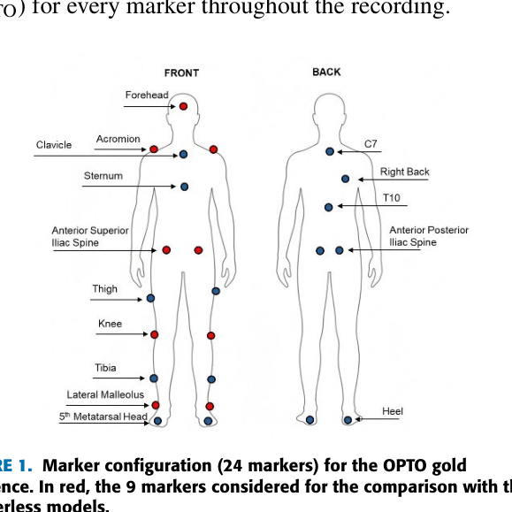

*markerless models.*

The postural assessment protocol consisted of 40-second quiet standing trials, performed with eyes open and arms relaxed alongside the body. This task enabled the detection of postural abnormalities and body instability. Each participant completed four repetitions of the postural task, two with the marker-based solution and two with the REHOME markerless camera-based solution.

To minimize the motion artifacts caused by loose clothing while respecting participant comfort, individuals wore form-fitting athletic clothes. This approach avoids the potential discomfort associated with wearing only the underwear [50], which is a common requirement for marker-based motion capture systems.

A. DATA COLLECTION Each participant was recorded using both a gold-standard optical motion-capture system (OPTO) and an Azure Kinect (AK) based system developed for the REHOME project. AK was used for data collection because, at the time of the REHOME project (ended in 2022), it was the newest and highest-performing RGB-D device for body tracking available on the market. This choice was supported by several studies demonstrating superior depth sensor performance [51], [52], [53] and body tracking capabilities [54], [55], [56] compared with both previous Kinect models and other less expensive RGB-D cameras.

The OPTO and AK acquisitions were performed separately to prevent the retroreflective markers from interfering with the AK depth estimation and to ensure robust body tracking [57], [58].

The OPTO system (VICON, Oxford Metrics Ltd., Oxford, United Kingdom; sampling rate: 100 Hz) comprised six infrared cameras operating at 100 Hz and tracking markers within a calibrated working volume of 5  \times  2  \times  2 m^{3}). Its accuracy is specified as <0.3 mm RMS for static measurements and <1 mm for dynamic acquisitions. For the assessment, an ad hoc set of 24 spherical retroreflective markers (15 mm diameter) was attached to the participant’s body with biocompatible double-sided adhesive tape, following the complete Plug-In Gait biomechanical model [59],

[60]. Although a complete marker configuration was used, we considered only nine markers on the anterior surface for direct comparison with markerless data (Fig. 1). This subset included markers positioned on the head (frontal), shoulders (acromion), hips (anterior superior iliac spine), knees (lateral epicondyle), and ankles (lateral malleolus), which are particularly important in posture, gait, and balance clinical assessments [61]. For each trial, the OPTO system generated a text file containing 3D coordinates (X_{OPTO}, Y_{OPTO}, and

The AK system, configured as described in [49], employed a proprietary body-tracking algorithm (Azure Kinect Body Tracking SDK v1.1.0) to estimate a 3D skeletal model with 33 joints in real time. The world coordinates (X_{WAK}, Y_{WAK}, and Z_{WAK}) are expressed in meters, where Z_{WAK} represents the absolute distance from the camera. The AK system outputs a JSON file containing the 3D coordinates for the 33joint skeletal model, the recorded video (MP4, 640  \times  360px, 30 fps, 40 s), and the intrinsic parameters of the camera for both the color and depth sensors. Two distinct models were used in the analysis of the AK system data. First, the 3D world coordinate model, which we denote as KIN_3D. Second, using the intrinsic parameters, we constructed a mixed 2.5D model that emulates that provided by MediaPipe (see Section B), denoted as KIN_2D. This model was achieved by transforming world coordinates into 2D image-plane coordinates (X_{IAK},YIAK), expressed in pixels, and combining them with the depth value (Z_{WAK}?). For a direct comparison with the OPTO system, we retained only nine joints corresponding approximately to the marker locations from both KIN_3D and KIN_2D models.

B. MEDIAPIPE MARKERLESS MODELS In addition to the markerless skeletal models obtained directly from the AK system (KIN_3D and KIN_2D), we evaluated Google MediaPipe Pose (MP) to investigate its feasibility for postural assessment in clinical applications. A key advantage of MP is that it operates on RGB-only video input [39], thereby eliminating the hardware complexity associated with RGB-D sensors, while maintaining real-time performance through optimized neural network architectures.

The RGB videos recorded during the AK acquisitions were processed offline using MediaPipe v0.10.24, to estimate a skeletal model comprising 33 landmarks. A custom Python script was developed to configure the pipeline and extract the landmark coordinates. The script exposes three key parameters: network complexity, detection confidence, and tracking confidence. The network complexity governs the trade-off between processing speed and accuracy, with three available levels: complexity 0 which prioritizes processing speed over accuracy; complexity 1 which is a balanced compromise between speed and accuracy; and complexity 2 which prioritizes accuracy over processing speed. The detection and tracking confidence parameters (range 0–1) set the minimum reliability thresholds for human-body detection and landmark tracking. Based on preliminary tests, we set both confidence values to 0.7 to ensure a robust compromise between minimizing false positives (e.g., wrong detection of human-like silhouettes) and avoiding missed tracking of partially occluded landmarks.

Using this configuration, we generated MP models at all three network complexity levels to compare their performances in quantitative postural assessments. For each complexity level, the script extracts two skeletons. The first is a 3D skeleton in world coordinates(X_{WMP}, Y_{WMP}, and Z_{WMP}) expressed in meters [62]. Unlike AK’s absolute depth, the Z_{WMP}component from the MP represents the relative distance of each landmark from origin of the model, which is approximately at the hip center. The second is a 2D skeleton in image-plane coordinates (X_{IMP}, Y_{IMP}), expressed in pixels. In addition to these 2D coordinates, a Z component (Z_{NMP}) was also provided and normalized according to the image resolution. Because of this additional property, this model is often considered a 2.5D model, in contrast to purely 2D models from other frameworks, such as OpenPose [40]. For the analysis, we selected a subset of landmarks for the MP models that approximately corresponded to the anatomical points used in the OPTO and AK systems.

Table 1 provides a comprehensive summary of all markerless models (AK and MP) evaluated in this study against the OPTO gold-standard reference. For brevity, we refer to the group of 2.5D models collectively as ‘2D models.’

**TABLE 1. List of investigated markerless models.**

| Model |  |  |
| --- | --- | --- |
|  | Name | Description |
| type |  |  |
|  | KIN 3D | AKmodel(XwAK,YwAK,ZwAK) |
| 3D | MP_1_3D MP03D | MP model compl.0 (XwMp,YwMp,ZwMP) MP model compl.1 (XwMp,YwMp,ZwMP) |
|  | MP23D | MP model compl.2 (XwMp,YwMp,ZwMP) |
|  | KIN 2D | AK model (X1Ak, Y1AK, ZwAK) |
| 2.5D | MP 02D | MP model compl.0 (XIMp,YIMp,ZNMP) |
|  | MP 1 2D | MP model compl.1 (X1Mp,Y1Mp, ZNMP) |
|  | MP22D | MP model compl.2 (XIMp,YIMP,ZNMP) |

C. DATA PROCESSING The 3D trajectories of all body points (markers, joints, and landmarks) were processed and analyzed using custom scripts developed in MATLAB R2024a. To ensure that the analysis focused on maximal postural steadiness, we selected the central 25-second segment from each 40-second recording, discarding the initial 10 seconds and the final 5 seconds to minimize artifacts (e.g., incidental body movements) from task initiation and termination.

All subsequent preprocessing was applied uniformly to this 25-second data window to create a common framework for

direct comparison across all models. First, we established a common temporal base by resampling all signals (i.e., trajectories) to 50 Hz, which involved downsampling the OPTO marker trajectories from their original 100 Hz) and upsampling the AK joint and MP landmark trajectories from their original 30 fps. Second, we applied a two-stage filtering process to the resampled trajectories for noise reduction. The signal was initially passed through a 10-sample movingaverage filter to attenuate sporadic spikes, which were more prevalent in AK and MP data. Subsequently, we applied a fourth-order Butterworth low-pass filter with a 10 Hz cutoff frequency to suppress high-frequency noise while preserving the physiological components of the movement. These filtering operations were applied identically to all X, Y, and Z coordinates across every model to guarantee an unbiased comparison.

D. POSTURAL PARAMETERS As previously established, the analysis was restricted to the set of body points available across all systems (OPTO, AK, and MP): the head, shoulders, hips, knees, and ankles. A dedicated MATLAB script was used to compute an identical set of postural parameters from the preprocessed 3D trajectories of all models, enabling a comprehensive assessment of posture through angular and linear measurements. These parameters were divided into five distinct groups:

• Horizontal angles: These angles quantify the horizontal alignment (tilt) of segments connecting bilateral
body points (e.g., left and right shoulders) relative to
the X-axis in the frontal (XY) plane, thus excluding the Z component. This group includes parameters
for the shoulders (H_SHOULD), hips (H_HIP), knees
(H_KNEE), and ankles (H_ANKLE). Values near 0◦

indicate optimal horizontal alignment.

• Vertical angles: These angles quantify the lateral bending of the vertical segments relative to the Y-axis in the
frontal (XY) plane, thus excluding the Z component.
This group includes the trunk segment (shoulder centroid to hip centroid, V_TRUNK), head segment (head
to shoulder centroid, V_HEAD), and ankle segment (hip
centroid to ankle centroid, V_ANKLE). Values near
0◦ indicate the correct upright posture without lateral
bending.

• Sagittal angles: These angles quantify the forwardbackward lean of body segments relative to the Z-axis
in the sagittal (ZY) plane, thus excluding the X component. This group includes the trunk (shoulders centroid
to hips centroid, Z_TRUNK), head (head to shoulder
centroid, Z_HEAD), knee (hip centroid to knee centroid,
Z_KNEE), and ankle (knee centroid to ankle centroid,
Z_ANKLE). Values near 90◦ indicate proper alignment
in an upright stance.

• Joint angles: These angles measure joint-specific angles
and are evaluated separately for the right and left sides
to identify potential asymmetries. This group includes
angles for the knees (LKNEE, RKNEE), shoulders
(LSHOULD, RSHOULD), and hips (LHIP, RHIP).

• Segment lengths: These measures quantify the length
of key body segments assessed separately for the right
and left sides. This group includes the lengths of the
upper leg (RUPLEG and LUPLEG), leg (RLEG and
LLEG), and trunk (RTRUNK and LTRUNK). The shoulder width (SHOULD) and hip width (HIP) are also part
of this group.
Angular measures were computed using the formula (1):

$$
\theta = atan 2 ( ∥ v_{1} \times v_{2} ∥ , v_{1} . v_{2} ) \tag{1}
$$

where v_{1} and v_{2} denote the segments considered. This formula is simplified when one vector aligns with a coordinate axis (for horizontal, vertical, and sagittal angles). Linear measurements were computed as the Euclidean distance between two 3D points (2).

q

$$
( x_{2} - x_{1} )^{2} + ( y_{2} - y_{1} )^{2} + ( z_{2} - z_{1} )^{2} \tag{2}
$$

d (P_{1}, P_{2}) =

where P_{1} and P_{2} denote the body points under consideration.

All angular parameters are expressed in degrees. Linear parameters are expressed in meters for all 3D models (OPTO, KIN_3D, MP_0_3D, MP_1_3D, and MP_2_3D) and in pixels for all 2D models (KIN_2D, MP_0_2D, MP_1_2D, and MP_2_2D).

This set of parameters, estimated from specific body key-points and segments, was selected for direct clinical relevance and interpretability. Five categories (horizontal, vertical, sagittal, joint, and length metrics) were considered to comprehensively quantify postural features, thus approximating traditional clinical metrics of posture derived from observational, goniometric, photographic, or stereophotogrammetric techniques [17], [63], [64]. The proposed approach, based on angular and linear measurements from body key points (e.g., joints and landmarks), ensures that our findings are directly translatable, comparable, interpretable, and clinically relevant for evaluating postural abnormalities, similar to the traditional techniques.

E. DATA ANALYSIS Each markerless model (both 3D and 2D) was compared with the OPTO gold-standard system using a set of established statistical metrics. For all parameters, we reported the mean

and standard deviation (SD) to summarize the central tendency and dispersion, a standard approach given the expected data normal distribution, and to ensure comparability with the related literature. A different analytical approach was adopted for the postural alignment angles, joint angles, and segment lengths.

Regarding postural alignment angles (i.e., horizontal, vertical, and sagittal angles), the comparison focused on accuracy, reliability, and agreement metrics. Accuracy was quantified using the Mean Absolute Error (MAE), expressed as degrees, for direct clinical interpretation. MAE was chosen over the Root Mean Square Error (RMSE) because of its low sensitivity to occasional outliers. Reliability was assessed via the Standard Error of Measurement (SEM), which indicates the typical error in a single observation, and the Minimal Detectable Change (MDC95), which represents the smallest change that can be considered real with 95% confidence. Agreement was evaluated using the Bland-Altman analysis to compute the measurement bias (systematic error between models) and the 95% Limits of Agreement (LOA), which defines the precision range for individual measurements. Additionally, radar and bar plots were used to visually compare absolute bias across body segments.

Owing to the expected systematic differences in joint angle calculations between marker-based and markerless systems (arising from different anatomical definitions), a symmetry analysis was performed instead of a direct agreement analysis using Bland-Altman. The Symmetry Index (SI) was computed to assess model-dependent asymmetries between the left (L) and right (R) sides of the body using the Equation (3):

$$
_{( | R | + | L | + \epsilon ) \epsilon \approx 10}^{-} 6 \tag{3}
$$



SI = 1 - (|R - L|)

The term \epsilon is a small constant added to prevent indeterminate conditions when R and L are close to zero. An SI value of 1 indicates perfect symmetry, whereas a value approaching zero indicates maximum asymmetry. Since this study included only non-pathological subjects without postural impairments, high SI values were expected independent of the model examined.

We intentionally omitted correlation metrics from our analysis for two primary reasons. First, the OPTO and AK acquisitions were asynchronous, making point-to-point correlations inappropriate. Second, the inherent systematic offsets between different skeletal models would artificially depress the correlation coefficients. Although these offsets impact correlation metrics, they do not necessarily compromise the utility of markerless models for their intended applications in unsupervised or remote clinical scenarios.

III. RESULTS We evaluated the performance of the eight markerless models (Table 1) by comparing their estimates against the OPTO gold-standard reference. The markerless models were derived from 48 trials acquired with the Azure Kinect (AK) system and compared to the corresponding 48 OPTO trials from the same participants. All models were successfully estimated for the entire AK dataset, equivalent to 36,000 source video frames (48 trials  \times  750 frames/trial), demonstrating robust performance across the varied anthropometric characteristics of the participants. The results are organized according to the parameter groups established in the Methods section, providing a clear performance assessment for each measurement category.

A. HORIZONTAL ANGLES The horizontal angles quantify the alignment of segments connecting the bilateral body points (shoulders, hips, knees, ankles) in the frontal plane, as illustrated in Fig. 2. Light-blue circles on the silhouette indicate the approximate position of reference points used to define body segments across all systems; they correspond to markers (OPTO), joints (AK), and landmarks (MP), whose actual locations depend on each specific skeletal model.

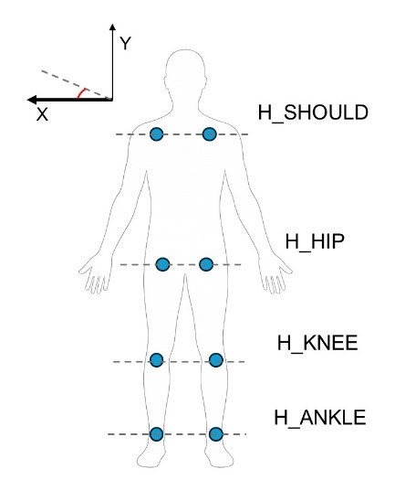

*FIGURE 2. Horizontal angles and positions of reference points.*

Table 2 presents the accuracy and reliability metrics (MAE, SEM, and MDC95) of each markerless model. The mean and standard deviation (SD) are also reported for OPTO, as reference measures. Table 3 shows the results of the Bland–Altman agreement analysis, with systematic bias in the first rows and 95% limits of agreement (expressed as lower and upper bounds) in the second row.

**TABLE 3. Bland-altman bias and LOA range.**

| Model | H SHOULD | H HIP | H KNEE | H ANKLE |
| --- | --- | --- | --- | --- |
|  | (deg) | (deg) | (deg) | (deg) |
| KIN_3D | 0.03 | -0.90 | -0.72 | 0.20 |
|  | (-2.60,2.67) | (-2.99,1.19) | (-4.20,2.77) | (-2.05,2.46) |
| MP03D | -0.19 | -1.07 | 0.37 | 5.08 |
|  | (-2.33,1.95) | (-3.85,1.70) | (-4.01,4.76) | (-4.13,14.29) |
| MP_1_3D | -0.49 | -0.41 | 5.04 | 4.86 |
|  | (-2.95,1.97) | (-3.31,2.48) | (-0.33,10.40) | (-0.33,10.05) |
| MP_2_3D | 9.18 | 0.66 | 22.62 | 7.05 |
|  | (5.13,13.23) | (-2.47,3.79) | (16.62,28.62) | (-0.81,14.91) |
| KIN_2D | 1.08 | -0.80 | -0.74 | 1.14 |
|  | (-1.96,4.12) | (-2.90,1.31) | (-4.06,2.58) | (-2.27,4.55) |
| MP_0_2D | 0.18 | -0.68 | -0.34 | 2.19 |
|  | (-2.38,2.74) | (-3.10,1.73) | (-3.99,3.31) | (-1.79,6.18) |
| MP 1 2D | 0.17 | -0.47 | 0.27 | 1.43 |
|  | (-3.35,3.70) | (-3.26,2.33) | (-3.23,3.77) | (-2.22,5.08) |
| MP_2_2D | -0.06 | -0.91 | 0.01 | 1.50 |
|  | (-2.71,2.59) | (-3.97,2.16) | (-3.47,3.49) | (-2.21,5.21) |

Fig. 3 displays radar plots of absolute bias, on a convenient scale to emphasize performance, derived from the Bland- Altman analysis, for an immediate visual comparison of systematic errors against OPTO across models (3D on the left, 2D on the right) and body segments.

Among the three-dimensional models, KIN_3D demonstrated the best and most balanced performance, with a MAE consistently below 1.5◦ for all segments. The low values for SEM and MDC95 suggest that this model is reliable for detecting small, clinically meaningful postural changes in the horizontal segments on the frontal plane. The 3D MP models exhibited variable performance. MP_0_3D proved to be competitive for the shoulders, hips, and knees, with results

**TABLE 2. Horizontal angles for OPTO and markerless models.**

|  |  | Mean ± SD |
| --- | --- | --- |
| Model | Parameter |  |
|  |  | (deg) |
| OPTOa | H SHOULD | 1.65±1.08 |
|  | H1 HIP | 1.90±1.22 |
|  | H KNEE | 1.76±1.38 |
|  | H ANKLE | 0.92±0.64 |
| KIN_3D | H SHOULD | 1.68±1.41 |
|  | H_HIP | 0.99±0.81 |
|  | H KNEE | 1.04±0.91 |
|  | H ANKLE | 1.12±0.90 |
| MP03D | H SHOULD | 1.46±0.92 |
|  | H_HIP | 0.82±0.57 |
|  | H KNEE | 2.13±1.56 |
|  | HANKLE | 6.00±4.59 |
| MP_1_3D | H SHOULD | 1.16±0.75 |
|  | H_HIP | 1.48±0.76 |
|  | H_KNEE | 6.79±2.43 |
|  | H ANKLE | 5.78±2.52 |
| MP_2_3D | H SHOULD | 10.83±1.54 |
|  | H_HIP | 2.56±0.88 |
|  | H KNEE | 24.38±3.03 |
|  | H_ANKLE | 7.97±3.78 |
| KIN_2D | H SHOULD | 2.73±1.92 |
|  | H HIP | 1.10±0.90 |
|  | H_KNEE | 1.02±0.84 |
|  | H ANKLE | 2.06±1.06 |
| MP 02D | H SHOULD | 1.83±1.23 |
|  | H HIP | 1.21±1.03 |
|  | H KNEE | 1.42±0.91 |
|  | H ANKLE | 3.11±1.93 |
| MP 1 2D | H_SHOULD | 1.82±1.53 |
|  | HIP | 1.43±1.00 |
|  | H KNEE | 2.03±0.97 |
|  | H ANKLE | 2.35±1.61 |
| MP22D | H SHOULD | 1.59±1.14 |
|  | H_HIP | 0.99±0.74 |
|  | H_KNEE | 1.77±1.18 |
|  | H ANKLE | 2.42±1.82 |

comparable to those of KIN_3D. However, its accuracy decreased slightly at the ankle level (MAE > 5◦), indicating only moderate precision. MP_1_3D exhibited intermediate behavior, with performance comparable to MP_0_3D on proximal segments (shoulders and hips), but a notable decline for knees and ankles. Contrary to expectations, MP_2_3D consistently showed poor performance across all segments. With an MAE of 22.6◦ for the knee angle (H_KNEE) and substantial systematic bias (Table 3 ), this model proved unsuitable for precise quantitative assessment of horizontal angles for posture evaluation.

Overall, the 2D models offer competitive accuracy. Their MAE values were comparable to those of the best 3D models,

with only slight increases in the SEM and MDC95 metrics. This finding indicates that although their absolute precision may be slightly lower, they can provide reliable estimates of horizontal alignment.

The radar plots in Fig. 3 visually confirm these findings: the KIN_3D profile is the smallest and most regular, whereas the MP_2_3D profile is the largest and most distorted, highlighting systematic and unbalanced errors. The radar profiles of the 2D models are clustered and relatively symmetrical, reinforcing their validity as robust and practical alternatives for horizontal alignment measurements.

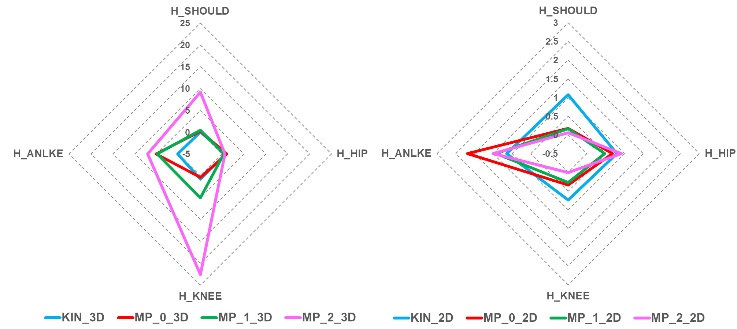

*FIGURE 3. Radar plots of absolute biases derived from bland-altman analyses for 3D models (left) and 2D models (right) across different horizontal body segments.*

In summary, for the measurement of horizontal angles, KIN_3D remains the optimal choice for high-precision applications (errors < ±5◦), followed by MP_0_3D, with caution for the ankle segment. We hypothesized that the performance on this specific segment could be improved by optimizing camera framing to ensure higher visibility of ankle landmarks. When simplicity and rapid deployment are priorities, 2D models represent an excellent and reliable alternative. The MP_1_3D model can be used with caution, particularly for the measurement of the distal segments (knees and ankles). The MP_2_3D model is not recommended in its current version for measuring horizontal angles because of substantial systematic errors and poor accuracy.

B. VERTICAL ANGLES The vertical angles measure the lateral bending of major body segments relative to the vertical (Y) axis on the frontal plane, as illustrated in Fig. 4. The light blue points on the silhouette indicate the approximate position of the reference points used to determine centroids to define body segments across all systems: they correspond to markers (OPTO), joints (AK), and

landmarks (MP). This analysis focused on the performance of the models in estimating the angles of the trunk (V_TRUNK), head (V_HEAD), and lower limbs (V_ANKLE). For MP, the head landmark is the midpoint of five facial landmarks (i.e., eyes, nose, and ears).

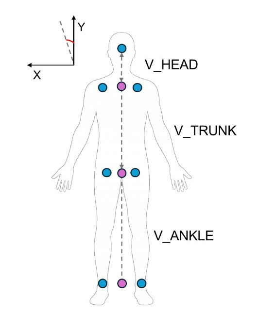

*FIGURE 4. Vertical angles and positions of the reference points and centroids.*

Table 4 presents the accuracy and reliability metrics (MAE, SEM, and MDC95) of each markerless model. The mean and standard deviation (SD) are also reported for OPTO as reference measures. Table 5 shows the results of the Bland–Altman agreement analysis, with systematic bias in the first rows and 95% limits of agreement (expressed as lower and upper bounds) in the second row.

Fig. 5 displays the bar plot of absolute bias, derived from the Bland-Altman analysis, for an immediate visual comparison of systematic errors against OPTO across models and body segments.

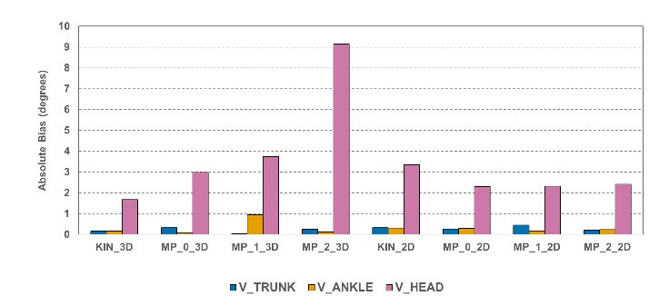

*FIGURE 5. Bar plot of absolute biases derived from bland-altman analyses for 3D and 2D models across the three vertical body segments.*

For measuring the lateral tilt of the trunk (V_TRUNK) and lower limbs (V_ANKLE), all markerless models, both 2D and 3D, demonstrated excellent performance.

As shown in Table 4, the MAE values were almost continuously below 2◦, indicating a high accuracy. The

**TABLE 4. Vertical angles for OPTO and markerless models.**

|  |  | Mean ± SD |
| --- | --- | --- |
| Model | Parameter | (deg) |
| OPTOa | V TRUNK | 1.23±0.80 |
|  | VHEAD | 1.12±0.08 |
|  | V_ANKLE | 0.88±0.63 |
| KIN 3D | V TRUNK | 1.08±0.73 |
|  | VHEAD | 1.67±0.98 |
|  | VANKLE | 0.73±0.52 |
| MP_0_3D | V_TRUNK | 0.91±0.75 |
|  | V_HEAD | 2.98±2.04 |
|  | VANKLE | 0.94±0.61 |
| MP_1_3D | V TRUNK | 1.26±0.86 |
|  | V_HEAD | 3.74±2.42 |
|  | VANKLE | 1.84±0.75 |
| MP_2_3D | V TRUNK | 1.48±0.88 |
|  | V_HEAD | 9.16±3.12 |
|  | V_ANKLE | 1.00±0.65 |
| KIN 2D | V TRUNK | 0.92±0.69 |
|  | V_HEAD | 3.35±2.51 |
|  | VANKLE | 0.57±0.35 |
| MP_0_2D | V_TRUNK | 0.97±0.66 |
|  | VHEAD | 2.30±1.59 |
|  | VANKLE | 0.59±0.47 |
| MP 1 2D | V TRUNK | 0.79±0.54 |
|  | V_HEAD | 2.32±1.64 |
|  | VANKLE | 0.72±0.51 |
| MP_2_2D | V_TRUNK | 1.04±0.73 |
|  | V_HEAD | 2.41±1.43 |
|  | V_ANKLE | 0.64±0.44 |

| TABLE 5. Bland-altman bias and LOA range. |
| --- |

| Model | V_TRUNK (deg) | V_HEAD (deg) | V_ANKLE (deg) |
| --- | --- | --- | --- |
| KIN_3D | -0.16 | 1.67 | -0.15 |
|  | (-1.70,1.39) | (-0.25,3.58) | (-1.99,1.68) |
| MP 03D | -0.33 | 2.98 | 0.06 |
|  | (-2.38,1.73) | (-1.03,6.98) | (-1.87,1.99) |
| MP_1_3D | 0.03 | 3.74 | 0.95 |
|  | (-1.67,1.72) | (-1.00,8.48) | (-1.39,3.30) |
| MP_2_3D | 0.25 | 9.15 | 0.12 |
|  | (-2.54,3.04) | (2.86,15.45) | (-1.90,2.14) |
| KIN_2D | -0.32 | 3.35 | -0.31 |
|  | (-1.91,1.28) | (-1.56,8.27) | (-1.55,0.93) |
| MP_0_2D | -0.26 | 2.30 | -0.30 |
|  | (-1.84,1.32) | (-0.82,5.43) | (-2.12,1.53) |
| MP_1_2D | -0.45 | 2.32 | -0.17 |
|  | (-2.24,1.35) | (-0.89,5.53) | (-1.94,1.61) |
| MP_2_2D | -0.20 | 2.41 | -0.24 |
|  | (-1.65,1.25) | (-0.40,5.21) | (-1.60,1.11) |

Bland-Altman analysis (Table 5 ) confirmed these strong results. The systematic biases were minimal (close to 0◦), and the LOA were narrow for nearly all models, which means that they are not only accurate on average, but also precise at the level of a single measurement. These findings suggest that all the tested models, including the 2D versions, are highly reliable for quantifying body balance and lateral sway.

Conversely, the estimation of the head angle (V_HEAD) revealed a significant systematic discrepancy in most markerless models. Except for KIN_3D (MAE < 2◦), all other

models yielded MAE values greater than 2◦, peaking at 9.15◦

for MP_2_3D (Table 4 ).

The Bland-Altman analysis (Table 5 ) is crucial for interpreting this result, as it reveals that the error is almost entirely due to a high systematic bias, while random variability remains low. This discrepancy is likely caused by an inherently different definition of the head reference point between the OPTO system (marker on the forehead) and markerless models, which estimate a differently positioned landmark or centroid. The null values for SEM and MDC95 for this parameter (Table 4 ) strongly suggest that this offset is constant and systematic, rather than random.

The bar plot in Fig. 5 visually summarizes the dual performance. The bars are negligible for V_TRUNK and V_ANKLE, expanding significantly for V_HEAD in all models, particularly for MP_2_3D, which exhibited the highest value.

In summary, for the measurement of lateral tilt on the frontal plane, the KIN_3D model delivered the best overall performance across all body segments. For the trunk and lower limbs, 3D and 2D models are highly recommended as reliable alternatives. Regarding the estimation of the absolute head tilt, all other models exhibited a systematic bias, particularly pronounced in MP_2_3D. Nevertheless, these models may still be valid for analyzing relative changes in head movement (e.g., range of sway) provided that the absolute angular value is not interpreted.

C. SAGITTAL ANGLES Sagittal angles quantify the forward-backward inclination of body segments relative to the Z axis in the sagittal plane (ZY), as illustrated in Fig. 6. The light blue points on the silhouette indicate the approximate position of the reference points used to determine centroids of bilateral points (e.g., centroids of shoulders, hips, knees, and ankles) to define body segments across all systems; they correspond to markers (OPTO), joints (AK), and landmarks (MP). This section evaluates the performance of the markerless models in estimating the angles of the head (Z_HEAD), trunk (Z_TRUNK), knee (Z_KNEE), and ankle (Z_ANKLE).

Table 6 presents the accuracy and reliability metrics (MAE, SEM, and MDC95) of each markerless model. The mean and standard deviation (SD) are also reported for OPTO as reference measures. Table 7 shows the results of Bland–Altman agreement analysis, with systematic bias in the first rows and 95% limits of agreement (expressed as lower and upper bounds) in the second row.

Fig. 7 displays radar plots of absolute bias, derived from the Bland-Altman analysis, for an immediate visual comparison of systematic errors against OPTO across models (3D on the left, 2D on the right) and body segments.

The analysis of sagittal angles is dominated by a key finding: the measurement error is almost systematic, rather than random. This element is evidenced by the MAE values in Table 6, which closely mirror the absolute bias from the Bland-Altman analysis (Table 7 ) across nearly all models and body segments. This suggests that the measurements are often consistent despite the large offsets.

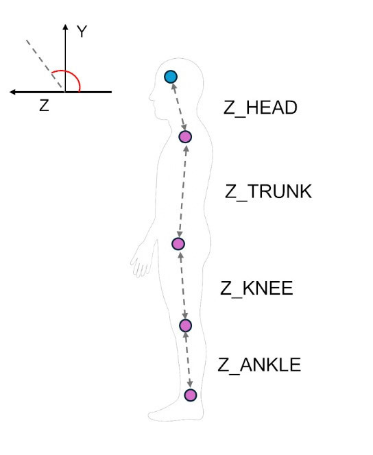

*FIGURE 6. Body segments to evaluate sagittal angles, with illustrative positions of reference points (light blue) and centroids (magenta) for shoulders, hips, knees, and ankles.*

The 3D models exhibited distinct performances. KIN_3D

| TABLE 7. Bland-altman bias and LOA range. |
| --- |

exhibited a consistent pattern of systematic offsets, with negative biases for the upper segments (trunk and head) and negative biases for lower segments (knee and ankle). This predictable pattern, supported by moderate and stable SEM and MDC95 values, suggests that the error stems from differences in the biomechanical model definition rather than from measurement instability.

| Model | Z TRUNK | Z HEAD | ZANKLE | Z_KNEE |
| --- | --- | --- | --- | --- |
|  | (deg) | (deg) | (deg) | (deg) |
| KIN_3D | -11.49 | -14.18 | 18.69 | 23.61 |
|  | (-19.30,-3.68) | (-25.88,-2.48) | (8.10,29.29) | (14.29,32.93) |
| MP_0_3D | 4.93 | 35.38 | 25.50 | 13.31 |
|  | (-6.70,16.56) | (22.49,48.26) | (15.98,35.03) | (6.11,20.52) |
| MP_1_3D | 2.01 | 31.75 | 25.12 | 16.24 |
|  | (-6.94,10.97) | (26.32,37.18) | (15.68,34.56) | (9.22,23.27) |
| MP_2_3D | 2.81 | 48.57 | 28.69 | 15.30 |
|  | (-10.13,16.03) | (42.02,55.12) | (17.75,39.63) | (8.16,22.43) |
| KIN 2D | -13.15 | -15.97 | 5.5 | 16.89 |
|  | (-18.28, -8.02) | (-17.56, -14.37) | (-1.44,12.44) | (11.24,22.53) |
| MP_0_2D | -13.05 | -15.62 | 5.59 | 16.85 |
|  | (-18.17, -7.93) | (-17.18, -14.07) | (-1.35,12.53) | (11.21,22.49) |
| MP_1_2D | -13.07 | -15.67 | 5.59 | 16.85 |
|  | (-18.19, -7.94) | (-17.24, -14.10) | (-1.34,12.52) | (11.21,22.50) |
| MP_2_2D | -13.05 | -15.66 | 5.58 | 16.87 |
|  | (-18.18, -7.91) | (-17.20, -14.11) | (-1.35,12.51) | (11.23,22.51) |

The 3D MediaPipe models (MP_0_3D, MP_1_3D, and MP_2_3D) showed significant positive biases, which were particularly pronounced for the head and ankle segments. These errors likely originate from the known challenge of accurately estimating the Z-component (depth) using an RGB source and learning-based 3D approaches.

The 2D models presented a remarkably uniform systematic error pattern across all segments and models with nearly constant bias values and compact limits of agreement. This high level of consistency suggests that the offsets were a result of geometric projection effects rather than algorithmic instability.

**TABLE 6. Sagittal angles for OPTO and markerless models.**

|  | N | Mean ± SD |
| --- | --- | --- |
| Model | Parameter |  |
|  | ( | (deg) |
| OPTOa | Z TRUNK | 103.15±2.61 |
|  | Z HEAD | 105.97±0.81 |
|  | Z ANKLE | 84.54±3.54 |
|  | Z_KNEE | 73.13±2.88 |
| KIN_3D | Z_TRUNK | 91.66±1.96 |
|  | Z_HEAD | 91.79±5.72 |
|  | Z_ANKLE | 103.23±2.30 |
|  | Z KNEE | 96.75±2.52 |
| MP03D | Z_TRUNK | 108.08±5.44 |
|  | Z HEAD | 141.35±6.82 |
|  | ZANKLE | 110.05±2.37 |
|  | Z_KNEE | 86.45±2.02 |
| MP_1_3D | Z_TRUNK | 105.16±3.67 |
|  | Z HEAD | 137.72±2.67 |
|  | ZANKLE | 109.66±3.04 |
|  | Z KNEE | 89.38±1.55 |
| MP_2_3D | Z TRUNK | 105.96±6.17 |
|  | Z HEAD | 154.55±3.71 |
|  | Z_ANKLE | 113.23±3.87 |
|  | Z KNEE | 88.43±1.72 |
| KIN 2D | Z_TRUNK | 90.00±0.01 |
|  | Z HEAD | 90.00±0.02 |
|  | Z ANKLE | 90.04±0.01 |
|  | Z KNEE | 90.02±0.01 |
| MP02D | Z TRUNK | 90.10±0.04 |
|  | Z HEAD | 90.35±0.10 |
|  | Z ANKLE | 90.13±0.02 |
|  | Z_KNEE | 89.98±0.01 |
| MP_1_2D | Z_TRUNK | 90.08±0.02 |
|  | Z_HEAD | 90.30±0.04 |
|  | ZANKLE | 90.13±0.02 |
|  | Z_KNEE | 89.99±0.01 |
| MP_2_2D | Z TRUNK | 90.11±0.04 |
|  | Z_HEAD | 90.32±0.05 |
|  | Z_ANKLE | 90.12±0.03 |
|  | Z KNEE | 90.00±0.01 |

The radar plots in Fig. 7 visually confirm the magnitude and nature of these systematic errors in the sagittal angles. All the models generated extended profiles, reflecting substantial systematic biases. The 2D models exhibited highly uniform and circular patterns, whereas the 3D models exhibited more segment-specific variations.

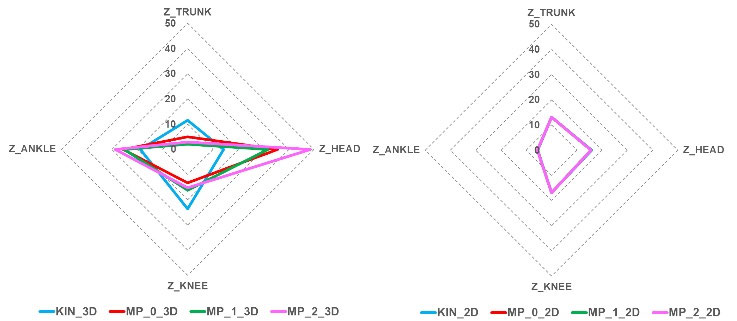

*FIGURE 7. Radar plots of absolute biases derived from bland-altman analyses for 3D models (left) and 2D models (right) across different sagittal body segments.*

The highly systematic nature of these errors provides a straightforward method for offset correction and, consequently, a reliable clinical use. The consistent offset patterns suggest that a simple, per-parameter calibration (e.g., subtracting the constant bias) could effectively improve the absolute accuracy of all models, making them clinically useful for the quantitative assessment of sagittal angles. For applications where calibration is not feasible, these models remain valuable for tracking relative changes in sagittal angles over time (e.g., monitoring postural improvement across sessions), as systematic offsets can be considered constant.

In summary, KIN_3D is the most reliable choice for sagittal angle measurement. Its predictable, uniform, and stable bias allows for tracking relative changes in sagittal posture and applying model-specific calibrations to remove offsets.

The 3D MediaPipe models exhibited large and variable positive biases, particularly for the head and ankle segments, which counterintuitively increased with higher model complexity. They are not recommended for sagittal angle estimation from a frontal camera view; a lateral view is likely required to improve the reliability of posture assessment on the sagittal plane. The 2D models showed a uniform and consistent systematic error across all segments, which could be resolved via segment-specific calibrations.

D. JOINT ANGLES Joint angles measure the 3D angles between body segments connecting specific anatomical points (Fig. 8). The light blue circles indicate the approximate locations of the reference points, and the red curves represent the 3D angles relative to the shoulders, hips, and knees. The analysis included shoulder angles (LSHOULD, RSHOULD), hip angles (LHIP, RHIP), and knee angles (LKNEE, RKNEE), evaluated separately for the left and right sides to detect asymmetries. The reference points correspond to the markers (OPTO), joints (AK), and landmarks (MP).

Due to inherent differences in anatomical definitions between marker-based and markerless systems, a direct comparison of absolute angle values through the Bland-Altman analysis could be misleading. Therefore, the analysis focused on measurement consistency (MAE, SEM, and MDC95) and bilateral symmetry (Symmetry Index), which should be more robust metrics of model performance.

The key metrics for the joint angles are presented in Table 8, and the results for the Symmetry Index (SI) are reported in Table 9.

A primary finding of the analysis was the inability of all 2D models to accurately measure knee flexion from a frontal view, even if a Z-component (Z_{WAK} or Z_{NMP}) was added to the image plane coordinates. As shown in Table 8, these models consistently calculated knee angles approaching 180◦, failing to capture the slight physiological flexion of knees in the upright position, as appreciable from OPTO.

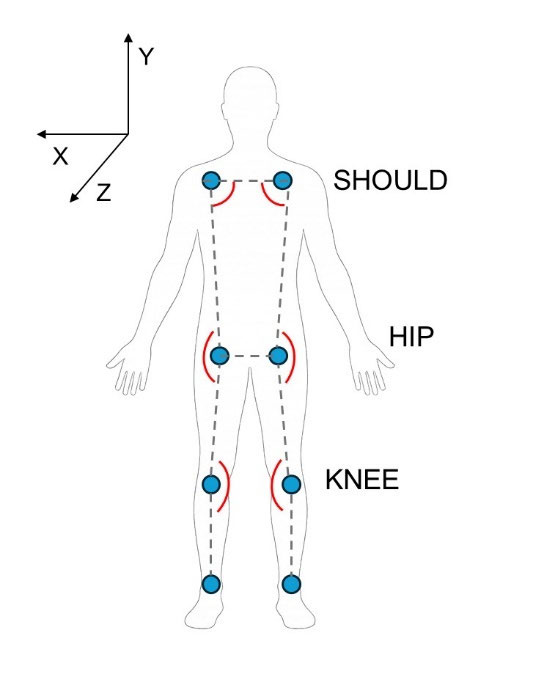

*FIGURE 8. Joint angles and illustrative positions of the reference points.*

This is because, for 2D models, the knee joints appear perfectly straight from the frontal view; a lateral view of the lower limbs could allow a more precise estimation of knee angles. However, for shoulder and hip angles, the 2D models remained viable in the frontal plane, with a performance comparable to that of their 3D counterparts.

As expected, 3D models generally outperform 2D alternatives, particularly for knee angles where depth information is critical. KIN_3D demonstrated the most consistent performance, with the lowest standard deviation (especially at the hip), suggesting superior stability in joint position estimation. MP_0_3D offers a balanced compromise, with competitive MAE values and good symmetry preservation. It provides practical accuracy for shoulder and hip angle assessments while maintaining reasonable, albeit less precise, estimation of knee angles. MP_1_3D exhibited an intermediate performance with increasing variability. MP_2_3D exhibited the most variable performance. Although its accuracy for some individual measurements was acceptable, its poor symmetry reduced its reliability for bilateral comparisons.

The Symmetry Index (SI) analysis, the results of which are shown in Table 9, reveals how well each model preserves the symmetry between the left and right sides of the body.

Most models maintained good symmetry (SI > 0.89) across all joint angles. Notably, even the OPTO system showed reduced symmetry at the shoulders (SI = 0.94), providing a valuable reference baseline that may reflect the true anatomical asymmetry detected by the markerless models.

The most critical finding was the poor performance of MP_2_3D, which showed the most pronounced asymmetry, particularly in the hips (SI = 0.939). This value is substantially lower than the others ( \ge  0.990), confirming its unreliability for applications where bilateral comparison is important.

**TABLE 9. Simmetry index (SI) for OPTO and markerless models.**

| Model | SHOULD | HIP | KNEE |
| --- | --- | --- | --- |
|  | Mean ± SD | Mean ± SD | Mean ± SD |
| OPTO | 0.940±0.025 | 0.990±0.008 | 0.993±0.005 |
| KIN_3D | 0.894±0.003 | 0.992±0.005 | 0.997±0.003 |
| MP_0_3D | 0.925±0.005 | 0.996±0.002 | 0.996±0.003 |
| MP_1_3D | 0.933±0.006 | 0.994±0.004 | 0.990±0.007 |
| MP_2_3D | 0.899±0.004 | 0.939±0.011 | 0.986±0.009 |
| KIN_2D | 0.895±0.003 | 0.993±0.004 | 0.998±0.001 |
| MP_0_2D | 0.899±0.007 | 0.994±0.005 | 0.995±0.005 |
| MP_1_2D | 0.910±0.004 | 0.993±0.006 | 0.995±0.005 |
| MP_2_2D | 0.908±0.006 | 0.991±0.006 | 0.996±0.004 |

**TABLE 8. Joint angles for OPTO and markerless models.**

<table data-source="local-ocr">
  <tr><th colspan="2">Mean ± SD</th></tr>
  <tr><td>Model</td><td>Parameter</td></tr>
  <tr><td colspan="2">(deg)</td></tr>
  <tr><td>OPTOa</td><td>LSHOULD</td><td>83.59±2.59</td></tr>
  <tr><td colspan="2">RSHOULD</td><td>94.33±3.19</td></tr>
  <tr><td colspan="2">LHIP</td><td>146.96±4.50</td></tr>
  <tr><td colspan="2">RHIP</td><td>148.87±4.78</td></tr>
  <tr><td colspan="2">LKNEE</td><td>164.56±4.40</td></tr>
  <tr><td colspan="2">RKNEE</td><td>166.00±3.85</td></tr>
  <tr><td>KIN_3D</td><td>LSHOULD</td><td>80.58±1.99</td></tr>
  <tr><td colspan="2">RSHOULD</td><td>99.68±1.89</td></tr>
  <tr><td colspan="2">LHIP</td><td>166.59±2.54</td></tr>
  <tr><td colspan="2">RHIP</td><td>168.49±3.39</td></tr>
  <tr><td colspan="2">LKNEE</td><td>173.51±2.98</td></tr>
  <tr><td colspan="2">RKNEE</td><td>173.31±3.62</td></tr>
  <tr><td>MP_0_3D</td><td>LSHOULD</td><td>83.94±1.91</td></tr>
  <tr><td colspan="2">RSHOULD</td><td>97.58±1.80</td></tr>
  <tr><td colspan="2">LHIP</td><td>157.07±5.83</td></tr>
  <tr><td colspan="2">RHIP</td><td>158.10±5.88</td></tr>
  <tr><td colspan="2">LKNEE</td><td>156.26±1.85</td></tr>
  <tr><td colspan="2">RKNEE</td><td>156.30±2.28</td></tr>
  <tr><td>MP13D</td><td>LSHOULD</td><td>81.93±1.57</td></tr>
  <tr><td colspan="2">RSHOULD</td><td>93.70±1.05</td></tr>
  <tr><td colspan="2">LHIP</td><td>164.50±3.80</td></tr>
  <tr><td colspan="2">RHIP</td><td>163.09±4.25</td></tr>
  <tr><td colspan="2">LKNEE</td><td>160.45±2.53</td></tr>
  <tr><td colspan="2">RKNEE</td><td>157.60±2.81</td></tr>
  <tr><td>MP_2_3D</td><td>LSHOULD</td><td>75.26±1.75</td></tr>
  <tr><td colspan="2">RSHOULD</td><td>92.24±2.12</td></tr>
  <tr><td colspan="2">LHIP</td><td>170.46±5.18</td></tr>
  <tr><td colspan="2">RHIP</td><td>150.84±6.82</td></tr>
  <tr><td colspan="2">LKNEE</td><td>156.09±2.67</td></tr>
  <tr><td colspan="2">RKNEE</td><td>151.89±3.89</td></tr>
  <tr><td>KIN_2D</td><td>LSHOULD</td><td>82.12±2.09</td></tr>
  <tr><td colspan="2">RSHOULD</td><td>101.33±2.03</td></tr>
  <tr><td colspan="2">LHIP</td><td>168.34±1.96</td></tr>
  <tr><td colspan="2">RHIP</td><td>170.04±3.02</td></tr>
  <tr><td colspan="2">LKNEE</td><td>178.75±0.78</td></tr>
  <tr><td colspan="2">RKNEE</td><td>178.51±0.89</td></tr>
  <tr><td>MP02D</td><td>LSHOULD</td><td>80.79±1.80</td></tr>
  <tr><td colspan="2">RSHOULD</td><td>98.94±1.83</td></tr>
  <tr><td colspan="2">LHIP</td><td>170.98±1.97</td></tr>
  <tr><td colspan="2">RHIP</td><td>172.00±2.67</td></tr>
  <tr><td colspan="2">LKNEE</td><td>176.94±1.63</td></tr>
  <tr><td colspan="2">RKNEE</td><td>177.32±1.99</td></tr>
  <tr><td>MP_1_2D</td><td>LSHOULD</td><td>82.04±1.76</td></tr>
  <tr><td colspan="2">RSHOULD</td><td>98.75±2.00</td></tr>
  <tr><td colspan="2">LHIP</td><td>173.61±2.17</td></tr>
  <tr><td colspan="2">RHIP</td><td>172.85±3.59</td></tr>
  <tr><td colspan="2">LKNEE</td><td>176.78±2.77</td></tr>
  <tr><td colspan="2">RKNEE</td><td>176.72±2.18</td></tr>
  <tr><td>MP_2_2D</td><td>LSHOULD</td><td>81.50±1.39</td></tr>
  <tr><td colspan="2">RSHOULD</td><td>97.94±1.42</td></tr>
  <tr><td colspan="2">LHIP</td><td>171.04±2.25</td></tr>
  <tr><td colspan="2">RHIP</td><td>173.15±3.01</td></tr>
  <tr><td colspan="2">LKNEE</td><td>177.29±1.89</td></tr>
  <tr><td colspan="2">RKNEE</td><td>177.90±1.43</td></tr>
</table>

The scatter plots in Fig. 9, which visualize the average MAE (mean values of bilateral segments) against SI, confirm

these findings. MP_2_3D was a clear outlier that often combine high errors with low symmetry.

Based on these results, we provide the following recommendations for measuring joint angles. The KIN_3D and MP_0_3D models provide the best overall performance, combining reasonable accuracy with strong symmetry preservation. The MP_1_3D model slightly degrades in angle measurements, especially at the hips, while preserving acceptable symmetry. The high-complexity MP_2_3D model should be avoided for joint angle analysis, particularly when quantifying bilateral asymmetries. The 2D models are suitable for shoulder and hip analysis from a frontal view, but are inadequate for knee angle evaluation. For meaningful knee angle assessment, a lateral camera view would be preferable.

However, all joint angle measurements require careful interpretation because of the differences between the systems. The most reliable applications are bilateral symmetry assessment and monitoring of temporal changes within the same model, as these applications rely on internal consistency rather than absolute accuracy against an external reference.

E. SEGMENT LENGTHS This final analysis quantifies the differences in the underlying skeletal reconstructions by comparing the linear measurements of the key body segments, as illustrated in Fig. 10. The light blue circles indicate the approximate locations of the reference points, whereas the red lines define the body segments. The reference points correspond to the markers (OPTO), joints (AK), and landmarks (MP). The analysis includes shoulder width (SHOULD), hip width (HIP), trunk lengths (LTRUNK, RTRUNK), thigh lengths (LUPLEG, RUPLEG), and leg lengths (LLEG, RLEG).

This analysis provided an essential context for a better understanding of the angular discrepancies observed in the previous sections. We analyzed the lengths of the 3D markerless models for a direct comparison with the OPTO measurements (Table 10), reporting mean differences (DIFF) in both absolute (meters) and relative (percentage) terms. We then examined the lengths in pixels for the 2D models (Table 11) to investigate the origin of model-specific discrepancies.

*FIGURE 9. Scatter plots of average MAE (average of left and right values) and SI values for each joint angle (SHOULD, HIP, and KNEE) and models. KIN_3D and MP_2_3D models are explicitly indicated as the AK markerless reference and the worst among MP 3D models, respectively. The OPTO reference SI values are shown as magenta horizontal lines.*

| SHOULD | OPTO | 0.326±0.018 |  |
| --- | --- | --- | --- |
| KIN_3D | 0.314±0.015 | -0.013 | -3.60 |
| MP_0_3D | 0.320±0.006 | -0.013 | -1.80 |
| MP_1_3D | 0.326±0.015 | 0.016 | 0.20 |
| MP_2_3D | 0.324±0.011 | -0.017 | -0.60 |
| HIP | OPTO | 0.235±0.028 |  |
| KIN_3D | 0.167±0.008 | -0.069 | -29.20 |
| MP_0_3D | 0.208±0.006 | -0.030 | -11.80 |
| MP_1_3D | 0.229±0.006 | -0.019 | -2.60 |
| MP_2_3D | 0.206±0.009 | -0.032 | -12.60 |
| RTRUNK | OPTO | 0.479±0.023 |  |
| KIN_3D | 0.446±0.022 | -0.035 | -6.90 |
| MP_0_3D | 0.475±0.009 | -0.019 | -0.80 |
| MP_1_3D | 0.475±0.009 | -0.017 | -0.90 |
| MP_2_3D | 0.457±0.011 | -0.026 | -4.50 |
| LTRUNK | OPTO | 0.487±0.031 |  |
| KIN_3D | 0.444±0.023 | -0.044 | -8.80 |
| MP_0_3D | 0.471±0.010 | -0.026 | -3.20 |
| MP_1_3D | 0.474±0.012 | -0.024 | -2.70 |
| MP_2_3D | 0.474±0.019 | -0.021 | -2.70 |
| RUPLEG | OPTO | 0.443±0.031 |  |
| KIN_3D | 0.384±0.019 | -0.059 | -13.30 |
| MP_0_3D | 0.387±0.009 | -0.056 | -12.70 |
| MP_1_3D | 0.417±0.007 | -0.033 | -6.00 |
| MP_2_3D | 0.430±0.008 | -0.028 | -2.90 |
| LUPLEG | OPTO | 0.445±0.029 |  |
| KIN_3D | 0.384±0.019 | -0.061 | -13.60 |
| MP_0_3D | 0.390±0.010 | -0.055 | -12.30 |
| MP_1_3D | 0.402±0.006 | -0.044 | -9.70 |
| MP_2_3D | 0.355±0.011 | -0.090 | -20.30 |
| RLEG | OPTO | 0.844±0.049 |  |
| KIN_3D | 0.754±0.036 | -0.090 | -10.70 |
| MP_0_3D | 0.765±0.014 | -0.079 | -9.30 |
| MP_1_3D | 0.782±0.010 | -0.064 | -7.30 |
| MP_2_3D | 0.785±0.010 | -0.062 | -7.00 |
| LLEG | OPTO | 0.837±0.049 |  |
| KIN_3D | 0.750±0.036 | -0.086 | -10.30 |
| MP_0_3D | 0.781±0.014 | -0.057 | -6.60 |
| MP_1_3D | 0.755±0.014 | -0.062 | -7.40 |
| MP_2_3D | 0.767±0.011 | -0.070 | -8.30 |

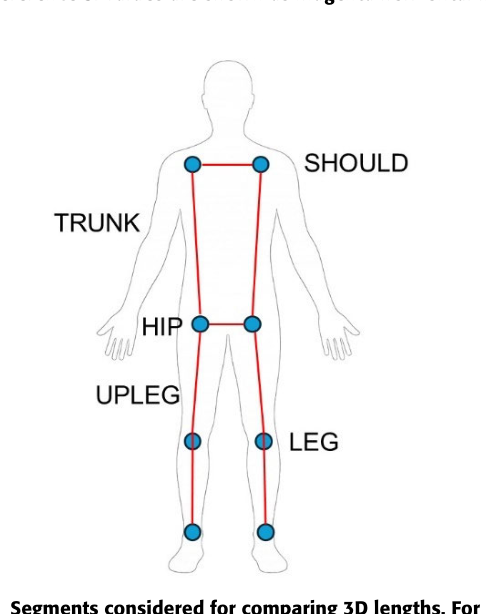

*the TRUNK, UPLEG, and LEG segments are shown for only one side of the body, although they were computed for both sides.*

A primary finding from the analysis (Table 10) is that all 3D markerless models consistently underestimated segment

**TABLE 10. Segment lengths for OPTO and 3D markerless models.**

|  |  | Mean ± SD | MeanDIFF | Mean |
| --- | --- | --- | --- | --- |
| Segment | Model | (m) | (m) | DIFF (%) |
|  | AnmA |  |  |  |

lengths and widths compared to the OPTO reference, with mean absolute differences ranging from 1.3 cm to 9.0 cm. The magnitude of this underestimation varied by segment.

Regarding shoulder width (SHOULD), all models provided a good approximation with minimal discrepancies

(|DIFF| < 1.7 cm). For hip width (HIP), KIN_3D showed a substantial underestimation (-6.9 cm), reflecting the AK-specific skeletal configuration where the hip joints are positioned closer together. In general, the MediaPipe models are significantly closer to OPTO regarding this segment (|DIFF|  \le  3.2 cm), with MP_1_3D being the best performer (|DIFF| = 1.9 cm).

Discrepancies in trunk length (LTRUNK and RTRUNK) were moderate. The 3D MediaPipe models generally outperformed KIN_3D in approximating the shoulder-to-hip distances. However, the low result for KIN_3D was attributable to the different locations of the hip joints. Finally, the lower limb segments (UPLEGs and LEGs) showed the most significant differences among all 3D models.

The analysis of bilateral segment SI (Fig. 11) revealed how well each model preserved left-right symmetry in its 3D reconstruction. KIN_3D preserved the best bilateral consistency, making it the most stable and symmetrical 3D model. In contrast, MP_2_3D exhibited the most pronounced asymmetries, particularly in the upper leg (UPLEGs), where the difference between the left and right sides was substantial. This finding supports the poor symmetry observed in the joint angle analysis.

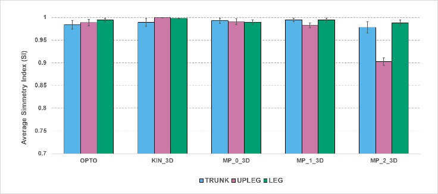

*FIGURE 11. Mean symmetry index (SI) of segment lengths for OPTO and 3D models.*

To determine whether the asymmetries in the 3D MediaPipe models originated from the 2D landmark tracking or the 3D reconstruction process, we analyzed the segment lengths in 2D image coordinates (Table 11) expressed in pixels and the symmetry index for bilateral segments (Fig. 12).

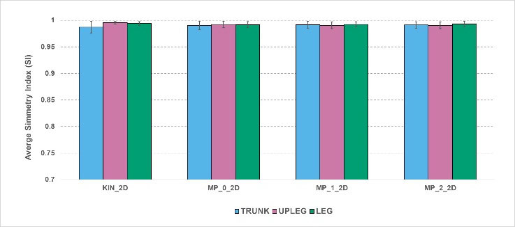

*FIGURE 12. Mean symmetry index (SI) of segment lengths for 2D models.*

**TABLE 11. Segment lengths for 2D markerless models.**

|  | KIN 2D | MP02D | MP12D | MP22D |
| --- | --- | --- | --- | --- |
| Segment | Mean±SD | Mean±SD | Mean±SD | Mean±SD |
|  | (xd) | (xd) | (xd) | (xd) |

|  | (px) | (px) | (px) | (px) |
| --- | --- | --- | --- | --- |
| SHOULD | 54.5±4.2 | 59.3±4.5 | 58.6±4.8 | 57.9±4.8 |
| HIP | 28.7±2.2 | 33.0±2.7 | 34.7±3.1 | 34.5±2.8 |
| RTRUNK | 78.0±6.3 | 83.4±7.6 | 83.8±7.5 | 81.9±7.6 |
| LTRUNK | 76.4±6.0 | 83.8±8.3 | 84.0±7.9 | 82.0±8.1 |
| RUPLEG | 64.8±5.2 | 69.9±5.4 | 69.0±5.2 | 69.7±5.2 |
| LUPLEG | 64.4±5.0 | 69.3±5.4 | 68.3±5.3 | 69.2±6.0 |
| RLEG | 121.1±8.8 | 133.7±9.1 | 131.6±9.2 | 133.8±9.5 |
| LLEG | 119.7±8.8 | 131.7±9.4 | 130.1±9.5 | 132.6±10.2 |

The 2D analysis provided a critical insight: all 2D models, including all MediaPipe variants, maintain exceptionally high bilateral symmetry (SI>0.99), as illustrated in Fig. 11. This is the key finding: the asymmetries observed in highercomplexity 3D MediaPipe models (particularly MP_1_3D and MP_2_3D) do not originate from 2D tracking. The underlying 2D landmark detection was stable and symmetric. Errors were effectively introduced during the uplift process. Additionally, we observed high consistency in pixel-based segment lengths (differences within fractions of a pixel)

among the three MediaPipe models (Table 11), indicating that 2D tracking performance is not significantly affected by model complexity. Thus, we can conclude that using higher-complexity models, which come at the cost of processing speed, is likely unnecessary for achieving accurate 2D tracking.

The systematic underestimation of segment lengths confirms that 3D markerless skeletal models are functional approximations of anatomical structures, and are not precise biomechanical replicas. This supports the main intent of these markerless models: their use as alternative and low-cost tracking options in unsupervised and remote clinical applications rather than as substitutes for gold-standard systems. Most importantly, the discovery that 3D asymmetries in high-complexity MediaPipe 3D models arise from 3D reconstructions has significant implications. This suggests that 2D tracking is robust, whereas the 3D reconstruction from a frontal view is critical.

IV. LIMITS OF MEDIAPIPE 3D MODELS Our analysis revealed critical issues in 3D MediaPipe models, with progressive degradation in performance as model complexity increased. This trend negatively impacted both angular measurements and the preservation of bilateral symmetry.

While a previous study reported issues with 3D models under highly dynamic conditions [65] without associating them with a specific model configuration, our results demonstrate not only that these critical flaws also manifest in a less challenging static standing task but also that they depend on model complexity. In addition, as proved by our segment length analysis, these errors stem from the 3D reconstruction process rather than from 2D tracking. This uplifting process in the MP relies on the GHUM body model [62], a statistical human body representation trained on a large corpus of 3D body scans to capture plausible poses. The model attempts to fit 2D joints to the most probable 3D pose. However, because multiple 3D poses can correspond to the same 2D representation, in the case of depth ambiguities or occlusions, 3D reconstruction is under constrained. Consequently, even small frame-to-frame variations or jitters in 2D key points may propagate and amplify into unrealistic 3D deformations.

To illustrate these criticisms visually, we rendered 3D skeletal reconstructions from the same video frame for all the

MP models. The frontal, lateral, and top views presented in Fig. 13 confirm the evident model degradation as complexity increases.

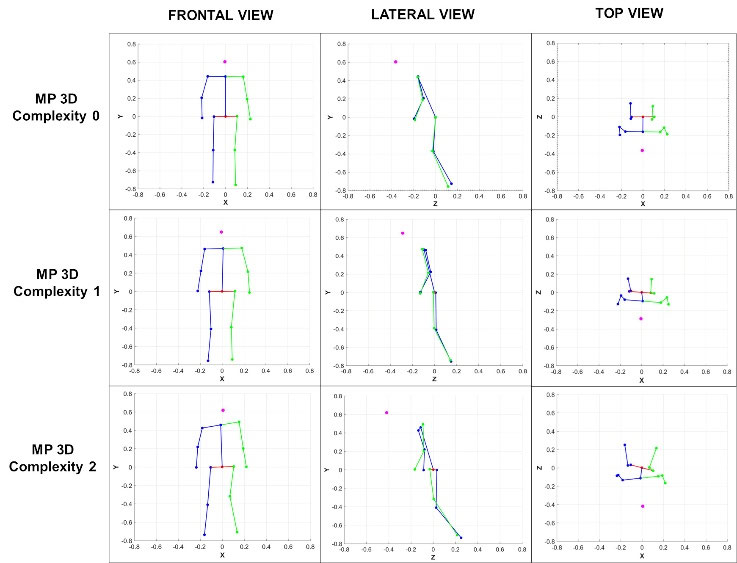

*FIGURE 13. Frontal, lateral, and top views of 3D skeletal reconstructions for the three MP model complexities.*

The frontal view shows a progressive misalignment and asymmetry. The MP_2_3D model exhibited an evident horizontal misalignment of the shoulders and lateral tilt of the trunk, confirming the quantitative angular results. Furthermore, the anomalous position of the left knee landmark is a clear source of the observed linear and angular asymmetries.

Although MP_0_3D and MP_1_3D appear similar in the lateral view, MP_2_3D shows anomalous positioning at the hip and a poor alignment of the bilateral segments. In addition, the head is positioned much farther forward, suggesting a significant error in the Z-component estimation.

The top-view perspective provides the most compelling evidence of failure. Although MP_0_3D was consistent and aligned, MP_2_3D was severely distorted, showing two pronounced and opposing rotations of the upper and lower body. Moreover, the landmarks were more scattered along the Z-axis than in the other models, creating a flattened reconstruction rather than a stable upright stance.

This visual evidence confirms the quantitative findings. This demonstrates that, in its current state, the highcomplexity MP_2_3D model introduces severe distortions during the 3D reconstruction phase, which makes it unsuitable for quantitative postural assessment.

V. DISCUSSION Postural assessment is essential for the diagnosis and monitoring of diverse healthcare applications. Marker-based optical motion capture systems are the gold standard for movement analysis but are impractical for extensive use in clinical practice because of their high costs, operational complexity, and laboratory requirements. In addition, in clinical and sports scenarios, professionals often face constraints such as limited time, limited economic resources, and the need

for rapid evaluations. These common conditions have driven interest in markerless alternatives for telemedicine and unsupervised use.

RGB-D sensors, such as Microsoft Kinect, have demonstrated good accuracy in movement and postural analyses compared to gold-standard systems. In [25], the authors validated the Kinect V1 for postural control tasks and reported high correlations (r > 0.90) for most measurements. In [26], the authors reported an ICC > 0.90 for many AK joint trajectories in postural tasks. In [28], postural measures were input into machine learning models, achieving consistent classification (90% accuracy) with clinical scores. The authors in [31] and [66] obtained a high level of agreement (accuracy > 90%) in assessing gait profiles from the parameters estimated using AK. High agreements and correlations were also reported in [56] and [67] for most spatio-temporal parameters. However, the rapid discontinuation of RGB-D sensors and the computational demands have hindered their widespread use. Although workarounds exist, such as interchangeability [68] or compatibility of other RGB-D cameras with AK body tracking SDK (e.g., Orbbec FEMTO), device-dependent solutions remain impractical because of continuous updates to integrate hardware and software changes. This factor reinforces the potential of using RGB-only markerless models. Google MediaPipe Pose (MP) is a promising next-generation alternative that enables real-time body tracking from standard RGB video streams with minimal computational overhead and no need for specialized hardware, making it well-suited for telemedicine.

However, the potential of the MP for 3D postural assessment remains to be explored. Previous studies have focused mainly on 2D applications, overlooking the availability of 3D skeletal models, which could provide more precise cameraindependent measurements.

This study addressed this gap by systematically evaluating the accuracy, reliability, and symmetry of 2.5D and 3D MP models, benchmarking them against a marker-based gold standard and Microsoft Azure Kinect, a leading RGB-D solution in the medical context.

A. FRONTAL PLANE ANALYSIS Our analysis of frontal plane alignment (horizontal and vertical angles) revealed a clear performance hierarchy among markerless approaches. The KIN_3D model remained superior in terms of precision and reliability, with mean absolute errors for horizontal angles consistently below 1.5◦. This level of performance approaches the accuracy required to detect clinically meaningful postural changes, which are often within the 2-5 degrees range in many clinical applications [69].

Surprisingly, the 2D models provided competitive performance for the same measurements. This finding challenges the common assumption that 3D reconstruction is inherently superior for frontal plane measurements, suggesting that, for many applications focused on horizontal and vertical alignment, the added computational overhead and hardware requirements of 3D models may be unnecessary.

A key and counterintuitive finding emerged from 3D MediaPipe models. The performance for the horizontal angles systematically degraded as the model complexity increased. Although the low-complexity MP_0_3D model proved to be a viable alternative, the high-complexity model was consistently the least accurate. This suggests that more sophisticated models can paradoxically introduce artifacts that corrupt skeletal 3D reconstruction rather than improving it.

Furthermore, the vertical angle analysis confirmed good performance for the trunk and lower limb segments. However, it exposed a systematic discrepancy common to all markerless models, except for KIN_3D: a consistent bias in measuring lateral head bending. This error likely stems from fundamental differences in the definition of anatomical points, i.e., the physical placement of the head marker (OPTO) and estimated head centroid (AK and MP). This issue was exacerbated in the MP_1_3D and MP_2_3D models, making them unsuitable for applications requiring accurate evaluation of head position.

B. SAGITTAL PLANE ANALYSIS The measurement of sagittal angles posed the greatest challenge for all markerless models, which uniformly exhibited substantial systematic bias against the OPTO reference. However, a critical finding was that these errors were not random. The close correspondence between the mean absolute error and systematic bias indicated a high degree of measurement consistency, suggesting that the errors are predictable and, therefore, correctable.

The source of this systematic bias differed according to technology. The KIN_3D model exhibited coherent offsets that likely reflect differences in the underlying biomechanical model definition. In contrast, the larger errors of the 3D MediaPipe models, especially for the head and ankle segments, could be attributed to the inherent difficulty of estimating a reliable Z component (head) from a monocular RGB source and to the excessive displacement of the 3D head landmark. The highly uniform errors of the 2D models could be a direct consequence of geometric projection effects.

The stable and systematic nature of these errors across all the models presents a clear opportunity. Simple perparameter, constant-offset calibration (e.g., subtracting the mean offset) can effectively mitigate these biases. This correction could significantly improve agreement with the gold standard, making these models viable for sagittal plane assessment in clinical applications.

C. JOINT ANGLES ANALYSIS The analysis of joint angles highlighted the significant impact of anatomical point definitions on the measurement outcomes. Our findings confirm that direct comparisons of absolute joint angles between marker-based and markerless models are misleading because of the inherent differences in how skeletal models are constructed. Consequently, the

decision to include bilateral symmetry analysis proved essential to investigate whether a model can reliably detect left-right asymmetries.

The 3D models effectively preserved bilateral symmetry, supporting their use in clinical assessments. KIN_3D and MP_0_3D emerged as the top performers, demonstrating robust symmetry preservation, which makes them reliable for comparing left-right measurements. Conversely, the MP_2_3D model exhibited the lowest performance, introducing significant artificial asymmetries, particularly at the hip and knee. This confirms its unsuitability for applications in which bilateral analysis is necessary.

The geometric limitations of the 2D models were clearly revealed in the knee angle assessment from a frontal view. However, their strong performance for shoulder and hip angles underscores an important element: the utility of a model is often task- and context-dependent. For clinical use, 2D models are a viable and practical tool for the frontal-plane analysis of shoulder and hip angles. For a meaningful assessment of knee flexion, a lateral camera view of the 2D models is essential.

D. SEGMENT LENGTHS ANALYSIS The analysis of segment lengths provided the fundamental context for all previous findings, revealing intrinsic differences between skeletal models. The primary confirmation is that markerless skeletons are functional approximations rather than precise biomechanical replicas. This was evidenced by the systematic underestimation of the 3D segment lengths across all models compared with the OPTO system.

While most 3D models maintained good left-right symmetry, MP_2_3D again emerged bacause of its pronounced bilateral asymmetries in the lower limbs, corroborating the angular findings. The investigation of 2D model segment lengths and symmetries provided an explanation for this failure. The key finding of this analysis is that the asymmetries in the high-complexity MediaPipe models do not originate from 2D landmark tracking but are introduced during the 2Dto-3D lifting procedure. Moreover, this process degrades with increasing complexity of the model. This insight is crucial for understanding the current limitations of monocular learningbased 3D pose estimation.

E. OVERALL MODEL PERFORMANCE Our findings reveal a clear trade-off between the high precision of depth-sensing hardware and broad accessibility of RGB-only models. Fig. 14 summarizes the main recommendations for using these models in postural assessment from frontal view recordings. A green checksymbol indicates that the model is adequate for a specific angle category; a yellow attentionsymbol indicates that the model is usable with caution, as it may require specific adjustments to improve measurement performance; and a red cross symbol indicates that the model is not recommended for the angle category because of significant or irresolvable issues.

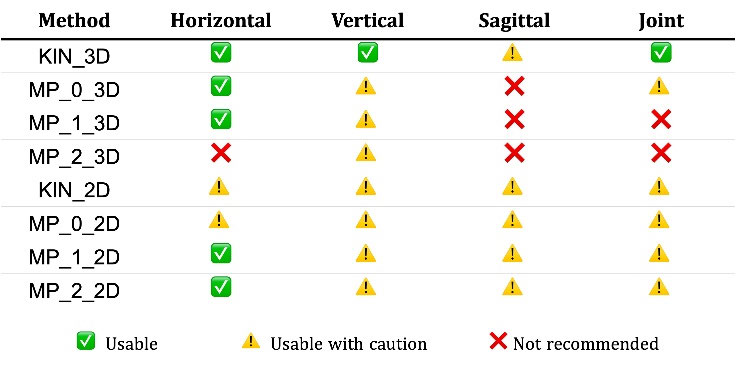

*FIGURE 14. Visual summary of recommendations for each model and angle category.*

The KIN_3D model consistently provided the most accurate and reliable performance. The integrated depth estimation resulted in superior 3D reconstructions, characterized by high accuracy and robust preservation of bilateral symmetry. For sagittal measurements, a calibration procedure is necessary to remove the predictable systematic bias and improve agreement with the OPTO systems (attention symbol). Nonetheless, it was confirmed to be the most reliable markerless solution.

The 3D MediaPipe models exhibited high performance variability in the tested version of the framework (v0.10.24). The utility for vertical angles is mainly limited by significant errors in head tilt estimation, although trunk and ankle angles are reliable (attention symbol). For sagittal angles (cross symbols), all models showed critical flaws and errors that often increased with model complexity; for this category, a lateral view would be more appropriate. More specifically, the low-complexity MP_0_3D emerged as a viable, although less precise, alternative to KIN_3D for most angular measurements, with some segment-specific limitations (attention symbols). The MP_1_3D model showed intermediate performance, with good precision in some cases, but degraded performance in others, including horizontal angles. Critically, the high-complexity MP_2_3D consistently showed the poorest results, with significant biases and failures in symmetry preservation, with the assignment of red crosssymbol for all angle categories. This counterintuitive result highlights the fundamental limitations of current 3D reconstruction from a single 2D perspective. We recommend using 3D MediaPipe models with caution, considering specific goals and tasks, and avoiding higher-complexity versions.

A key insight from this study is the excellent, consistent, and highly similar performance of all 2D models. For frontal plane analysis, they provided an optimal balance of accuracy and reliability, gaining a usability symbol for the horizontal angle and a warning symbol for vertical angles (due to the head bias). For sagittal angles, a per-segment calibration could significantly improve performance (attention symbol). The primary limitation of joint angle estimation is the inability to assess knee flexion from a frontal view, as expected. A lateral perspective is optimal for more accurate measurements. Overall, 2D models offer advantages

such as simplicity and lightweight deployments, making them a convenient and effective choice for many front-view applications.

F. STUDY LIMITATIONS Despite these valuable insights, several limitations should be considered. First, the exclusive focus on healthy participants. This was a deliberate choice for investigating the baseline performance and inherent challenges of markerless models without confounding factors related to pathological postural

alterations. However, this choice restricts the generalizability of our findings to clinical populations, where postural abnormalities and movement artifacts could affect the models differently.

Moreover, this study only focused only on static standing tasks. However, as the analysis is not based on isolated frames but on 25-second segments of 40-second continuous recordings, it captures the natural postural sway and micro-adjustments, exploring MP performance in quasistatic, low-dynamic contexts. Nevertheless, the performance of markerless models can differ significantly in highly dynamic tasks, such as walking or balancing, which present additional challenges related to motion blurring and partial occlusions that could interfere with the stability and temporal consistency of skeleton reconstruction.

Our findings were then derived from recordings from a single camera, frontal-view perspective, and controlled laboratory conditions, which are relevant setup constraints. Performance and tracking robustness may be affected by other environmental and external factors (different camera perspectives, extreme lighting conditions, variable backgrounds, and occlusions), typical of in-the-wild scenarios, that were not explored in this study.

In addition, asynchronous recordings with OPTO and AK, to avoid interference between systems, prevented direct correlation analyses with the gold standard. Although we assumed that posture measures remained stable in healthy subjects across short time intervals, this hypothesis could introduce minor variability in our findings.

Finally, the results are inherently related to the specific software versions considered (v1.1.0 for AK, v0.10.24 for MP), providing a relevant snapshot of only these releases.

Further studies are therefore necessary to validate the results in clinical populations with postural alterations and dynamic tasks to evaluate the robustness and accuracy of markerless models in more challenging conditions.

G. IMPROVEMENT STRATEGIES AND FUTURE DIRECTIONS The continuous evolution of artificial intelligence, highperformance technologies, and the growth of complex, multimodal datasets are expected to rapidly improve RGB-only markerless models and address the critical issues identified in this study. However, several strategies can enhance the performance of the current models.

Multi-camera solutions can yield more robust 3D reconstructions by fusing body skeletons acquired simultaneously from multiple views (e.g., frontal and lateral), as investigated in recent studies [70], [71]. The advantage of this method is the immediate estimation of clinically relevant measurements related to frontal (e.g., lateral trunk flexion) and sagittal (e.g., camptocormia) abnormalities. The main drawbacks of multi-camera setups are hardware complexity, procedures for camera synchronization and calibration, and multi-view fusion techniques. The same improvements could be obtained through multi-sensor fusion, for example, integrating the computational efficiency of MP on RGB with the robustness of depth estimation from depth sensors, as in [72], albeit at the cost of integrating additional sensors.

To improve the agreement with gold-standard systems, adaptive calibration algorithms can be implemented to resolve the systematic biases we observed in the current models. This strategy could significantly enhance overall accuracy and direct clinical applicability. Further clinical boost could come from AI-based and Explainable AI (XAI) models to support the early identification and classification of different postural abnormalities, ensuring rapid corrective intervention and clinical interpretability [73], [74]. However, this approach requires large, well-annotated datasets of images, parameters, and data to be efficiently implemented.

Looking at future research, more substantial improvements may be achieved through innovative architectures that incorporate and leverage the potential synergy of multi-modality (e.g., thermal cameras, IR cameras, event cameras) [75] and additional biomechanical constraints [76]. Recent studies have explored emerging methodologies, such as AI-FEM co-modeling [77] to generate more anatomically plausible 3D reconstructions, and hybrid approaches based on Inverse Kinematics and Proportional Derivative [78], [79] to integrate an external refinement step and enforce dynamic consistency over time.

Finally, our study highlighted a strategic dilemma for clinical applications: should we continue to rely on more accurate but unstable (on the market) RGB-D devices, or invest time and resources in highly accessible RGB-only models that are not yet mature? This is a non-trivial question, but it opens two parallel development paths: 1) hardware-independent research, to continue improving 3D RGB-only models until they will overperform RGB-D sensors for many clinical tasks; 2) hardware-specific research, to boost the development of stable medical-grade RGB-D sensors, decoupling clinical tools and applications from the volatility of the consumer market. Although these two paths appear divergent, their progression is likely to lead to future convergence, thus opening new research scenarios and expanding opportunities for the advancement of knowledge.

VI. CONCLUSION This comprehensive evaluation demonstrates that while no current markerless model can fully replicate the precision of a marker-based gold standard, several are clinically viable alternatives when their strengths and weaknesses are appropriately matched to the application.

The KIN_3D model remains the most robust markerless solution for comprehensive and high-precision 3D postural assessments. The current 3D MediaPipe models must be used with caution. The low-complexity MP_0_3D offers a reasonable compromise, whereas increasing the model complexity does not guarantee a better performance. This study demonstrated that measurement biases can be identified and potentially corrected through simple per-segment or per-model calibrations or through a lateral perspective to enhance their clinical utility. 2D models, including those from MediaPipe, proved to be effective and reliable alternatives for frontal plane analysis, offering an optimal balance of accuracy and simplicity for applications such as large-scale monitoring or telemedicine. The analysis in the frontal plane provides important clinical insights into body segment misalignment related to various musculoskeletal disorders, such as scoliotic attitudes, dysmetria, valgus or varus deformities, and abnormal body support, which are often associated with pain.

While it is necessary to build upon these findings, implement improvement strategies, and address the limitations discussed, this study can guide clinicians in matching the most suitable markerless model to the correct posture assessment application. It provides a strong evidence-based foundation for obtaining reliable and objective measurements, paving the way for the future validation in pathological populations.

ACKNOWLEDGMENT Generative AI tools (Google Gemini) were used to assist with grammar, language, and style editing. The scientific content, analysis, figures, and conclusions presented herein are the original work of the authors and were developed without the use of such tools.

## REFERENCES

[1] Y. Ivanenko and V. S. Gurfinkel, ‘‘Human postural control,’’ Frontiers

Neurosci., vol. 12, p. 171, Mar. 2018. [2] O. Alizadehkhaiyat, M. M. Roebuck, A. T. Makki, and S. P. Frostick, ‘‘Pos-

tural alterations in patients with subacromial impingement syndrome,’’ Int. J. Sports Phys. Therapy, vol. 12, no. 7, pp. 1111–1120, Dec. 2017. [3] B. Debû, C. D. O. Godeiro, J. C. Lino, and E. Moro, ‘‘Managing gait,

balance, and posture in Parkinson’s disease,’’ Current Neurol. Neurosci. Rep., vol. 18, no. 5, p. 23, Apr. 2018. [4] J. Barra, L. Oujamaa, V. Chauvineau, P. Rougier, and D. Pérennou,

[9] J. L. P. do Rosário, ‘‘Photographic analysis of human posture: A literature

review,’’ J. Bodywork Movement Therapies, vol. 18, no. 1, pp. 56–61, Jan. 2014. [10] D. Singla, Z. Veqar, and M. E. Hussain, ‘‘Photogrammetric assessment

of upper body posture using postural angles: A literature review,’’ J. Chiropractic Med., vol. 16, no. 2, pp. 131–138, Jun. 2017. [11] C. Fortin, D. E. Feldman, F. Cheriet, and H. Labelle, ‘‘Clinical methods

for quantifying body segment posture: A literature review,’’ Disability Rehabil., vol. 33, no. 5, pp. 367–383, Jul. 2011. [12] T. S. Furlanetto, J. A. Sedrez, C. T. Candotti, and J. F. Loss, ‘‘Photogram-

metry as a tool for the postural evaluation of the spine: A systematic review,’’ World J. Orthopedics, vol. 7, no. 2, pp. 136–148, Feb. 2016. [13] C. A. Artusi, C. Geroin, G. Imbalzano, S. Camozzi, S. Aldegheri,

L. Lopiano, M. Tinazzi, and N. Bombieri, ‘‘Assessment of axial postural abnormalities in parkinsonism: Automatic picture analysis software,’’ Movement Disorders Clin. Pract., vol. 10, no. 4, pp. 636–645, Feb. 2023. [14] A. B. Porto and V. H. A. Okazaki, ‘‘Thoracic kyphosis and lumbar lordosis

assessment by radiography and photogrammetry: A review of normative values and reliability,’’ J. Manipulative Physiolog. Therapeutics, vol. 41, no. 8, pp. 712–723, Oct. 2018. [15] L. R. Pivotto, I. J. R. L. Navarro, and C. T. Candotti, ‘‘Radiography and

photogrammetry-based methods of assessing cervical spine posture in the sagittal plane: A systematic review with meta-analysis,’’ Gait Posture, vol. 84, pp. 357–367, Feb. 2021. [16] A. B. Porto and V. H. A. Okazaki, ‘‘Procedures of assessment on the

quantification of thoracic kyphosis and lumbar lordosis by radiography and photogrammetry: A literature review,’’ J. Bodywork Movement Therapies, vol. 21, no. 4, pp. 986–994, Oct. 2017. [17] J. L. P. D. Rosário, ‘‘Biomechanical assessment of human posture: A

literature review,’’ J. Bodywork Movement Therapies, vol. 18, no. 3, pp. 368–373, Jul. 2014. [18] R. Don, P. Capodaglio, V. Cimolin, M. G. Benedetti, F. D’Osualdo,

C. Frigo, L. Vismara, and S. Négrini, ‘‘Instrumental measures of spinal function: Is it worth? A state-of—The art from a clinical perspective,’’ Eur. J. Phys. Rehabil. Med., vol. 48, no. 2, pp. 255–273, Jun. 2012. [19] S. Schmid, D. Studer, C.-C. Hasler, J. Romkes, W. R. Taylor, R. Brunner,

and S. Lorenzetti, ‘‘Using skin markers for spinal curvature quantification in main thoracic adolescent idiopathic scoliosis: An explorative radiographic study,’’ PLoS ONE, vol. 10, no. 8, pp. 1–12, Aug. 2015. [20] F. Roggio, S. Ravalli, G. Maugeri, A. Bianco, A. Palma, M. Di Rosa,

and G. Musumeci, ‘‘Technological advancements in the analysis of human motion and posture management through digital devices,’’ World J. Orthopedics, vol. 12, no. 7, pp. 467–484, Jul. 2021. [21] R. Moreira, A. Teles, R. Fialho, R. Baluz, T. C. Santos, R. Goulart-Filho,

L. Rocha, F. J. Silva, N. Gupta, V. H. Bastos, and S. Teixeira, ‘‘Mobile applications for assessing human posture: A systematic literature review,’’ Electronics, vol. 9, no. 8, p. 1196, Jul. 2020. [22] L. Simpson, M. M. Maharaj, and R. J. Mobbs, ‘‘The role of wearables

in spinal posture analysis: A systematic review,’’ BMC Musculoskeletal Disorders, vol. 20, no. 1, p. 55, Feb. 2019. [23] E. Papi, W. S. Koh, and A. H. McGregor, ‘‘Wearable technology for spine

movement assessment: A systematic review,’’ J. Biomechanics, vol. 64, pp. 186–197, Nov. 2017. [24] R. Moreira, R. Fialho, A. S. Teles, V. Bordalo, S. S. Vasconcelos,

G. P. D. M. Gouveia, V. H. Bastos, and S. Teixeira, ‘‘A computer visionbased mobile tool for assessing human posture: A validation study,’’ Comput. Methods Programs Biomed., vol. 214, Feb. 2022, Art. no. 106565. [25] R. A. Clark, Y.-H. Pua, K. Fortin, C. Ritchie, K. E. Webster, L. Denehy, and

A. L. Bryant, ‘‘Validity of the Microsoft Kinect for assessment of postural control,’’ Gait Posture, vol. 36, no. 3, pp. 372–377, Jul. 2012. [26] M. Antico, N. Balletti, G. Laudato, A. Lazich, M. Notarantonio, R. Oliveto,

S. Ricciardi, S. Scalabrino, and J. Simeone, ‘‘Postural control assessment via Microsoft Azure Kinect DK: An evaluation study,’’ Comput. Methods Programs Biomed., vol. 209, Sep. 2021, Art. no. 106324. [27] E. Hannink, T. Shannon, K. L. Barker, and H. Dawes, ‘‘The reliability

and reproducibility of sagittal spinal curvature measurement using the Microsoft Kinect V2,’’ J. Back Musculoskeletal Rehabil., vol. 33, no. 2, pp. 295–301, Mar. 2020. [28] Z. Zhang, R. Hong, A. Lin, X. Su, Y. Jin, Y. Gao, K. Peng, Y. Li, T. Zhang,

H. Zhi, Q. Guan, and L. Jin, ‘‘Automated and accurate assessment for postural abnormalities in patients with Parkinson’s disease based on Kinect and machine learning,’’ J. NeuroEng. Rehabil., vol. 18, no. 1, p. 169, Dec. 2021.

[29] C. Ferraris, ‘‘At-home assessment of postural stability in Parkinson’s dis-

ease: A vision-based approach,’’ J. Ambient Intell. Humanized Comput., vol. 15, no. 5, pp. 2765–2778, 2024. [30] C. A. Artusi, C. Geroin, C. Pandino, S. Camozzi, S. Aldegheri, L. Lopiano,

M. Tinazzi, and N. Bombieri, ‘‘Dynamic video assessment of axial postural abnormalities in Parkinson’s disease: A pilot study,’’ Movement Disorders Clin. Pract., vol. 12, no. 5, pp. 626–637, May 2025. [31] C. Ferraris, G. Amprimo, S. Cerfoglio, G. Masi, L. Vismara, and

V. Cimolin, ‘‘Machine-learning-based validation of Microsoft Azure Kinect in measuring gait profiles,’’ Electronics, vol. 13, no. 23, p. 4739, Nov. 2024. [32] J. Wang, S. Tan, X. Zhen, S. Xu, F. Zheng, Z. He, and L. Shao, ‘‘Deep

3D human pose estimation: A review,’’ Comput. Vis. Image Understand., vol. 210, Sep. 2021, Art. no. 103225. [33] A. Avogaro, F. Cunico, B. Rosenhahn, and F. Setti, ‘‘Markerless human

pose estimation for biomedical applications: A survey,’’ Frontiers Comput. Sci., vol. 5, Jul. 2023, Art. no. 1153160. [34] A. Badiola-Bengoa and A. Mendez-Zorrilla, ‘‘A systematic review of the

application of camera-based human pose estimation in the field of sport and physical exercise,’’ Sensors, vol. 21, no. 18, p. 5996, Sep. 2021. [35] G. Amprimo, G. Masi, G. Olmo, and C. Ferraris, ‘‘Deep learning for hand

tracking in Parkinson’s disease video-based assessment: Current and future perspectives,’’ Artif. Intell. Med., vol. 154, Aug. 2024, Art. no. 102914. [36] P. M. Pecoraro, L. Marsili, A. J. Espay, M. Bologna, and L. di Biase,

‘‘Computer vision technologies in movement disorders: A systematic review,’’ Movement Disorders Clin. Pract., vol. 12, no. 9, pp. 1229–1243, May 2025. [37] F. Roggio, B. Trovato, M. Sortino, and G. Musumeci, ‘‘A comprehensive

analysis of the machine learning pose estimation models used in human movement and posture analyses: A narrative review,’’ Heliyon, vol. 10, no. 21, Nov. 2024, Art. no. e39977. [38] N. R. Fisal, A. Fathalla, D. A. Elmanakhly, and A. Salah, ‘‘Reported

challenges in deep learning-based human pose estimation: A systematic review,’’ IEEE Access, vol. 13, pp. 80520–80539, 2025. [39] C. Lugaresi, ‘‘MediaPipe: A framework for building perception pipelines,’’

2019, arXiv:1906.08172. [40] Z. Cao, G. Hidalgo, T. Simon, S.-E. Wei, and Y. Sheikh, ‘‘OpenPose:

Realtime multi-person 2D pose estimation using part affinity fields,’’ IEEE Trans. Pattern Anal. Mach. Intell., vol. 43, no. 1, pp. 172–186, Jan. 2021. [41] T. B. D. G. Lafayette, V. H. D. L. Kunst, P. V. D. S. Melo,

P. D. O. Guedes, J. M. X. N. Teixeira, C. R. D. Vasconcelos, V. Teichrieb, and A. E. F. da Gama, ‘‘Validation of angle estimation based on body tracking data from RGB-D and RGB cameras for biomechanical assessment,’’ Sensors, vol. 23, no. 1, p. 3, Dec. 2022. [42] B. Lagomarsino, A. Massone, F. Odone, M. Casadio, and M. Moro,

‘‘Video-based markerless assessment of bilateral upper limb motor activity following cervical spinal cord injury,’’ Comput. Biol. Med., vol. 196, Sep. 2025, Art. no. 110908. [43] C. S. T. Hii, K. B. Gan, N. Zainal, N. M. Ibrahim, S. Azmin, S. H. M. Desa,

B. van de Warrenburg, and H. W. You, ‘‘Automated gait analysis based on a marker-free pose estimation model,’’ Sensors, vol. 23, no. 14, p. 6489, Jul. 2023. [44] D. Menychtas, N. Petrou, I. Kansizoglou, E. Giannakou, A. Grekidis,

A. Gasteratos, V. Gourgoulis, E. Douda, I. Smilios, M. Michalopoulou, G. C. Sirakoulis, and N. Aggelousis, ‘‘Gait analysis comparison between manual marking, 2D pose estimation algorithms, and 3D marker-based system,’’ Frontiers Rehabil. Sci., vol. 4, Sep. 2023, Art. no. 1238134. [45] F. Roggio, S. Di Grande, S. Cavalieri, D. Falla, and G. Musumeci,

‘‘Biomechanical posture analysis in healthy adults with machine learning: Applicability and reliability,’’ Sensors, vol. 24, no. 9, p. 2929, May 2024. [46] G. F. Ananda, D. S. Putra, and Fahmi, ‘‘Contactless infant height mea-

surement for enhanced early detection of stunting using computer vision techniques,’’ IEEE Access, vol. 13, pp. 42364–42376, 2025. [47] S. Dill, A. Ahmadi, M. Grimmer, D. Haufe, M. Rohr, Y. Zhao, M. Sharbafi,

and C. H. Antink, ‘‘Accuracy evaluation of 3D pose reconstruction algorithms through stereo camera information fusion for physical exercises with MediaPipe pose,’’ Sensors, vol. 24, no. 23, p. 7772, Dec. 2024. [48] C. Ferraris, I. Ronga, R. Pratola, G. Coppo, T. Bosso, S. Falco,

G. Amprimo, G. Pettiti, S. Lo Priore, L. Priano, A. Mauro, and D. Desideri, ‘‘Usability of the REHOME solution for the telerehabilitation in neurological diseases: Preliminary results on motor and cognitive platforms,’’ Sensors, vol. 22, no. 23, p. 9467, Dec. 2022.

[49] G. Amprimo, ‘‘Assessment tasks and virtual exergames for remote mon-

itoring of Parkinson’s disease: An integrated approach based on Azure Kinect,’’ Sensors, vol. 22, no. 21, p. 8173, Oct. 2022. [50] S. Cerfoglio, C. Ferraris, L. Vismara, G. Amprimo, L. Priano, G. Pettiti,

M. Galli, A. Mauro, and V. Cimolin, ‘‘Kinect-based assessment of lower limbs during gait in post-stroke hemiplegic patients: A narrative review,’’ Sensors, vol. 22, no. 13, p. 4910, Jun. 2022. [51] G. Kurillo, E. Hemingway, M.-L. Cheng, and L. Cheng, ‘‘Evaluating the

accuracy of the Azure Kinect and Kinect v2,’’ Sensors, vol. 22, no. 7, p. 2469, Mar. 2022. [52] M. Tölgyessy, M. Dekan, Ł. Chovanec, and P. Hubinský, ‘‘Evaluation of the

Azure Kinect and its comparison to Kinect V1 and Kinect V2,’’ Sensors, vol. 21, no. 2, p. 413, Jan. 2021. [53] M. Servi, A. Profili, R. Furferi, and Y. Volpe, ‘‘Comparative evalu-

ation of Intel RealSense D415, D435i, D455, and Microsoft Azure Kinect DK sensors for 3D vision applications,’’ IEEE Access, vol. 12, pp. 111311–111321, 2024. [54] M. Tölgyessy, M. Dekan, and Ł. Chovanec, ‘‘Skeleton tracking accuracy

and precision evaluation of Kinect v1, Kinect v2, and the Azure Kinect,’’ Appl. Sci., vol. 11, no. 12, p. 5756, Jun. 2021. [55] J. Bertram, T. Krüger, H. M. Röhling, A. Jelusic, S. Mansow-Model,

R. Schniepp, M. Wuehr, and K. Otte, ‘‘Accuracy and repeatability of the Microsoft Azure Kinect for clinical measurement of motor function,’’ PLoS ONE, vol. 18, no. 1, Jan. 2023, Art. no. e0279697. [56] J. A. Albert, V. Owolabi, A. Gebel, C. M. Brahms, U. Granacher, and

B. Arnrich, ‘‘Evaluation of the pose tracking performance of the Azure Kinect and Kinect v2 for gait analysis in comparison with a gold standard: A pilot study,’’ Sensors, vol. 20, no. 18, p. 5104, Sep. 2020. [57] S. Jo, S. Song, J. Kim, and C. Song, ‘‘Agreement between Azure Kinect and marker-based motion analysis during functional movements: A feasibility study,’’ Sensors, vol. 22, no. 24, p. 9819, Dec. 2022. [58] S. Zaccardi, R. Brahimetaj, E. Rodriguez, S. V. D. Bergh, M. Ibrahim,

E. Swinnen, D. Beckwée, and B. Jansen, ‘‘Impact of infrared interference on Azure Kinect’s motion tracking performance during validation studies against marker-based gold standard,’’ Gait Posture, vol. 113, pp. 262–263, Sep. 2024. [59] R. B. Davis, S. Õunpuu, D. Tyburski, and J. R. Gage, ‘‘A gait analysis data

collection and reduction technique,’’ Hum. Movement Sci., vol. 10, no. 5, pp. 575–587, Oct. 1991. [60] M. P. Kadaba, H. K. Ramakrishnan, and M. E. Wootten, ‘‘Measurement

of lower extremity kinematics during level walking,’’ J. Orthopaedic Res., vol. 8, no. 3, pp. 383–391, May 1990. [61] L. Yu, Y. Zhao, Q. Mao, K.-L. Tsui, M. Y. C. Pang, H. Guo, and

H. Wang, ‘‘A qualitative study exploring physiotherapists’ insights on the design and development of technology-enhanced gait and balance assessment systems for older adults,’’ Digit. HEALTH, vol. 11, Aug. 2025, Art. no. 20552076251365074. [62] MediaPipe Card. Accessed: Pose BlazePose GHUM 3D, Model Nov. 12, 2025. [Online]. Available: https://storage.googleapis.com/ mediapipe-assets/Model%20Card%20BlazePose%20GHUM%203D.pdf [63] M. D’Amico, E. Kinel, and P. Roncoletta, ‘‘Normative 3D opto-electronic

stereo-photogrammetric posture and spine morphology data in young healthy adult population,’’ PLoS ONE, vol. 12, no. 6, Jun. 2017, Art. no. e0179619. [64] A. F. M. Ribeiro, A. Bergmann, T. Lemos, A. G. Pacheco, M. M. Russo,

L. A. S. de Oliveira, and E. de Carvalho Rodrigues, ‘‘Reference values for human posture measurements based on computerized photogrammetry: A systematic review,’’ J. Manipulative Physiolog. Therapeutics, vol. 40, no. 3, pp. 156–168, Mar. 2017. [65] Y. Lin, X. Jiao, and L. Zhao, ‘‘Detection of 3D human posture based on

improved mediapipe,’’ J. Comput. Commun., vol. 11, no. 2, pp. 102–121, Feb. 2023. [66] S. Cerfoglio, C. Ferraris, L. Vismara, G. Amprimo, L. Priano, M. Bigoni,

M. Galli, A. Mauro, and V. Cimolin, ‘‘Estimation of gait parameters in healthy and hemiplegic individuals using Azure Kinect: A comparative study with the optoelectronic system,’’ Frontiers Bioeng. Biotechnol., vol. 12, Nov. 2024, Art. no. 1449680. [67] T. M. Guess, R. Bliss, J. B. Hall, and A. M. Kiselica, ‘‘Comparison

of Azure Kinect overground gait spatiotemporal parameters to marker based optical motion capture,’’ Gait Posture, vol. 96, pp. 130–136, Jul. 2022.

[68] A. D. C. A. Coroiu and A. Coroiu, ‘‘Interchangeability of Kinect

and orbbec sensors for gesture recognition,’’ in Proc. IEEE 14th Int. Conf. Intell. Comput. Commun. Process. (ICCP), Romania, Sep. 2018, pp. 309–315. [69] P. Slade, A. Habib, J. L. Hicks, and S. L. Delp, ‘‘An open-source and

wearable system for measuring 3D human motion in real-time,’’ IEEE Trans. Biomed. Eng., vol. 69, no. 2, pp. 678–688, Feb. 2022. [70] L. Russo, S. Sozzi, R. Soldi, B. M. V. Guerra, S. Ramat, and M. Schmid,

‘‘Optimization and fusion of Azure Kinect data for enhanced skeleton tracking,’’ in Proc. IEEE Med. Meas. Appl. (MeMeA), Chania, Greece, May 2025, pp. 1–6. [71] B. Horsak, M. Simonlehner, V. Quehenberger, B. Dumphart, P. Wegscheider, A. Kranzl, and D. Slijepcevic, ‘‘Validity and reliability of monocular 3D markerless gait analysis in simulated pathological gait: A comparative study with OpenCap,’’ J. Biomechanics, vol. 193, Dec. 2025, Art. no. 112986. [72] G. Amprimo, G. Masi, G. Pettiti, G. Olmo, L. Priano, and C. Ferraris,

‘‘Hand tracking for clinical applications: Validation of the Google MediaPipe hand (GMH) and the depth-enhanced GMH-D frameworks,’’ Biomed. Signal Process. Control, vol. 96, Oct. 2024, Art. no. 106508. [73] L. di Biase, P. M. Pecoraro, and F. Bugamelli, ‘‘AI video analysis in

Parkinson’s disease: A systematic review of the most accurate computer vision tools for diagnosis, symptom monitoring, and therapy management,’’ Sensors, vol. 25, no. 20, p. 6373, Oct. 2025. [74] R. U. Karim, S. Mahdi, A. Samin, A. N. Zereen, M. Abdullah-Al-Wadud,

and J. Uddin, ‘‘Optimizing stroke recognition with MediaPipe and machine learning: An explainable AI approach for facial landmark analysis,’’ IEEE Access, vol. 13, pp. 32636–32660, 2025. [75] G. Amprimo, A. Ancilotto, A. Savino, F. Quazzolo, C. Ferraris, G. Olmo,

E. Farella, and S. D. Carlo, ‘‘EHWGesture—A dataset for multimodal understanding of clinical gestures,’’ in Proc. IEEE/CVF Int. Conf. Comput. Vis. (ICCV) Workshops, Oct. 2025, pp. 2701–2710. [76] M. Souaifi, W. Dhahbi, N. Jebabli, H. I. Ceylan, M. Boujabli,

R. I. Muntean, and I. Dergaa, ‘‘Artificial intelligence in sports biomechanics: A scoping review on wearable technology, motion analysis, and injury prevention,’’ Bioengineering, vol. 12, no. 8, p. 887, Aug. 2025. [77] F. Laganà, D. Pellicanò, M. Arruzzo, D. Pratticò, S. A. Pullano, and

A. S. Fiorillo, ‘‘FEM-based modelling and AI-enhanced monitoring system for upper limb rehabilitation,’’ Electronics, vol. 14, no. 11, p. 2268, May 2025. [78] D. Pagnon, M. Domalain, and L. Reveret, ‘‘Pose2Sim: An open-source

Python package for multiview markerless kinematics,’’ J. Open Source Softw., vol. 7, no. 77, p. 4362, Sep. 2022. [79] A. I. Aytekin, C. Li, D. Luvizon, R. Dabral, M. Oswald, M. Habermann,

and C. Theobalt, ‘‘Physics-based human pose estimation from a single moving RGB camera,’’ in Proc. IEEE/CVF Conf. Comput. Vis. Pattern Recognit. Workshops (CVPRW), Nashville, TN, USA, Jun. 2025, pp. 3900–3909.

CLAUDIA FERRARIS received the M.S. degree in computer science and the Ph.D. degree in neuroscience from Università degli Studi di Torino, Turin, Italy, in 1997 and 2021, respectively.

She is currently a Researcher with the Institute of Electronics, Computer, and Telecommunication Engineering (IEIIT), National Research Council (CNR). Prior to her current appointment, she gained professional experience in the aeronautical and automotive sectors and then served as a Research Fellow with CNR-IEIIT, from 2012 to 2020. She has authored several multidisciplinary studies on these topics, published in national and international peer-reviewed journals and books. Her primary research interests include markerless human motion tracking frameworks using optical devices and computer vision, non-invasive and automatic characterization of movement disorders, ICT solutions for telemedicine and remote monitoring, exergaming for motor and cognitive rehabilitation, the application of artificial intelligence for early detection, prognosis, and progression of psychomotor status, and biosignal analysis for stress and engagement detection.

He is currently a Postdoctoral Researcher in computer engineering with the Department of Computer and Control Engineering, Politecnico di Torino. He is working on human pose estimation (HPE) using deep learning, and machine learning for the automatic assessment and monitoring of neurodegenerative diseases (e.g., Parkinson’s disease). He also develops tele-rehabilitation solutions for elderly, exploiting gamification paradigms (exergames and serious games) as an Associate Researcher with the Italian National Research Council (CNR-IEIIT).

Dr. Amprimo is an IEEE Young Professional and a member of the IEEE Engineering Medicine and Biology Society (EMBS).

She is currently a Research Assistant with the Department of Electronics, Information, and Bioengineering, Politecnico di Milano. She carries out her research activities between the ‘‘Luigi Divieti’’ Posture and Movement Analysis Laboratory, Politecnico di Milano, and the Research Laboratory in Biomechanics, Rehabilitation, and Ergonomics, IRCCS Istituto Auxologico Italiano, Piancavallo, within a multidisciplinary environment that integrates engineering and rehabilitative medicine. Her main research interests lie in the field of human motion analysis, particularly in clinical populations with motor and neurological disorders, also leveraging wearable sensors and markerless motion capture systems for functional assessment and remote care.

He is currently a Postdoctoral Researcher with the Department of Neurosciences, University of Turin, Turin, Italy. He conducts his research with the Movement Analysis Laboratory, IRCCS Istituto Auxologico Italiano, Piancavallo. He is the author of numerous works published in national and international journals and books, focusing on multifactorial quantitative analysis of human movement in clinical and rehabilitative contexts, prevention, and osteopathic contexts. Home Page and Publication List: www.vismaraluca.it

GIANLUCA AMPRIMO (Member, IEEE) received the Ph.D. degree in computer and control engineering from Politecnico di Torino, Italy, in 2025.

SERENA CERFOGLIO received the M.S. degree in biomedical engineering and the Ph.D. degree in bioengineering from Politecnico di Milano, Milan, Italy, in 2021 and 2025, respectively.

LUCA VISMARA received the bachelor’s degree in sports science, the degree in osteopathy, the Master’s of Physiotherapy degree, the M.S. degree in physical education, and the Ph.D. degree in experimental medicine and therapy, in 2024, dealing with motion analysis, rehabilitation, and prevention.

VERONICA CIMOLIN received the M.S. degree in biomedical engineering and the Ph.D. degree in bioengineering from Politecnico di Milano, Milan, Italy, in July 2002 and 2007, respectively, with a thesis on the application of quantitative movement analysis in assessing children with cerebral palsy.

She is currently an Associate Professor with the Department of Electronics, Information, and Bioengineering, Politecnico di Milano. She conducts her research at the ‘‘Luigi Divieti’’ Posture and Movement Analysis Laboratory and the Motion Analysis Laboratory, IRCCS Istituto Auxologico Italiano, Piancavallo. Moreover, she collaborates with several motion analysis laboratories in national clinical settings and international projects. She is the author of numerous works published in national and international journals and books, focusing on multifactorial quantitative analysis of human movement in clinical and rehabilitative contexts.

## Footnotes
- **[p.1.1]** The associate editor coordinating the review of this manuscript and
- **[p.1.2]** approving it for publication was Domenico Rosaci .
- **[p.17.3]** ‘‘Asymmetric standing posture after stroke is related to a biased egocentric coordinate system,’’ Neurology, vol. 72, no. 18, pp. 1582–1587, May 2009. [5] J. E. Visser, M. G. Carpenter, H. van der Kooij, and B. R. Bloem, ‘‘The
- **[p.17.4]** clinical utility of posturography,’’ Clin. Neurophysiol., vol. 119, no. 11, pp. 2424–2436, Nov. 2008. [6] F. Quijoux, A. Nicolaï, I. Chairi, I. Bargiotas, D. Ricard, A. Yel-
- **[p.17.5]** nik, L. Oudre, F. Bertin-Hugault, P. Vidal, N. Vayatis, S. Buffat, and J. Audiffren, ‘‘A review of center of pressure (COP) variables to quantify standing balance in elderly people: Algorithms and open-access code,’’ Physiol Rep., vol. 9, no. 22, Nov. 2021, Art. no. e15067. [7] T. Paillard and F. Noé, ‘‘Techniques and methods for testing the postural
- **[p.17.6]** function in healthy and pathological subjects,’’ BioMed Res. Int., vol. 2015, pp. 1–15, Nov. 2015. [8] T. Zhang and J. Zheng, ‘‘Enhancing postural control in stroke patients:
- **[p.17.7]** Advances in mechanisms and functional recovery analysis of core stability training,’’ Neurolog. Sci., vol. 46, no. 8, pp. 3457–3467, Aug. 2025.