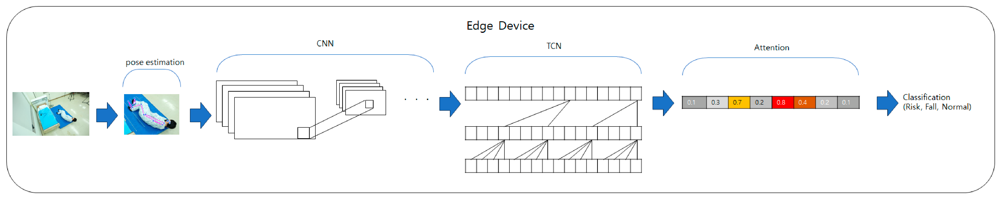
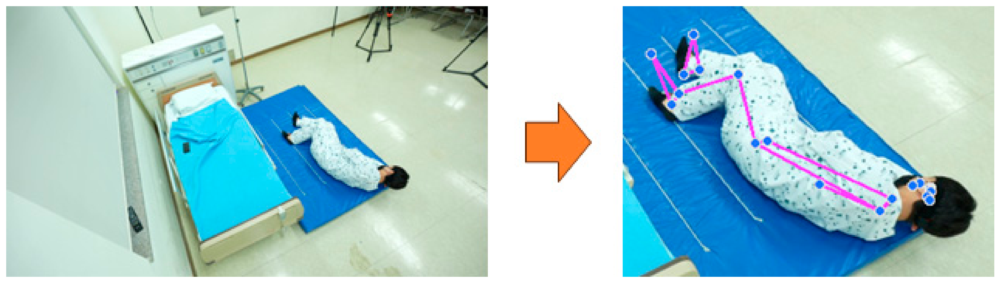
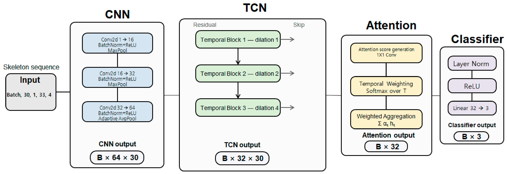
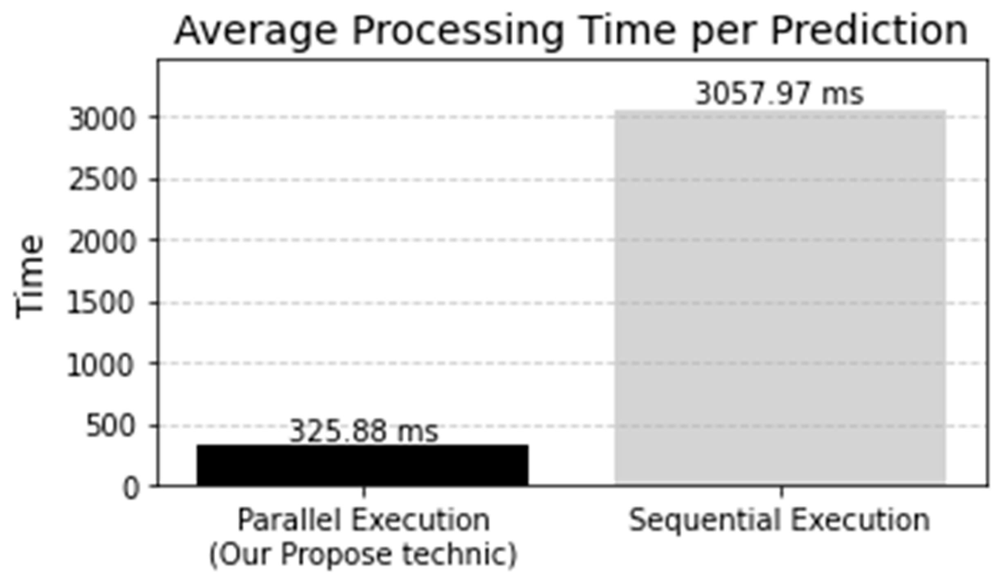
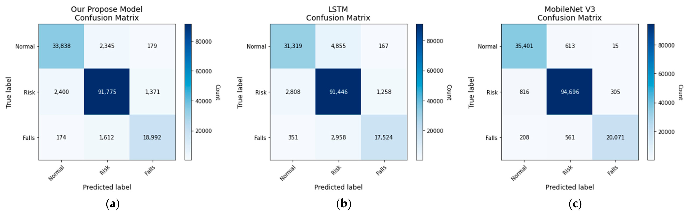

# Article A Lightweight CNN–TCN–Attention Framework

# for Low-Latency Pre-Fall Transition and Fall Recognition on Resource-Constrained Edge Devices

Woojin Cho , Seok-Oh Bang, Hyun-Seok Choi, Ki-Tae Kwon, Sang-Wuk Shin, Jin-Sung Roh, Jong-Min Lim and Hyun Mok Park *

Digital Convergence Research Headquarters, KIEL Institute, Bucheon 14560, Republic of Korea; wooju_1@kiel.re.kr (W.C.); bso3859@kiel.re.kr (S.-O.B.); vicgundam@kiel.re.kr (H.-S.C.); magiclight@kiel.re.kr (K.-T.K.); swshin@kiel.re.kr (S.-W.S.); unixsystem@kiel.re.kr (J.-S.R.); ljm4097@kiel.re.kr (J.-M.L.) * Correspondence: hyunmokmok@kiel.re.kr; Tel.: +82-32-820-7454

## Abstract

Falls are a major cause of severe injury and mortality among older adults, requiring rapid state recognition and alerts in healthcare and caregiving environments. However, many existing fall-recognition approaches primarily focus on post-fall detection or assume access to cloud/GPU computing, leaving limited evidence for short-term pre-fall recognition on low-end CPU-based edge devices. This study proposes a lightweight CNN–TCN– Attention framework for recognizing fall and pre-fall states on resource-constrained edge devices. Using MediaPipe, three-dimensional coordinates and visibility scores of 33 human body landmarks are extracted from input videos. Raw RGB frames are not directly used by the classifier, thereby reducing the processing of visually identifiable information. A total of 2300 fall-related videos from the AI-Hub dataset were reorganized into three classes: normal, pre-fall, and fall. The pre-fall onset was defined as the point at which the downward vertical velocity of the nose landmark exceeded a dataset-specific threshold. The model uses a CNN to extract frame-level skeletal patterns, a temporal convolutional network (TCN) to learn temporal changes in posture, and an attention module to aggregate temporal features. It was deployed on a Raspberry Pi Zero 2 W using ONNX Runtime. The proposed model achieved 94.71% accuracy and a macro F1-score of 93.63%, with an average state-decision latency of 325.88 ms/decision. It improved accuracy by 2.83 percentage points over the lightweight CNN–LSTM–Attention baseline while maintaining comparable latency and achieved approximately 1.75 \times  faster processing than the MobileNetV3–TCN– Attention model.

Keywords: edge device; CNN; TCN; fall; low-power computing

## 1. Introduction

Falls represent a major public health and medical concern in aging societies. They are among the leading causes of serious injury and mortality in older adults and are closely associated with a reduced quality of life [1]. In healthcare settings, falls are regarded as a major type of adverse event that threatens patient safety. The World Health Organization (WHO) and the U.S. Centers for Disease Control and Prevention (CDC) identify falls as a leading cause of injury and death among older adults, while healthcare institutions in Korea manage fall incidents as a key patient-safety indicator [2–4]. The Korea Institute for

Electronics 2026, 15, 3748 2 of 20

Healthcare Accreditation recommends periodic assessments of fall risk among hospitalized patients, and various preventive measures, including clinical observation, the installation of safety rails, and caregiver assistance, have been implemented [5–7]. Nevertheless, falls remain one of the most frequently reported patient-safety incidents in hospitals and may result in substantial socioeconomic burdens, including prolonged rehabilitation, increased medical costs, and greater caregiver burden.

Existing systems for fall detection and prevention can be broadly classified according to their sensing modality into wearable-based, environmental-sensor-based, and vision-based approaches. Wearable-based systems use accelerometers, gyroscopes, and related sensors to measure user movement; however, their practical use is limited by poor adherence to continuous device use and restricted battery life [8–10]. Environmental-sensor-based systems detect abnormal movements using pressure or motion sensors installed on floors, beds, or chairs. Although these systems generally require relatively low computational resources, their performance may vary depending on sensor placement and the spatial configuration of the environment [11,12]. Vision-based systems offer the advantage of directly observing a person’s posture and movement through cameras. However, privacy concerns associated with raw video data and the high computational cost of video processing remain major barriers to real-world deployment [13–16].

Recent studies have actively applied deep learning architectures, including convolutional neural networks (CNNs), recurrent neural networks (RNNs), and temporal convolutional networks (TCNs), to wearable, environmental-sensor, and video data to improve fall-recognition performance. In particular, skeleton-based approaches using human-joint coordinates have the advantages of smaller data volumes than raw video and reduced dependence on background information. Recent studies have also demonstrated the usefulness of combining complementary neural network modules according to task characteristics and deployment constraints. For example, Lim et al. proposed NeuroFed-LightTCN for resource-efficient seizure detection, demonstrating that lightweight temporal convolution can be combined with architectural compression to support temporal event recognition under constrained computing conditions [17]. Although the sensing modality differs from skeleton-based fall recognition, this work illustrates the broader applicability of lightweight TCN-based temporal modeling for edge-oriented biomedical inference. In the visual domain, Fan et al. proposed a hybrid framework combining generative image representations, transformer-based cross-view alignment, and attention-based aggregation for sparse-view 3D reconstruction [18]. Although the task differs substantially from temporal fall-state recognition, the study demonstrates a general task-oriented design principle in which complementary neural modules are assigned distinct representation, alignment, and aggregation roles. Following a similar modular design principle, the present study combines a compact CNN for frame-level skeletal representation, a TCN for temporal modeling, and lightweight attention for temporal feature aggregation, with particular emphasis on CPUbased edge deployment. However, many previous studies assume access to cloud servers or GPU-equipped computing environments and focus primarily on detecting falls after they have occurred. Consequently, relatively limited research has evaluated standalone operation on resource-constrained edge devices or the early recognition of short-term pre-fall intervals [19–21].

This study proposes a lightweight CNN–TCN–Attention framework for recognizing fall and pre-fall states on low-end edge devices. Three-dimensional skeletal coordinates are extracted from input videos using MediaPipe [22], thereby avoiding the direct use of raw video frames as model inputs and reducing the influence of appearance-related factors such as lighting, background, and clothing. In addition, existing fall videos from the AI-Hub dataset were reorganized into three classes: normal, pre-fall, and fall. The onset of the

Electronics 2026, 15, 3748 3 of 20

pre-fall state was defined as the first time point at which the downward vertical velocity of the nose landmark exceeded a predefined threshold. In this study, the pre-fall interval does not refer to long-term clinical fall risk; rather, it denotes the short-term motion segment immediately preceding the transition to a fall state within a fall video.

The proposed model uses a CNN to extract spatial relationships among skeletal joints in each frame and a TCN to learn temporal patterns from consecutive postural changes. An attention module performs a weighted aggregation of temporal features, assigning greater importance to time points that are relatively more relevant to classification. The trained model was deployed on a Raspberry Pi Zero 2 W using ONNX Runtime. Its feasibility in a resource-constrained CPU environment was evaluated by applying input-resolution adjustment, inference scheduling, and multicore execution.

The main contributions of this study are as follows.

1. Dataset configuration: A three-class labeling procedure was developed to reorganize existing AI-Hub fall videos into normal, pre-fall, and fall intervals. 2. Model design: A lightweight model containing approximately 30,000 parameters was designed by integrating a CNN, a TCN, and a lightweight attention mechanism to learn the spatial and temporal features of skeletal sequences. The contribution of each model component was also analyzed [23,24]. 3. System implementation: The proposed model and skeleton-extraction pipeline were implemented in the CPU environment of a Raspberry Pi Zero 2 W. Sequential and parallel execution times were compared to assess the feasibility of standalone operation on a low-end edge device.

This study presents an implementation of a skeleton-based fall-state recognition model integrated into a low-end edge device. The proposed system demonstrates the potential to reduce dependence on cloud connectivity and support on-site early warning. However, further evaluation is required before its applicability in real-world healthcare settings can be established. Because the current evaluation relies on a single AI-Hub dataset, cross-dataset generalization to participants, camera viewpoints, and environments not represented in the source dataset has not yet been established. Future studies should therefore include external validation using independent fall datasets with more diverse participants and uncontrolled environments, detailed false-alarm analysis, and additional assessment of the actual warning time provided before a fall.

## 2. Proposed System

### 2.1. Overall Architecture

The proposed system consists of four stages: data acquisition, skeleton preprocessing, feature extraction and state classification, and output generation. The overall pipeline was designed to operate on a resource-constrained edge device without relying on remote transmission of camera footage or cloud-based computation. Figure 1 illustrates the overall processing pipeline of the proposed system.

*Figure 1. Overall architecture of the proposed lightweight fall-state recognition system.*

Electronics 2026, 15, 3748 4 of 20

1. Data acquisition: Continuous video frames are captured using an installed camera. The input frames are preprocessed, including resolution adjustment, to make them suitable for subsequent pose-estimation operations. 2. Skeleton preprocessing: Human joint coordinates are extracted from each input frame and normalized relative to the center of the pelvis. This process removes background and appearance-related information from the classifier input and allows the model to focus primarily on human posture and movement. 3. Feature extraction and state classification: The normalized skeleton sequence is provided as input to the proposed CNN–TCN–Attention model. The model learns joint-coordinate patterns within individual frames and temporal changes across consecutive frames. It then classifies the input sequence into one of three states: normal, pre-fall, or fall. 4. Output generation: When the classification result corresponds to either the prefall or fall state, the system generates an alert signal. This signal may be used in a standalone early-warning system to communicate hazardous conditions to healthcare professionals, caregivers, or system administrators.

In this study, the term Fall Risk does not refer to long-term clinical fall risk assessed on the basis of factors such as age, disease, medication, or walking ability. Instead, it denotes a short-term motion interval immediately preceding the transition to a fall state within a recorded fall event. Hereafter, this state is referred to as the pre-fall interval.

### 2.2. Skeleton-Based Data Preprocessing

To reduce the influence of background and appearance-related information in the input video and to represent human movement efficiently, skeleton sequences were generated using a pose-estimation method.

The MediaPipe pose-estimation model was applied to each video frame to detect 33 major body landmarks. For each landmark, three-dimensional coordinates (x, y, z) and a visibility score were extracted, resulting in a (33  \times  4) joint-feature array for each frame [22]. The extracted coordinates were normalized relative to the center of the pelvis to reduce variations caused by the subject’s position and body scale within the image. The resulting skeleton sequences were stored as sequence-level .npy files and subsequently used for model training and inference.

The main advantages of the skeleton-based representation are as follows.

•
Environmental robustness: The representation minimizes the influence of visual
factors that are not directly relevant to prediction, including illumination changes,
complex backgrounds, and variations in clothing. This allows the classifier to focus
primarily on human posture and movement.
•
Privacy preservation: The classification model receives sequences of joint coordinates
rather than raw video frames containing facial and environmental information. Therefore, compared with raw-video-based approaches, the proposed method reduces the
direct processing of visually identifiable information. However, because the input
frames must still be processed temporarily during pose estimation, the skeleton-based
approach does not guarantee complete anonymity.
•
Lightweight data representation: A limited number of joint coordinates are used instead of complete high-resolution images, thereby reducing storage requirements and
the computational complexity of the classification model. This characteristic is advantageous for execution on edge devices with limited memory and CPU performance.

Figure 2 presents an example of skeleton data extracted using MediaPipe 0.10.36. An important practical issue in real-time skeleton extraction from images or videos is that pose estimation may fail under certain conditions, such as when a person is lying down, partially

Electronics 2026, 15, 3748 5 of 20

occluded, positioned at an unfavorable camera angle, or located outside the effective field of view.

*Figure 2. Example of skeleton extraction using MediaPipe.*

To address this issue, a heuristic exception-handling algorithm was incorporated into the proposed system. Specifically, when skeleton detection remains unavailable for longer than a predefined period immediately after a pre-fall state has been recognized, the system classifies the event as a fall and generates an alert. This rule is intended to account for actual fall situations in which the skeleton disappears because of substantial postural deformation, occlusion, or movement into a camera blind spot. Because this procedure is heuristic, its contribution and potential effect on false alarms should be evaluated separately from the learned classification model.

### 2.3. Construction of the Classification Scheme

Many existing fall-recognition studies have focused on binary classification between fall and non-fall states. Although this approach is effective for detecting a fall while it is occurring or after it has occurred, it has limited ability to represent short-term motion changes immediately preceding the transition to a fall state [25].

In this study, the existing AI-Hub fall videos were reorganized into three classes: normal, pre-fall, and fall. The pre-fall class, which may also be referred to as Fall Risk in the system interface, does not represent a clinical assessment of long-term fall risk. Instead, it represents a short-term temporal segment immediately preceding the onset of a fall event.

The transition point in each fall-event video was defined using the downward vertical velocity of the nose landmark. At time (t), the downward velocity of the nose landmark was calculated as

$$
v_{down} ( t ) = \frac{y_{nose} ( t ) - y_{nose} ( t - ∆ t )}{∆ t}
$$

$$
\frac{y_{nose} ( t - ∆ t )}{∆ t} \tag{1}
$$

where ∆t denotes the actual time interval between two frames. Depending on the axis convention of the coordinate system, the sign was adjusted such that downward movement corresponded to a positive value. The fall-transition time t_{f} was defined as the first time point at which v_{down}(t) exceeded 1 normalized coordinate unit per second.

This threshold is not a universally established clinical criterion for falls. Rather, it is a dataset-specific operational threshold introduced to divide the transition intervals in the dataset in a consistent and reproducible manner.

The three classes were defined as follows.

•
Normal: This class includes daily-activity sequences unrelated to a fall event, as well
as segments in which no pre-fall characteristics are observed.
•
Pre-fall: This class represents the interval preceding the defined fall-transition time t_{f}
in a fall-event video. It may include movements such as loss of balance, stumbling,
upper-body inclination, or attempts to grasp nearby objects. However, the inclusion

Electronics 2026, 15, 3748 6 of 20

of a frame in this interval does not imply that every preceding frame represents a clinically hazardous state. • Fall: This class represents the interval beginning at the fall-transition time t_{f} , at which the downward velocity of the nose landmark first exceeds the predefined threshold. It may include both the active descent and the posture observed after the person reaches the floor.

Each fall video was analyzed at the frame level, and the intervals before and after t_{f} were automatically labeled as pre-fall and fall, respectively. This procedure does not directly measure physical impact. Instead, it operationally defines the state-transition point on the basis of downward joint motion.

Accordingly, the proposed three-class configuration should not be interpreted as a clinical risk-prediction model that estimates the long-term probability of a future fall. It is instead a fall-state early-recognition framework that distinguishes the short-term motion interval preceding the transition to a fall state in a continuous video sequence.

### 2.4. CNN–TCN–Attention-Based Classification Model

Through pose estimation, each raw video frame is converted into an array of human joint coordinates. This joint-coordinate representation avoids the direct use of background and appearance information as classifier inputs and represents posture- and movementrelated information using a relatively small amount of data.

As illustrated in Figure 3, the proposed model combines a CNN, a TCN, and an attention module to learn the spatial and temporal characteristics of skeleton sequences.

*Figure 3. Detailed architecture of the proposed lightweight CNN–TCN–Attention network.*

The CNN–TCN–Attention architecture was selected according to the characteristics of the input representation, the temporal nature of the target event, and the computational constraints of the target edge device. The input consists of a short sequence of 30 frames, with each frame represented by a compact 33  \times  4 skeletal joint-feature array. A lightweight CNN is first used to transform the joint-coordinate array into a compact frame-level representation before temporal modeling. The TCN then models changes across consecutive frames through convolution-based temporal processing, allowing short-term transition patterns to be captured without relying on recurrent state propagation. Finally, a lightweight attention module assigns different importance to temporal features before sequence-level classification. Therefore, the architecture was designed to achieve a practical balance between temporal modeling capability and computational cost rather than to maximize classification accuracy without considering deployment latency.

Electronics 2026, 15, 3748 7 of 20

The selected architecture should not be interpreted as the only possible or globally optimal network configuration. Alternative temporal modules, including LSTM, GRU, transformer-based temporal encoders, and graph-based skeleton encoders, could also be employed for fall-state recognition. However, the present study focused on a compact configuration suitable for deployment on the CPU-only Raspberry Pi Zero 2 W. The comparative experiments showed that the proposed CNN–TCN–Attention model achieved higher classification performance than the lightweight CNN–LSTM–Attention model while maintaining comparable processing latency, whereas the MobileNetV3–TCN–Attention model achieved higher classification accuracy at a substantially greater processing cost. Accordingly, the proposed architecture was selected as a practical accuracy–latency trade-off for the target edge environment rather than as a universally optimal architecture. In addition, component-level profiling showed that the lightweight attention module accounted for only 0.13% of the measured processing time across the profiled stages, indicating that temporal weighting was introduced with a relatively small inference-time overhead.

The proposed architecture was designed to learn spatiotemporal features from skeleton sequences through the complementary functions of the CNN, TCN, and attention modules.

CNN-based frame-level feature extraction: The input at each time step is a 33  \times  4 1. array containing three-dimensional coordinates and visibility scores for 33 body landmarks. Each joint-feature array is processed by a lightweight CNN and transformed into a compact frame-level feature vector. The CNN learns local patterns among coordinate components and joint groups according to the predefined landmark arrangement. These features represent frame-level postural characteristics, including upper-body inclination, the relative positions of the knees and pelvis, and changes in landmark visibility. 2. TCN-based temporal feature learning: The sequence of frame-level posture features generated by the CNN is provided as input to the TCN. Using dilated causal convolutions, the TCN learns temporal patterns in consecutive postural changes. Its enlarged temporal receptive field enables the model to capture both short-term movements and motion patterns extending across multiple frames, including the progression from loss of balance to a fall. 3. Attention-based temporal aggregation: After the TCN processes the temporal pattern across the 30-frame input sequence, the attention module assigns learned weights to the temporal features. Features at time steps that are more relevant to classification receive greater weights and are aggregated into a sequence-level representation. This mechanism reduces the influence of less informative temporal segments and allows the classifier to focus on motion patterns that contribute more strongly to the final prediction. 4. Classifier: The feature vector produced by the attention module is passed to a classifier consisting of a fully connected layer and a softmax function. The classifier estimates the probability that the input action sequence belongs to the normal, pre-fall, or fall class, and the class with the highest probability is selected as the final prediction.

## 3. Implementation

### 3.1. Dataset Configuration

The fall-video data used in this study were obtained from the “Video–Sensor Paired Dataset of Fall-Accident Risk Behaviors” provided by AI-Hub in the Republic of Korea. A total of 2300 videos in MP4 format were used. The dataset was divided into training, validation, and test sets at ratios of 60%, 20%, and 20%, respectively. All videos used in the present study were obtained from the same AI-Hub data source. Therefore, the reported evaluation primarily reflects performance within this dataset distribution and should not

Electronics 2026, 15, 3748 8 of 20

<table>
  <tr><th colspan="2">be interpreted as demonstrating cross-dataset generalization. Validation using independent fall datasets is required to assess robustness to broader variations in participants, camera</th></tr>
  <tr><th>viewpoints, and recording environments.</th></tr>
  <tr><td colspan="2">The following preprocessing procedure was performed to transform the videos into</td></tr>
  <tr><td colspan="2">model inputs. First, each video was decomposed into individual frames, and three- dimensional skeletal coordinates (x, y, z) were extracted for 33 major body landmarks using MediaPipe [22]. Through this process, the raw videos were converted into NumPy</td></tr>
  <tr><td>(.npy) data files.</td></tr>
  <tr><td colspan="2">To reduce variation caused by the subject’s position within the image, the extracted</td></tr>
  <tr><td colspan="2">joint coordinates in each frame were normalized relative to the center of the pelvis. Fi- nally, all skeleton sequences were divided into fixed-length segments of 30 frames, corre- sponding to approximately 1 s of video, to construct the input dataset for model training</td></tr>
  <tr><td>and inference. 3.2. Development Environment</td></tr>
  <tr><td colspan="2">Model development and deployment were performed in separate computing en-</td></tr>
  <tr><td colspan="2">vironments. Because training directly on the edge device would impose an excessive computational and memory burden, model training was offloaded to a GPU-equipped workstation. The trained model was subsequently converted and deployed on the edge device for inference. The specifications of the workstation and edge-device environments</td></tr>
  <tr><td>are presented in Table 1.</td></tr>
  <tr><td>Table 1. Edge Device and Workstation Specifications.</td></tr>
  <tr><td>Environment</td><td>Category</td><td>Specification</td></tr>
</table>

| Environment | Category | Specification |
| --- | --- | --- |
| Training environment | Hardware | CPU: I9-11900 K RAM: 64 GB GPU: Geforce RTX 3070 Ti |
| environment | Software | OS: Windows 10 Framework: Python 3.9, PyTorch 2.1.0 Libraries: MediaPipe 0.10.14, OpenCV 4.10.0, NumPy 1.26, Scikit-learn 1.5.2 |
| Edge environment (inference) | Hardware | Edge Device: Raspberry Pi Zero 2 W CPU: Broadcom BCM2710A1 RAM: 512 MB |
| environment (inference) | Software | OS: Raspberry Pi OS (64 Bit) |

### 3.3. Model Training and Optimization

The proposed system was designed for CPU-based real-time operation on a low-end edge device, such as the Raspberry Pi Zero 2 W, which has highly constrained processing capability and only 512 MB of memory [26].

Conventional computationally intensive CNN architectures are unsuitable for practical execution in this environment. Therefore, structural model-lightweighting techniques and inference-pipeline optimizations were applied to reduce CPU utilization and memory consumption.

#### 3.3.1. Model Training

The proposed CNN–TCN–Attention model was trained using the AdamW optimizer and a multiclass cross-entropy loss function [27]. The initial learning rate was set to 1  \times  10-3, the batch size was set to 64, and the model was trained for a maximum of 100 epochs.

Electronics 2026, 15, 3748 9 of 20

Early stopping was applied when the validation loss did not improve for 10 consecutive epochs. The model weights from the epoch with the lowest validation loss were used for the final evaluation. Early stopping was employed not as a method that completely prevents overfitting, but as a procedure for reducing unnecessary training and limiting the potential for overfitting.

Training strategy and hyperparameter setting. AdamW, multiclass cross-entropy loss, cosine-annealing learning-rate scheduling, and early stopping were adopted as the common training strategy for the main experiments. The numerical settings in Table 2 represent the fixed configuration used to obtain the main experimental results and should not be interpreted as a globally optimal hyperparameter configuration. The initial learning rate of 1  \times  10-3 and batch size of 64 were used as the reference training configuration, while the maximum number of epochs was set to 100 with early stopping to terminate training when validation loss no longer improved. To additionally examine the influence of the numerical training settings, a focused sensitivity analysis of the learning rate and batch size was conducted using the training and validation partitions, as described in Section 4.2.2.

**Table 2. Training Hyperparameter Settings.**

| Hyperparameter | Setting |
| --- | --- |
| Optimizer | AdamW |
| Initial learning rate | 0.001 |
| Loss function | Multi-class cross-entropy |
| Batch size | 64 |
| Maximum epochs | 100 |
| LR scheduler | Cosine annealing [28] |
| Early-stopping patience | 10 epochs |

The training hyperparameters are summarized in Table 2.

#### 3.3.2. Architecture-Level Model Lightweighting

First, a custom lightweight CNN was designed specifically for the (33  \times  4) skeleton input used in this study. The CNN consists of only three Conv2d blocks, with the maximum number of channels limited to 64. This design substantially reduces the computational cost of frame-level spatial feature extraction.

Second, the number of TCN channels was reduced. Although the TCN is a core component for learning temporal motion patterns, it can become a computational bottleneck. The channel configuration was therefore set to 32–32–32 to reduce temporal-processing costs while retaining the capacity required to learn essential motion patterns.

Third, hardware-friendly operations were employed. The temporal blocks were implemented using two-dimensional convolution operations rather than conventional one-dimensional convolutions. In the proposed tensor configuration, this implementation was intended to improve computational efficiency on the target CPU by facilitating parallel execution through optimized convolution kernels and SIMD instructions.

Fourth, the trained PyTorch model was converted to the Open Neural Network Exchange (ONNX) format. ONNX Runtime [29] was used as the cross-platform inference engine on the Raspberry Pi Zero 2 W. Its optimized kernels for ARM-based CPU architectures can reduce framework overhead and improve inference efficiency compared with executing the original PyTorch model directly on the edge device.

Through these lightweighting and deployment strategies, the proposed model was designed to perform pre-fall and fall-state recognition using only the CPU of the Raspberry Pi Zero 2 W, without requiring an additional neural processing unit.

Electronics 2026, 15, 3748 10 of 20

#### 3.3.3. Real-Time Inference-Pipeline Optimization

The complete inference pipeline sequentially performs pose estimation and state classification using the CNN–TCN–Attention model. In the initial implementation, pose estimation and classification were applied to every camera frame. However, because of the limited CPU resources of the Raspberry Pi Zero 2 W, the resulting processing rate was below 1 frame per second.

Component-level profiling confirmed that MediaPipe Pose estimation was the dominant processing stage, accounting for 65.05% of the total processing time across the profiled stages, whereas the CNN–TCN–Attention classification stage accounted for only 5.13%. Input-frame resizing also represented a substantial portion of the processing time (29.38%). Therefore, the input resolution and execution frequencies of pose estimation and state classification were adjusted. A detailed component-level profiling analysis is presented in Section 4.2.3.

1. The primary bottleneck in the pipeline was the Input-resolution reduction: pose.process() operation of MediaPipe Pose, whose computational cost is strongly affected by input-image resolution. Preliminary evaluation indicated that skeleton extraction remained sufficiently stable when the input image width was reduced to 192 pixels. Accordingly, camera frames were resized before pose estimation to reduce the computational burden of MediaPipe. 2. Skeleton-extraction scheduling: MediaPipe Pose remained relatively computationally intensive even after input-resolution reduction. Pose estimation was therefore scheduled at intervals of 10 camera frames rather than being performed on every frame. This strategy reduced the frequency of pose-estimation operations and lowered the overall CPU workload. 3. State-classification scheduling: State classification was also performed at 10-frame intervals. This reduced repeated sequence-level inference while maintaining periodic updates of the recognized state.

Here, (B) and (T) denote the batch size and sequence length, respectively. Table 3 summarizes the overall model architecture resulting from the proposed structural lightweighting and computational optimization strategies.

**Table 3. Detailed Architecture of the Proposed Lightweight CNN–TCN–Attention Model.**

| Stage | Module | Output Shape (B = Batch Size, T = Sequence Length) | # Parameters |
| --- | --- | --- | --- |
| Input | - | (B,T,1,33,4) | - |
|  | Conv2d | (BxT,16,16,4) | 160 |
| CNN | Conv2d Conv2d | (BxT,16,16,4) (BxT,32,8,4) | 160 4672 |
| CNN | Conv2d Conv2d | (BxT,32,8,4) (BxT,64) | 4672 18,496 |
|  | Temporal Block 1 | (B,32,T) | 2.2 K |
| TCN | Temporal Block 1 Temporal Block 2 Temporal Block 3 | (B,32,T) (B,32,T) (B,32,T) | 2.2 K 2.0 K 2.0 K |
|  | Temporal Block 3 Skip Connection | (B,32,T) (B,32,T) | 2.0 K 3.0 K |
|  | Conv2d | (B,1,T,1) | 33 |
| Attention | Conv2d Softmax & Weighted sum | (B,1,T,1) (B,32) | 33 - |
| Classifier | LayerNorm + ReLU + Linear | (B,3) | 99 |
| Total | - | - | 32 K |

Electronics 2026, 15, 3748 11 of 20

## 4. Evaluation

### 4.1. Evaluation Metrics

The proposed model was evaluated in terms of both classification performance and processing efficiency on the edge device. Classification performance was assessed based on the three-class prediction results for the normal, pre-fall, and fall states. System efficiency was evaluated by measuring the time required to complete one execution of the entire processing pipeline on the Raspberry Pi Zero 2 W.

#### 4.1.1. Classification Performance Metrics

Accuracy, precision, recall, and F1-score were used to evaluate multiclass classification performance.

•
Accuracy: Accuracy represents the proportion of samples for which the correct class
was predicted among all evaluated samples.
•
Precision: Precision represents the proportion of samples that actually belong to a
given class among those predicted as that class.
•
Recall: Recall represents the proportion of samples correctly identified as a given class
among all samples that actually belong to that class.
•
F1-score: The F1-score is the harmonic mean of precision and recall and provides a
balanced measure of the two metrics.

Classification metrics were calculated using the scikit-learn library in Python. Specifically, accuracy_score, confusion_matrix, and classification_report from sklearn.metrics were used for performance evaluation. Precision, recall, and F1-score were calculated independently for each class and reported using macro averaging across the normal, prefall, and fall classes. Class-specific metrics were also examined to identify differences in performance among the three classes.

The proposed system was designed to generate an alert for both the pre-fall and fall states. Therefore, in addition to the three-class evaluation, an alarm-level binary evaluation was defined as follows:

No Alarm = {Normal}, Alarm = {Fall Risk, Fall}

The fall alarm miss rate was defined as the proportion of actual fall samples that were incorrectly classified as the non-alarm normal state:

Where (y) denotes the ground-truth class and (\hat{y}) denotes the predicted class.

#### 4.1.2. System Efficiency Metric

Because the proposed system was designed for near-real-time operation on a resourceconstrained edge device, processing latency was considered a key measure of practical feasibility. The following metric was used to compare the computational efficiency of the evaluated models.

•
Average state-decision latency: This metric represents the average time required
to complete one state decision. It includes input-frame resizing, MediaPipe-based
pose estimation, skeleton preprocessing, classification-model execution, and result
generation. The latency is reported in milliseconds per decision (ms/decision).

### 4.2. Evaluation Result 4.2.1. Analysis of the Contributions of the Main Model Components

An ablation study was conducted to evaluate the contribution of each component of the proposed CNN–TCN–Attention architecture. Variant models were constructed by removing the temporal feature-learning component, the spatial feature-extraction component, or the

Electronics 2026, 15, 3748 12 of 20

|  | Accuracy | Precision | Recall | F1-Score |
| --- | --- | --- | --- | --- |
| CNN-TCN- Attention (our proposed) | 94.71% | 93.75% | 93.51% | 93.63% |
| CNN-Attention | 92.81% | 91.70% | 90.93% | 91.31% |
| TCN-Attention | 88.60% | 87.79% | 85.10% | 86.29% |
| CNN-TCN | 86.32% | 87.54% | 78.20% | 81.91% |

For the ablation study, the preprocessing procedure, optimizer, training strategy, and common hyperparameters were kept identical across all variants. Only the designated architectural component was removed in each experiment so that differences in performance could be attributed primarily to the architectural change rather than to independent hyperparameter retuning.

The TCN–Attention model, in which the CNN-based frame-level feature extractor was removed, achieved an accuracy of 88.60% and an F1-score of 86.29%. This result suggests that extracting compact spatial representations from the joint-coordinate arrays before temporal modeling facilitates the learning of discriminative movement patterns.

The CNN–TCN model without the attention module showed the lowest recall and F1-score, at 78.20% and 81.91%, respectively. This decrease indicates that uniformly treating all temporal features may limit the model’s ability to emphasize the time steps that are most relevant to state classification. The attention module improved performance by assigning different weights to temporal features and aggregating them according to their relative contribution to the final prediction.

Overall, the ablation results indicate that the three components perform complementary functions. The CNN extracts frame-level spatial features, the TCN models their temporal evolution, and the attention module emphasizes the temporal features most relevant to classification. The complete integration of these components produced the best performance among the evaluated model variants.

An important result of the proposed model was its low rate of misclassifying actual falls as normal states. In the confusion matrix, the proportion of actual fall samples classified as normal was 0.84%. Thus, the model maintained a low fall alarm miss rate on the evaluation dataset. However, this result alone is insufficient to establish safety and reliability in clinical settings. Additional validation using independent participants, diverse hospital environments, and long-duration continuous recordings is required.

#### 4.2.2. Comparative Evaluation of Classification Performance and Processing Latency

To evaluate the proposed model relative to alternative temporal architectures, it was compared with CNN–LSTM–Attention and MobileNetV3–TCN–Attention models using the same dataset and evaluation environment. The comparison considered both three-

Electronics 2026, 15, 3748 13 of 20

class classification performance and the average state-decision latency measured on the edge device.

To improve CPU utilization, sequential execution on a single processing path was compared with a parallelized configuration using multiple CPU cores in Figure 4. In the parallel configuration, two CPU cores were allocated to MediaPipe-based pose estimation, while one core was allocated to classification inference. The use of task-level parallelism and CPU-core allocation reduced the average state-decision latency to approximately 325.88 ms/decision.

*Figure 4. Comparison of average state-decision latency under sequential and parallel execution.*

This result indicates that the scheduling strategy improved pipeline throughput by allowing pose estimation and classification-related operations to make more effective use of the limited multicore CPU resources. The measured latency also satisfied the 333.3 ms state-update interval adopted in this study. Nevertheless, the measured value represents an average latency, and additional analysis of worst-case latency, latency variance, and sustained performance over long-duration execution would be required to establish strict real-time guarantees.

Hyperparameter sensitivity analysis. Because neural network performance may vary depending on the adopted training configuration, an additional sensitivity analysis was conducted for the proposed CNN–TCN–Attention model. Six predefined combinations of learning rate (3  \times  10-4, 1  \times  10-3, and 3  \times  10-3) and batch size (32 and 64) were evaluated using a fixed dropout rate of 0.2 and weight decay of 1  \times  10-5. The analysis was performed using only the training and validation partitions, with validation macro-F1 used as the selection criterion; the held-out test set was not involved in this screening procedure. The screening results showed a measurable variation in validation performance across the investigated configurations, confirming that the optimization behavior of the proposed model was sensitive to the learning rate and batch size. This analysis was used only to examine hyperparameter sensitivity and was not used as an estimate of the final test-set performance reported in Table 5. The investigated configurations produced a 5.55-percentage-point spread in validation macro-F1, confirming measurable sensitivity to the learning rate and batch size.

The sensitivity analysis was conducted separately from the final performance evaluation. The final model performance under the main experimental protocol is reported in Table 5, where the proposed model achieved 94.71% accuracy and a macro F1-score of 93.63%.

As shown in Table 5, the proposed CNN–TCN–Attention model outperformed the lightweight CNN–LSTM–Attention model in classification performance while exhibiting a comparable processing latency. The proposed model improved accuracy by 2.83 percentage

Electronics 2026, 15, 3748 14 of 20

|  | Accuracy | Precision | Recall | F1-Score | Average State-Decision Latency (ms/Decision) |
| --- | --- | --- | --- | --- | --- |
| CNN-TCN- Attention (our proposed) | 94.71% | 93.75% | 93.51% | 93.63% | 325.88 ms |
| CNN-LSTM- Attention | 91.88% | 91.82% | 88.68% | 90.15% | 326.51 ms |
| Mobilenet V3- TCN-Attention | 98.27% | 97.89% | 97.85% | 97.86% | 570.52 ms |

For deployment efficiency, the CNN–LSTM–Attention model was configured with a hidden-state size of 16 and two LSTM layers. Although this lightweight configuration reduced the computational cost of the recurrent architecture, it also limited its representational capacity. The observed performance difference suggests that the proposed TCN-based architecture provided a more favorable balance between temporal-modeling capability and computational cost under the resource constraints of the Raspberry Pi Zero 2 W.

The MobileNetV3–TCN–Attention model achieved the highest classification performance, with an accuracy of 98.27% and an F1-score of 97.86%. However, its larger convolutional feature extractor increased the average state-decision latency to 570.52 ms/decision. This value exceeded the 333.3 ms state-update interval used as the target in this study. Consequently, although the MobileNetV3-based model provided superior classification performance, it was less suitable for the latency requirements of the target edge device.

The proposed model achieved an average state-decision latency of 325.88 ms/decision while maintaining an accuracy of 94.71% and an F1-score of 93.63%. These results indicate that the proposed architecture provides a practical trade-off between classification performance and processing latency for CPU-based deployment on a low-end edge device.

Figure 5 presents the confusion matrices of the proposed model and the two comparison models. A particularly important error type for the intended alert system is the misclassification of an actual fall as normal because this error results in no alert being generated for a fall event.

*Figure 5. Comparison of confusion matrices for three models. (a) CNN–TCN–Attention (Proposed) (b) CNN–LSTM–Attention (c) MobileNetV3–TCN–Attention.*

Electronics 2026, 15, 3748 15 of 20

The proposed model showed a lower proportion of fall-to-normal misclassifications than the MobileNetV3–TCN–Attention model, despite the latter achieving higher overall accuracy. This finding indicates that overall accuracy alone may not fully reflect the practical safety characteristics of a fall-alert system. The proposed model was effective in suppressing the fall-to-normal error, which represents the most critical alarm-level false-negative case in the proposed classification scheme.

The proposed model also demonstrated relatively high recall for the pre-fall class, supporting its ability to recognize short-term motion patterns preceding the transition to a fall state. However, the pre-fall results should be interpreted as recognition of an operationally defined interval within the dataset rather than as evidence that the model predicts long-term clinical fall risk.

#### 4.2.3. Component-Level Processing-Time Profiling

Component-level profiling was performed on the Raspberry Pi Zero 2 W using an input width of 192 pixels. After 10 warm-up executions, processing times were accumulated over 100 measured decisions. The profiling analysis measured the major pipeline stages separately using application-level wall-clock timing.

To further analyze the computational characteristics of the proposed edge-AI pipeline, component-level processing-time profiling was conducted. The major processing stages were divided into input-frame resizing, MediaPipe Pose estimation, landmark packing, skeleton normalization, CNN feature extraction, TCN temporal processing, attention, and final classification. The profiling results are summarized in Table 6.

**Table 6. Processing-Time Share of the Major Pipeline Components.**

| Processing Stage | Processing-Time Share |
| --- | --- |
| Input-frame resizing | 29.38% |
| MediaPipe Pose estimation | 65.05% |
| Landmark packing | 0.14% |
| Skeleton normalization | 0.30% |
| CNN | 2.04% |
| TCN | 2.84% |
| Attention | 0.13% |
| Classifier | 0.12% |
| Total | 100.00% |

MediaPipe Pose estimation accounted for 65.05% of the measured processing time, representing the dominant computational bottleneck of the system. Input-frame resizing accounted for an additional 29.38%. In contrast, landmark packing and skeleton normalization accounted for only 0.14% and 0.30%, respectively.

Within the neural network classification stage, the CNN accounted for 2.04% of the total processing time and the TCN for 2.84%, while the attention module and final classifier accounted for only 0.13% and 0.12%, respectively. Consequently, the complete CNN–TCN– Attention classification stage represented approximately 5.13% of the total processing time across the profiled stages.

These results indicate that the dominant computational cost of the deployed system originates from image preprocessing and pose estimation rather than from the proposed lightweight classification architecture. In particular, the measured 65.05% contribution of

Electronics 2026, 15, 3748 16 of 20

MediaPipe Pose supports the input-resolution reduction and inference-scheduling strategies adopted in Section 3.3.3.

The reported profiling values represent application-level processing-time shares of the major pipeline stages and should not be interpreted as processor-utilization percentages or low-level kernel profiling.

## 5. Discussion

This study proposed a lightweight CNN–TCN–Attention-based fall-state recognition system designed for operation on resource-constrained edge devices and evaluated its feasibility on a Raspberry Pi Zero 2 W. The proposed model uses a CNN to extract framelevel spatial features from skeletal joint coordinates and a TCN to learn temporal patterns in consecutive postural changes. An attention module was further incorporated to perform a weighted aggregation of temporal features within each input sequence.

The experimental results showed that the proposed model achieved higher accuracy and F1-score than the lightweight CNN–LSTM–Attention model while maintaining a comparable average state-decision latency. Although the MobileNetV3–TCN–Attention model achieved higher classification performance, it required substantially longer processing time on the Raspberry Pi Zero 2 W. Therefore, the proposed model did not achieve the highest overall classification accuracy among the evaluated models, but provided a practical trade-off between classification performance and processing latency in a low-end CPU environment.

The skeleton-based representation describes human posture and movement using joint coordinates rather than directly providing raw RGB images containing faces, clothing, and surrounding environments to the classification model. This approach reduces both the input-data size and the computational burden of the classification stage. It also limits the direct use of visually identifiable information contained in the original video. However, because raw frames are temporarily processed during pose estimation, the proposed approach should not be interpreted as guaranteeing complete anonymity.

### 5.1. Main Findings

First, the introduction of a pre-fall state extends conventional fall detection by distinguishing a short-term motion interval preceding the transition to a fall. Whereas many previous studies have focused primarily on detecting falls during or after their occurrence, the proposed framework was designed to learn movement patterns that may appear before a fall, including loss of balance, postural instability, and attempts to grasp nearby objects. The proposed model achieved an overall three-class classification accuracy of 94.71% and an average state-decision latency of 325.88 ms/decision. The component-level profiling analysis further showed that the computational burden of the complete pipeline was dominated by MediaPipe Pose estimation rather than by the proposed classifier. MediaPipe Pose accounted for 65.05% of the measured processing time, whereas the complete CNN–TCN– Attention classification stage accounted for only 5.13%. This finding indicates that further improvements in end-to-end responsiveness are likely to depend primarily on optimization or acceleration of the pose-estimation stage.

These results should not be interpreted as demonstrating a 94.71% probability of correctly detecting every individual fall. Rather, 94.71% represents the overall accuracy obtained across the normal, pre-fall, and fall classes on the test dataset. In addition, the pre-fall class represents an operationally defined interval within recorded fall events rather than a clinical prediction of long-term fall risk.

Second, the results demonstrate the feasibility of executing the proposed pipeline in a CPU-based edge environment. Techniques such as input-resolution reduction, frame-

Electronics 2026, 15, 3748 17 of 20

based scheduling, and multicore task allocation enabled the system to achieve an average state-decision latency below 330 ms without cloud-based computation. This suggests that a low-end edge device can support periodic on-site recognition of pre-fall and fall states.

However, the measured latency of 325.88 ms is close to the target state-update interval of 333.3 ms. The difference between the measured latency and the target interval is therefore insufficient to provide a substantial processing margin. Moreover, because the reported value represents an average rather than a worst-case latency, the current results do not establish a strict real-time guarantee. Deployment on a more capable processor or an accelerator-equipped platform, such as a device with a neural processing unit, may provide greater computational headroom and more stable latency.

### 5.2. Limitations and Future Work

First, the dataset has limited environmental and participant diversity. Most of the AI- Hub fall videos were recorded under relatively controlled conditions, with limited variation in lighting, background, participant age, clothing, and the use of mobility-assistance devices. Furthermore, because all experiments in the present study were conducted using a single data source, cross-dataset generalization has not yet been established. Consequently, performance may decrease when the system is applied to participants, viewpoints, and environments that differ substantially from those represented in the current dataset. Future work should therefore include external validation using independent fall datasets, followed by evaluation in real-world settings such as hospital rooms, long-term care facilities, and continuous CCTV monitoring environments.

Second, challenges remain in recognizing unusual or heavily occluded postures. MediaPipe-based pose estimation occasionally failed when a participant was lying down, viewed from an unfavorable camera angle, or obscured by bedding. To mitigate this problem, the proposed system applied a heuristic rule that classified an event as a fall when skeleton detection remained unavailable for a predefined period after a pre-fall state. Although this rule may compensate for pose-estimation failures in some fall scenarios, it cannot completely eliminate false alarms under visually similar conditions. Future work should investigate additional motion features, including joint velocity, acceleration, and inter-frame positional variance, to improve recognition reliability.

Third, the heuristic for handling skeleton-detection failure may be particularly useful when a person falls outside the camera frame. However, it may also generate an incorrect fall alert when a person loses balance but subsequently walks out of the camera’s field of view. In fall-alert applications, missed falls may be considered more critical than false alarms; nevertheless, excessive false alarms can increase alarm fatigue and reduce trust in the system. Therefore, the heuristic should be used only as an auxiliary decision rule in a clinical alert system rather than as an independent basis for confirming a fall. Its threshold and duration should also be validated according to the intended deployment environment.

Fourth, the deployment evaluation was limited to a single CPU-only edge platform, the Raspberry Pi Zero 2 W. Therefore, the present results do not establish how the proposed framework behaves on accelerator-equipped edge devices. A GPU-equipped single-board computer was not available in the current experimental environment, and a direct crossdevice comparison could not be included in this study. Future work will evaluate the framework on GPU- or NPU-equipped edge platforms, such as Jetson-class devices, and compare end-to-end latency, model-inference performance, power consumption, and energy efficiency under comparable operating conditions.

Fifth, the proposed system has potential for multimodal extension. The current framework relies exclusively on skeleton data. Integrating additional sensing modalities, such as radar, pressure measurements, acoustic events, depth information, or wearable

Electronics 2026, 15, 3748 18 of 20

inertial data, may improve robustness when pose estimation fails or visual observations are ambiguous. Future studies should evaluate whether multimodal fusion can reduce both missed alarms and false alarms while maintaining computational feasibility on resourceconstrained edge devices.

## 6. Conclusions

This study proposed a lightweight CNN–TCN–Attention model for the simultaneous recognition of pre-fall and fall states in a resource-constrained edge-computing environment. Unlike conventional studies that primarily focus on detecting falls during or after their occurrence, the proposed framework distinguishes a short-term motion interval immediately preceding the transition to a fall state. This provides an early-recognition approach rather than conventional post-fall detection alone.

Through skeleton-based preprocessing, three-dimensional joint coordinates were used instead of raw visual data as direct inputs to the classification model. This reduced the amount of visual information processed during classification. The CNN extracted framelevel spatial features, while the TCN learned temporal patterns from consecutive postural changes. The attention module further emphasized temporal features that were relatively important for state classification.

Experimental results showed that the proposed model achieved 94.71% accuracy and a macro F1-score of 93.63%. Its accuracy was 2.83 percentage points higher than that of the lightweight CNN–LSTM–Attention model, while its average state-decision latency was 325.88 ms/decision. Compared with the MobileNetV3–TCN–Attention model, the proposed framework processed each decision approximately 1.75 times faster. These results demonstrate the feasibility of periodic near-real-time recognition on a low-end edge device without a high-performance GPU or NPU. However, because the measured latency was close to the target update interval and represents an average value, it should not be interpreted as establishing a strict real-time guarantee.

Another contribution of this study is the development of an end-to-end edge-AI framework encompassing the construction of a three-state dataset—normal, pre-fall, and fall—the design of a lightweight CNN–TCN–Attention model, and optimization for deployment on a low-end CPU.

Future work will focus on three main directions. First, the generalizability of the proposed framework will be evaluated using independent fall datasets containing more diverse participants, camera viewpoints, and recording environments, followed by validation in real hospital and caregiving settings. Second, cross-platform deployment experiments will be conducted on GPU- or NPU-equipped edge devices to evaluate whether hardware acceleration provides meaningful improvements in end-to-end responsiveness, power consumption, and energy efficiency relative to the CPU-only Raspberry Pi Zero 2 W implementation. Third, the framework will be extended toward multimodal edge AI by integrating complementary sensing information, including radar, pressure, acoustic, depth, and wearable inertial signals. These extensions will support a more comprehensive evaluation of robust and resource-efficient fall-state recognition in practical environments.

Electronics 2026, 15, 3748 19 of 20

and sterilization to enter the global market) funded by the Ministry of Trade Industry & Energy (MOTIE, Korea).

Data Availability Statement: The data used in this study is the ‘Video–Sensor Paired Dataset of Fall-Accident Risk Behaviors’ dataset provided by AI-Hub. This data is publicly accessible at: https://www.aihub.or.kr/aihubdata/data/view.do?dataSetSn=71641 accessed on 19 August 2026.

Conflicts of Interest: The authors declare no conflicts of interest.

## References

1. Chen, Y.; Dai, F.; Huang, S.; Qi, D.; Peng, C.; Zhang, A.; Wang, Y.; Gu, Y.; Guo, J. Global, regional, and national burden of falls among older adults: Findings from the Global Burden of Disease Study 2021 and Projections to 2040. NPJ Aging 2025, 11, 85. [CrossRef] [PubMed] 2. World Health Organization. Falls: Fact Sheet. WHO. Available online: https://www.who.int/news-room/fact-sheets/detail/falls (accessed on 24 October 2025). 3. Centers for Disease Control and Prevention. Older Adult Falls Data. Available online: https://www.cdc.gov/falls/dataresearch/index.html (accessed on 24 October 2025). 4. Seoul National University Hospital. Patient Safety Indicators. Seoul (KR): Seoul National University Hospital. Available online: http://dept.snuh.org/upload/editor/files/000005/4YSS4YWq4Yar4YSM4YWh4YSL4YWh4Yar4YSM4YWl4YarIOGEgOGFquG Gq+GEheGFp+GGq+GEjOGFteGEkeGFrQ==.pdf (accessed on 24 October 2025). 5. SmartHospital. Patient Safety Assurance Activities. Available online: https://smarthospital.or.kr/items/hams/criteria/agh/doc0 1.php (accessed on 24 October 2025). 6. Fall Prevention Activities Based on Root Causes. Seoul (National) University Hospital—Patient Safety Management Center. Available online: https://nhimc.esafetykorea.or.kr/js/smarteditor2-2.8.2.3/files/20240709030433_1720505073930668cd2f1e32f0_Name %3D9.%20%EA%B7%BC%EB%B3%B8%EC%9B%90%EC%9D%B8%EC%97%90%20%EB%94%B0%EB%A5%B8%20%EB%82%99%

EC%83%81%20%EC%98%88%EB%B0%A9%ED%99%9C%EB%8F%99.pdf (accessed on 24 October 2025). 7. Kim, K.S.; Kim, J.A.; Choi, Y.-K.; Kim, Y.J.; Park, M.H.; Kim, H.-Y.; Song, M.S. A Comparative Study on the Validity of Fall Risk Assessment Scales in Korean Hospitals. Qual. Improv. Health Care 2011, 5, 28–37. [CrossRef] [PubMed] 8. Igual, R.; Medrano, C.; Plaza, I. Challenges, issues and trends in fall detection systems. Biomed. Eng. Online 2013, 12, 66. [CrossRef] [PubMed] 9. Moore, K.; O’Shea, E.; Kenny, L.; Barton, J.; Tedesco, S.; Sica, M.; Crowe, C.; Alamäki, A.; Condell, J.; Nordström, A.; et al. Older adults’ experiences with using wearable devices: Qualitative systematic review and meta-synthesis. JMIR mHealth uHealth 2021, 9, e23832. [CrossRef] [PubMed] 10. Subramaniam, S.; Faisal, A.I.; Deen, M.J. Wearable sensor systems for fall risk assessment: A review. Front. Digit. Health 2022, 4, 921506. [CrossRef] [PubMed] 11. Pech, M.; Sauzeon, H.; Yebda, T.; Benois-Pineau, J.; Amieva, H. Falls Detection and Prevention Systems in Home Care for Older Adults: A Systematic Review. Sensors 2021, 21, 8039. [CrossRef] [PubMed] 12. Ruiz, J.F.B.; Navarro, M.; Oña, E.D.; Ruiz-Rube, I. Bedtime Monitoring for Fall Detection and Prevention in Older Adults: A Systematic Review. Sensors 2022, 19, 7139. [CrossRef] [PubMed] 13. Wang, Y.; Muntean, C.; Pathak, P.; Stynes, P. A Real-Time Human Action Recognition Model for Assisted Living. In Engineering Applications of Neural Networks, Proceedings of the 26th International Conference, EANN 2025, Limassol, Cyprus, 26–29 June 2025; Iliadis, L., Maglogiannis, I., Kyriacou, E., Jayne, C., Eds.; Springer: Cham, Switzerland, 2025; Volume 2581, pp. 3–16. [CrossRef] 14. Lakhdari, A.; Li, J.; Abusafia, A.; Bouguettaya, A. Privacy-aware IoT fall detection services for aging in place. arXiv 2025, arXiv:2506.22462. 15. Hashemifard, K.; Florez-Revuelta, F.; Lacey, G. A Fallen Person Detector with a Privacy-Preserving Edge-AI Camera. In Proceedings of the 9th International Conference on Information and Communication Technologies for Ageing Well and e-Health (ICT4AWE 2023), Prague, Czech Republic, 22–24 April 2023; pp. 262–269. [CrossRef] Alam, E.; Sufian, A.; Dutta, P.; Leo, M. Vision-Based Human Fall Detection Systems Using Deep Learning: A Review. Comput. 16. Biol. Med. 2022, 146, 105626. [CrossRef] [PubMed] 17. Lim, Z.Y.; Pang, Y.H.; Ooi, S.Y.; Khoh, W.H.; Chew, Y.J. NeuroFed-LightTCN: Federated Lightweight Temporal Convolutional Networks for Privacy-Preserving Seizure Detection in EEG Data. Appl. Sci. 2025, 15, 9660. [CrossRef] 18. Fan, Y.; Li, H.; Bao, Y.; Xu, Y. 2 views to 3D: Spatially aligned structure reconstruction using large generative models. Autom. Constr. 2026, 190, 107138. [CrossRef] Biglari, A.; Wei, T. A Review of Embedded Machine Learning Based on Hardware, Application, and Sensing Scheme. Sensors 19. 2023, 23, 2131. [CrossRef] [PubMed]

Electronics 2026, 15, 3748 20 of 20

20. Mohan, H.M.; Anitha, S.; Chai, R.; Ling, S.H. Edge Artificial Intelligence: Real-Time Noninvasive Technique for Vital Signs of Myocardial Infarction Recognition Using Jetson Nano. Adv. Hum.-Comput. Interact. 2021, 2021, 6483003. [CrossRef] 21. Yu, X.; Wang, C.; Wu, W.; Xiong, S. A Real-Time Skeleton-Based Fall Detection Algorithm Based on Temporal Convolutional Networks and Transformer Encoder. Pervasive Mob. Comput. 2025, 107, 102016. [CrossRef] 22. Bazarevsky, V.; Grishchenko, I.; Raveendran, K.; Zhu, T.; Zhang, F.; Grundmann, M. BlazePose: On-device real-time body pose tracking. arXiv 2020, arXiv:2006.10204. 23. Bai, S.; Kolter, J.Z.; Koltun, V. An empirical evaluation of generic convolutional and recurrent networks for sequence modeling. arXiv 2018, arXiv:1803.01271. 24. Vaswani, A.; Shazeer, N.; Parmar, N.; Uszkoreit, J.; Jones, L.; Gomez, A.N.; Kaiser, Ł.; Polosukhin, I. Attention is all you need. Adv. Neural Inf. Process. Syst. 2017, 30, 5998–6008. 25. Ahmed, F.; Biswas, P.; Rashid, A.; Khaliluzzaman, M. Fall Detection from Indoor Videos Using MediaPipe and Handcrafted Feature. In Proceedings of the 2024 27th International Conference on Computer and Information Technology (ICCIT), Cox’s Bazar, Bangladesh, 20–22 December 2024; pp. 3206–3211. [CrossRef] 26. Raspberry Pi Ltd. Raspberry Pi Zero 2 W—Technical Specifications. Official Raspberry Pi Product Information Page. Available online: https://www.raspberrypi.com/products/raspberry-pi-zero-2-w/ (accessed on 19 August 2026). 27. Loshchilov, I.; Hutter, F. Decoupled weight decay regularization. In Proceedings of the International Conference on Learning Representations (ICLR), New Orleans, LA, USA, 6–9 May 2019. 28. Loshchilov, I.; Hutter, F. SGDR: Stochastic gradient descent with warm restarts. In Proceedings of the International Conference on Learning Representations (ICLR), Toulon, France, 24–26 April 2017. 29. ONNX Runtime Developers. ONNX Runtime. Official Software. 2021. Available online: https://onnxruntime.ai (accessed on 19 August 2026).

Disclaimer/Publisher’s Note: The statements, opinions and data contained in all publications are solely those of the individual author(s) and contributor(s) and not of MDPI and/or the editor(s). MDPI and/or the editor(s) disclaim responsibility for any injury to people or property resulting from any ideas, methods, instructions or products referred to in the content.

## Footnotes
- **[p.1.1]** Academic Editors: Md Maruf Hossain
- **[p.1.2]** Shuvo, Krishna Roy and Sanchita
- **[p.1.3]** Ghose
- **[p.1.4]** Received: 31 July 2026
- **[p.1.5]** Revised: 18 August 2026
- **[p.1.6]** Accepted: 20 August 2026
- **[p.1.7]** Published: 21 August 2026
- **[p.1.8]** Copyright: © 2026 by the authors.
- **[p.1.9]** Licensee MDPI, Basel, Switzerland.
- **[p.1.10]** This article is an open access article
- **[p.1.11]** distributed under the terms and
- **[p.1.12]** conditions of the Creative Commons
- **[p.1.13]** Attribution (CC BY) license.
- **[p.18.14]** Author Contributions: Conceptualization, W.C., J.-S.R. and H.M.P.; Methodology, W.C.; Software, W.C.; Validation, W.C.; Formal analysis, W.C.; Investigation, W.C., S.-O.B., H.-S.C., S.-W.S., J.-S.R. and J.-M.L.; Resources, W.C., K.-T.K. and J.-S.R.; Data curation, W.C.; Writing—original draft, W.C. and J.- S.R.; Writing—review & editing, W.C.; Visualization, W.C. and S.-O.B.; Supervision, H.M.P.; Funding acquisition, H.M.P. All authors have read and agreed to the published version of the manuscript.
- **[p.18.15]** Funding: This work was supported by the Technology Innovation Program (RS-2025-02311041, Development and demonstration of high color light ICT lighting system with cyanosis diagnosis