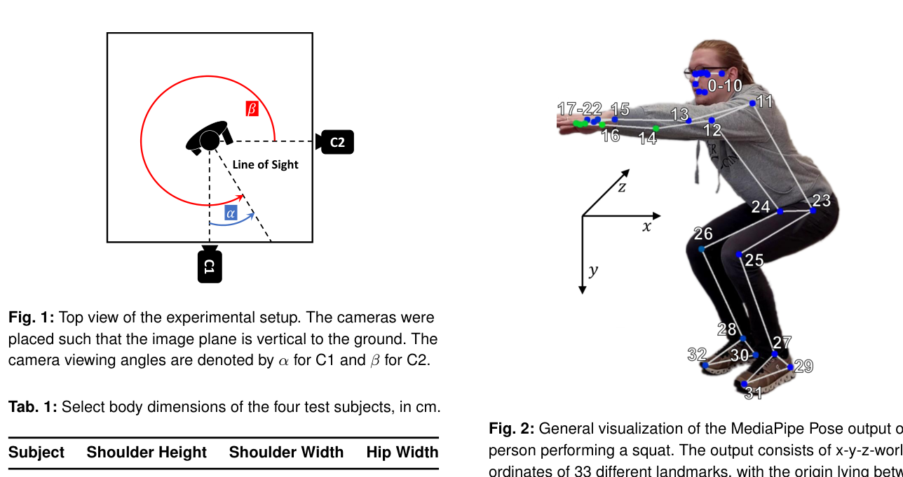
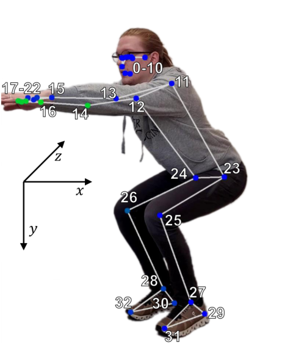
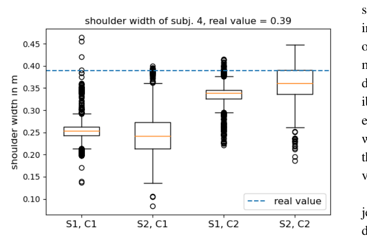
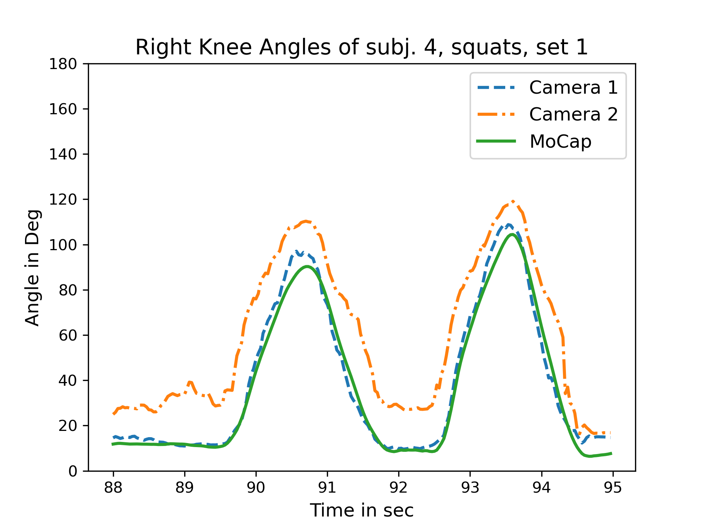
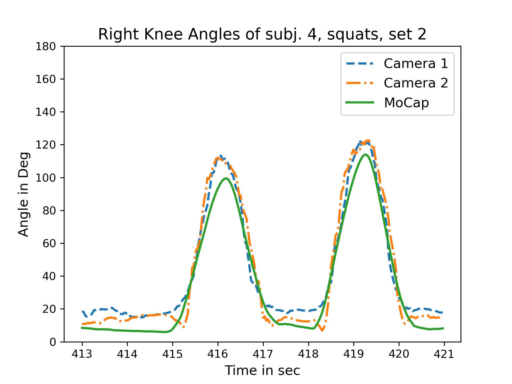

DE GRUYTER Current Directions in Biomedical Engineering 2023;9(1): 563-566

# Sebastian Dill*, Andreas Rösch, Maurice Rohr, Gökhan Güney, Luisa De Witte, Elias Schwartz, and Christoph Hoog Antink Accuracy Evaluation of 3D Pose Estimation with MediaPipe Pose for Physical Exercises

https://doi.org/10.1515/cdbme-2023-1141

Abstract: With the recent increase in interest in machine learning and computer vision, camera-based pose estimation has emerged as a promising new technology. One of the most popular libraries for camera-based pose estimation is MediaPipe Pose due to its computational efficiency, ease of use, and the fact that it is open-source. However, little work has been performed to establish how accurate the library is and whether it is suitable for usage in, for example, physical therapy. This paper aims to provide an initial assessment of this. We find that the pose estimation is highly dependent on the camera’s viewing angle as well as the performed exercise. While high accuracy can be achieved under optimal conditions, the accuracy quickly decreases when the conditions are less favourable.

Keywords: Computer Vision, Pose Estimation, Motion Analysis, MediaPipe, Accuracy Evaluation

## 1 Introduction

Building on the advances in computer vision in recent years, significant research has been conducted on video-based human pose estimation and motion capture. Popular libraries like MediaPipe Pose [1] have been utilized not only for entertainment, but even for complex medical applications such as joint load prediction [4] or movement limitation analysis [6]. The successful usage for these tasks indicate that the method might be applicable to physical therapy, enabling patients to do parts of their therapy at home while under supervision of an automated camera-based evaluation system. However, a great amount of responsibility and trustworthiness is required for this kind of application, since it directly affects the user’s health and well-being. Wrong executions and overexertion while doing at-home exercises might lead to an inefficient training or even worse, serious injuries [3]. Even though the

aforementioned approaches show promising results when pose estimation algorithms are used for high-level application tasks, this level of trustworthiness can not be achieved without direct accuracy evaluation of the libraries themselves, of which there has been a significant lack.

In this work, we aim to do provide a first step towards a quantitative evaluation of MediaPipe Pose, to asses its accuracy when calculating metrics relevant to physical therapy and identify its strengths and weaknesses. We will also give a qualitative recommendation for tasks that it can be used on and provide an outlook on how to improve it.

## 2 Methods

In order to give a qualitative evaluation of the MediaPipe pose estimation, an experiment was conducted where pose information of several people performing physical exercises was gathered by two cameras and a motion capture (MoCap) system. After synchronizing these three recordings, select metrics relevant for physical therapy were calculated and compared.

### 2.1 Experiment

An experiment was conducted to record both video data and ground truth (GT) MoCap data. The measurement setup consisted of two cameras (C1 and C2) positioned perpendicular to one another, recording an area of approximately 5  \times  5 meters, and the MTw Awinda MoCap system by Movella1, which has proven to be a reliable and accurate system to track human movement [5] and has been previously used in exercise-related movement analysis [2]. A schematic of the setup can be seen in Fig. 1, where the definition of the two camera viewing angles \alpha and \beta, specifying the angles between the subject’s line of sight and the cameras’ viewing directions, is also given.

Four healthy test subjects (all male) were recorded doing five different stationary physical exercises (two push-up variants, squats, kick-backs on all fours, ground swimming) under the supervision of a physiotherapist. To calibrate the Mo- Cap suit, several body dimensions of the subjects were measured. Tab. 1 gives an overview over some of these measure-

S. Dill et al., Accuracy evaluation of MediaPipe Pose for physical exercise analysis

| Subject | Shoulder Height | Shoulder Width | Hip Width |
| --- | --- | --- | --- |
| 1 | 159.0 | 34.0 | 26.0 |
| 2 | 152.5 | 35.5 | 26.0 |
| 3 | 157.5 | 39.0 | 28.0 |
| 4 | 158.0 | 39.0 | 30.0 |

ments. Each subject performed two sets of exercises (S1/S2),

interrupted by a short period of walking where they left the view of the cameras. Each set consisted of six repetitions of each exercise. All subjects performed the first set of exercises in the center of the measurement area, under an angle of \alpha = 90∘, \beta = 0∘. For the second set, the angles were individually changed by each subject (Subj. 1: \alpha = 180∘, \beta = 90∘, Subj. 2: \alpha = 30∘, \beta = -60∘, Subj. 3: \alpha = -90∘, \beta = 180∘, Subj. 4: \alpha = 45∘, \beta = -45∘). Overall, 240 exercise instances were recorded.

### 2.2 Data Processing

The videos were recorded with two identical low-cost securitytype cameras2 with a resolution of 2560  \times  1920 pixels and a frame rate of 30 frames per second. The MoCap suit captured data with 60 Hz, which was downsampled to match the 30 Hz of the cameras. MediaPipe Pose was run on every video recording to receive a pose estimation with every parameter influencing accuracy set to the highest possible value3. MediaPipe’s output consists of real-world x-y-z-coordinates of 33 different pose landmarks (in meters), where the x-y-plane is parallel to the image plane and the z-axis is oriented perpendicularly away from the camera. The coordinate systems

*the hip joints (23 and 24). MediaPipe’s visibility estimate is colorcoded from blue (1) to green (0).*

are centered between the hip joints and move with the subject. A visualization of the landmarks and the coordinate system is given in Fig. 2. Due to the positioning of the cameras, as

seen in Fig. 1, the coordinate systems of the two cameras are rotated by approximately 90∘ around the y-axis. The MoCap suit outputs x-y-z-coordinates of 23 different segments as well as 66 joint angles such as Right Knee Flexion/Extension. This coordinate system’s origin is set once during calibration and does not depend on the subject’s movement. The axes are oriented such that the x-y-plane is parallel to the ground while the z-axis is pointing vertically upwards.

To synchronize the three different recordings, an overall movement metric M was calculated by summing up the difference over all joint coordinates between each frame. While the pose data from all three recordings are given in a different coordinate system each, all three coordinate systems share one axis vertical to the ground. It is also the axis in which the movement range is the largest since all exercises are stationary. Therefore only this axis was considered when calculating M. The so-calculated movement metrics are normalized and correlated to determine the offset.

### 2.3 Metrics

Since the goal of this work was to assess the quality of MediaPipe’s raw pose estimation capabilities without any additional post-processing, we opted to not compare the coordinate values directly since this would have required a coordinate transformation, which inherently depends on the coordi-

S. Dill et al., Accuracy evaluation of MediaPipe Pose for physical exercise analysis

nate values. Instead, the results are focused on metrics that are independent of the coordinate systems. Namely, the metrics investigated are the shoulder width, hip width and the flexion angles of the knees and elbows. The shoulder width and hip width can be calculated from the MediaPipe data as the euclidean distance between joints 11 and 12, as well as 23 and 24 respectively. These values should have low variance over time because of an anatomically limited range of motion. The true values have already been measured before the experimented and are displayed in Tab. 1. The flexion angles are defined as the 3D angles between the corresponding limbs and can easily be calculated from the pose coordinates. The true values are directly output by the MoCap suit.

## 3 Results and Discussion

The results for the body dimension comparisons are presented first. Fig. 3 shows the box plot of the estimated shoulder widths for subject 4 as an example. From this boxplot several conclusions can be drawn. First, it is very obvious that the shoulder width is both biased and not constant. While the bias is easily explained by the fact that MediaPipe has no information about the subject’s size, the high interquartile range in the estimates show that the underlying model is not consistent over time, indicating a more profound limitation of the model. Secondly, a high dependency on the viewing angle of the cameras can be noted. When relating the interquartile range to the median, the lowest value is achieved for (S1, C2), where the viewing angle is 0∘ and highest for (S2, C1) and (S2, C2), where the viewing angles are 45∘.

**Tab. 2: RMSE of the relative shoulder width (SW) and hip width (HW), as estimated from camera one (C1) and camera 2 (C2), separated by set. All values are relative to the normalized measured widths for each subject.**

| Subject/Set | SW (C1) | SW (C2) | HW (C1) | HW (C2) |
| --- | --- | --- | --- | --- |
| 1/1 | 15.39% | 14.31% | 6.24% | 16.63% |
| 1/2 | 15.15% | 11.18% | 17.43% | 9.78% |
| 2/1 | 22.55% | 14.30% | 4.99% | 19.36% |
| 2/2 | 20.49% | 17.83% | 17.30% | 30.65% |
| 3/1 | 26.41% | 10.70% | 5.40% | 17.89% |
| 3/2 | 8.64% | 11.27% | 34.37% | 19.91% |
| 4/1 | 29.05% | 5.71% | 11.90% | 24.23% |
| 4/2 | 29.78% | 11.22% | 12.06% | 33.81% |

widths were also normalized. Then, the root-mean-squareerror (RMSE) was calculated over all frames in which a person was detected. The results are given in Tab. 2. The maximum RMSE of the shoulder width is calculated for subject 4, (S2, C1), being 29.78% off of the true value. The maximum RMSE of the hip width is calculated for subject 3, (S2, C1), being 34.37% off of the mean true value. This also highlights the dependency on the viewing angle, where the 45∘ angle chosen by subject four for the second set, seems to be particularly bad for the estimation. For the first sets, where the camera viewing angles do not change between subjects, the RMSE for the shoulder widths is always less for C2 than C1. This can be expected, as for C1, the shoulder joints lie directly behind one another, with the first occluding the second, impeding the estimation. Interestingly, this does not hold true for the hip width, which most of the times behaves exactly opposite to the shoulder width when comparing C1 and C2.

The results for the angle estimation of subject 4 are presented in Fig. 4 as an example. From the first set, the viewing angle dependency is once again apparent. C2 is constantly overestimating the angle while C1 matches the true value almost perfectly. This again is expected since the angle is predominantly in the x-y-plane of C1, and therefore highly visible. From the second graph, it is interesting to note that the estimation quality does not degrade as much as it did for the width estimations. Instead, both cameras manage to estimate the angle rather well. The biggest deviations from the true value are visible when the angle approaches 0∘.

*Fig. 3: Boxplot showing the shoulder width of subject 4, estimated for each set (S1/S2) and from both cameras (C1/C2).*

To combat the bias, the estimated widths were normalized by the estimated shoulder heights. Similarly, the measured

Tab. 3 shows the RMSE of important angles over all subjects for all exercises. The table once again suggests a high dependency of the camera’s viewing angle. Furthermore, it is apparent that the angle estimation works best for the squat exercise, where the subjects are standing. On the other hand, the error is the highest for the ground swimming exercise where

the subjects are lying on the ground. This is to be expected considering the setup. The closer the person is to lying, the

S. Dill et al., Accuracy evaluation of MediaPipe Pose for physical exercise analysis

*Fig. 4: Plot showing the right knee angles of subject 4 while performing two repetitions of the squat exercise. The first set is shown at the top and the second set is shown at the bottom.*

smaller the area visible to the camera becomes. Furthermore, the probability for self-occlusion increases.

## 4 Conclusion

In this work, we have performed a qualitative assessment of MediaPipe’s pose estimation by conducting an experiment where several subjects performed physical exercises and comparing metrics relevant to physical therapy to a ground truth recorded by a motion capture system. From our results, it can be seen, that the pose estimation is highly dependent on the camera’s viewing angle as well as the performed exercise. While high accuracy can be achieved when the subject is performing a standing exercise under an optimal angle, the accuracy quickly declines when the angle is less favourable or the exercise inherently causes self-occlusion. The next logical step to increase accuracy would be to fuse the pose information provided by the two cameras. This would both reduce the dependency on the angle and limit the influence of self-occlusion. Another approach could be to employ bio-

**Tab. 3: RMSE over all subjects of one important angle for each exercise, for both sets and cameras. RE: right elbow angle, RK: right knee angle. All values are given in degree (∘).**

| Exc./Angle | (S1,C1) | (S1,C2) | (S2,C1) | (S2,C2) |
| --- | --- | --- | --- | --- |
| Push-Up/RE | 15.32 | 34.96 | 26.58 | 23.30 |
| Push-Up v.2/RE | 22.40 | 33.71 | 29.34 | 32.71 |
| Squat/RK | 9.14 | 14.19 | 12.45 | 14.48 |
| Kick-Back/RK | 24.27 | 18.76 | 24.90 | 25.56 |
| Swimming/RE | 23.48 | 50.76 | 42.22 | 42.61 |

mechanical movement models that the pose information is fitted to. This way it could be ensured that certain body proportions remain constant.

Author Statement Research funding: The authors gratefully acknowledge financial support provided by the Hessian Ministry for Digital Strategy and Development [Hessisches Ministerium für Digitale Strategie und Entwicklung, Distr@l-Förderlinie 2, “SG4smartmedication”, 21_0038_2A]. Conflict of interest: Authors state no conflict of interest. Informed consent: Informed consent has been obtained from all individuals included in this study. Ethical approval: The research related to human use complies with all the relevant national regulations,

institutional policies and was performed in accordance with the tenets of the Helsinki Declaration as a self-experiment of the authors.

## References

[1] Bazarevsky V, Grishchenko I, Raveendran K, et al. BlazePose: On-device Real-time Body Pose tracking. 2020; doi: 10.48550/ARXIV.2006.10204. [2] Di Paolo, Stefano, et al. Rehabilitation and return to sport assessment after anterior cruciate ligament injury: quantifying joint kinematics during complex high-speed tasks through wearable sensors. Sensors, 2021, 21. Jg., Nr. 7, S. 2331. [3] Jones, Bruce H.; COWAN, David N.; KNAPIK, Joseph J. Exercise, training and injuries. Sports Medicine, 1994, 18. Jg., S. 202-214. [4] Mehrizi R, Peng X, Metaxas DN, et al. Predicting 3-D Lower Back Joint Load in Lifting: A Deep Pose Estimation Approach. IEEE Trans Hum-Mach Syst 2019;49(1):85–94; doi: 10.1109/THMS.2018.2884811. [5] Paulich, Monique, et al. Xsens MTw Awinda: Miniature wireless inertial-magnetic motion tracker for highly accurate 3D kinematic applications. Xsens: Enschede, The Netherlands, 2018. [6] Trinidad-Fernández M, Cuesta-Vargas A, Vaes P, et al. Human motion capture for movement limitation analysis using an RGB-D camera in spondyloarthritis: a validation study. Med Biol Eng Comput 2021;59(10):2127–2137; doi: 10.1007/s11517-021-02406-x.

## Footnotes
- **[p.1.1]** *Corresponding author: Sebastian Dill, KIS*MED, Technische Universität Darmstadt, Merckstraße 25, Darmstadt, Germany, e-mail: dill@kismed.tu-darmstadt.de Maurice Rohr, Gökhan Güney, Christoph Hoog Antink, KIS*MED, TU Darmstadt, Merckstraße 25, Darmstadt, Germany Andreas Rösch, Luisa De Witte, Elias Schwartz, smart medication eHealth Solutions GmbH, Kauber Weg 2, Frankfurt am Main, Germany
- **[p.1.2]** 1 https://www.movella.com/products/wearables/xsens-mtw-awinda
- **[p.1.3]** Open Access. © 2023 The Author(s), published by De Gruyter. License.
- **[p.1.4]** This work is licensed under the Creative Commons Attribution 4.0 International
- **[p.2.5]** 2 Reolink RLC-510A, https://reolink.com/de/product/rlc-510a/ 3 https://github.com/google/mediapipe/blob/master/docs/solutions/pose.md