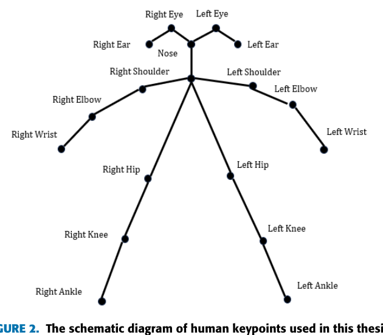

Received 15 January 2025, accepted 5 February 2025, date of publication 14 February 2025, date of current version 10 March 2025.

Digital Object Identifier 10.1109/ACCESS.2025.3542240

# Efficient Real-Time Sports Action Pose Estimation via EfficientPose and Temporal Graph Convolution

YUANZHE MA^{1}, HUI LI^{2}, AND HONGQIAO YAN 2

1Graduate School, Shandong Sport University, Jinan 250100, China 2School of Sport Communication and Information Technology, Shandong Sport University, Jinan 250100, China

Corresponding author: Hongqiao Yan (yanhongqiao@sdpei.edu.cn)

ABSTRACT Accurate and efficient human pose estimation is crucial for precise motion tracking and performance feedback in real-time sports analysis. This paper presents a real-time pose estimation framework that integrates EfficientPose and T-GCN (Temporal Graph Convolutional Networks) to address the challenges of dynamic and complex sports scenarios. EfficientPose utilizes a highly efficient network architecture to achieve accurate 3D pose estimation from single-frame images, providing a robust foundation for subsequent temporal modeling. T-GCN further refines the motion trajectories by modeling temporal dependencies and spatial relationships across frames, ensuring temporal continuity and spatial consistency. Experimental results demonstrate the superior performance of the proposed framework, achieving the lowest Mean Absolute Error (MAE: 30.5 mm), the highest Multiple Object Tracking Accuracy (MOTA: 80.2%), and maintaining a real-time frame rate (45 FPS) across multiple benchmarks. Compared to traditional methods, the proposed approach exhibits significant advantages in handling high-speed motions, occlusions, and complex multi-agent interactions, enabling high-precision and temporally stable pose estimation. This framework provides an efficient and robust solution for real-time sports performance analysis, offering valuable scientific support for performance feedback and tactical decision-making.

INDEX TERMS Real-time pose estimation, EfficientPose, T-GCN, 3D pose estimation, performance feedback.

I. INTRODUCTION In sports events, real-time estimation of athletes’ motion poses is critical for tactical adjustments and immediate decision-making. Due to the rapid changes and high irregularity of athletes’ movements during competitions, coaches and analysts urgently require more precise and timely information to devise more targeted strategies. However, traditional pose estimation methods often struggle to accurately capture dynamic pose changes, especially when dealing with fast and complex motion states, which leads to insufficient real-time feedback in terms of both accuracy and timeliness. In recent years, deep learning-based sports action pose estimation methods [1], [2], [3] have shown greater promise in capturing

pose variations during the movement process, providing more accurate pose estimates supported by large-scale data.

In the research on action pose estimation and real-time feedback systems, OpenPose [4] can accurately detect joint locations from a single image, making it suitable for processing planar information in images. However, it is limited in capturing depth information and analyzing complex dynamic scenes. To address this limitation, DensePose [5] is capable of better capturing depth information and analyzing dynamic scene details but still faces challenges in low-resolution images or multi-person scenarios, where the network must handle large amounts of computation, leading to poor realtime performance. In response to the limitations of these methods, this paper focuses on the latest advancements in EfficientPose [6]. EfficientPose introduces a CNN [7], [8] based feature extraction method and a highly efficient and accurate 3D pose estimation approach. With its efficient network architecture and precise joint localization, EfficientPose has quickly become a popular model in the field of human pose estimation. Compared to traditional pose estimation methods, EfficientPose provides more accurate 3D pose predictions [9], [10] while reducing computational overhead, making it ideal for real-time applications. However, its limitations are gradually becoming apparent, particularly in tracking athletes’ continuous movements and fine-grained modeling. Since CNNs primarily rely on local convolution operations, they are not well suited to modeling spatiotemporal dependencies. Therefore, combining other temporal modeling methods, such as LSTM (Long Short- Term Memory) [11], is often necessary. LSTMs are classical models for handling sequential data, capable of capturing long-term dependencies effectively over time, making them suitable for action pose prediction and estimation in video sequences. However, LSTMs are computationally expensive, particularly in multi-person scenarios and complex movements, leading to instability and difficulty in maintaining efficiency.

In response, this study focuses on T-GCN (Temporal Graph Convolutional Networks) [12]. T-GCN combines the advantages of GCN [13] and RNN [14], capturing both temporal changes and spatial dependencies. By integrating temporal information, T-GCN is able to infer the pose of occluded objects by leveraging information from preceding and subsequent time steps, significantly improving the accuracy of multi-object pose estimation [15], [16], [17]. Additionally, T-GCN can capture long-term dependencies in temporal sequences, providing stable and efficient performance when dealing with complex dynamic changes and multi-object interactions.

In this paper, we propose a model architecture that integrates EfficientPose and T-GCN to facilitate efficient real-time action pose estimation in sports events. Efficient- Pose is employed for 3D pose estimation in each frame, while T-GCN is utilized for temporal modeling to optimize the motion trajectory of each joint between frames. This integrated approach enhances the temporal consistency and stability of pose estimation, particularly in dynamically evolving environments such as sports events. The objective of this approach is to strike a balance between real-time performance and accurate pose estimation, thereby ensuring the production of high-quality results in rapidly changing scenarios. The contributions of this paper are as follows:

• Integration of EfficientPose and T-GCN to propose an
efficient and accurate real-time pose estimation solution,
optimized for the complexity and rapid changes of
athlete movements in sports events.

• Introduction of a temporal information-based multiobject pose estimation method that enhances the
continuity and accuracy of athlete motion estimation.

• Validation of the proposed method’s performance
in multi-athlete pose estimation within the complex

dynamic context of sports events, achieving efficient and real-time pose estimation.

II. RELATED WORKS A. MULTI-PERSON POSE ESTIMATION Multi-person pose estimation is a crucial research direction in the field of human pose estimation, especially in complex scenarios where accurate pose estimation for multiple athletes is of significant practical value. In sports events, action analysis of athletes typically involves real-time tracking and action prediction for multiple individuals. Therefore, the accuracy and efficiency of multi-person pose estimation are essential for tactical adjustments and immediate decision-making. Traditional multi-person pose estimation methods often rely on segmenting and processing each individual separately, which often fails in scenarios with overlapping individuals, interactions, or complex backgrounds. To address these issues, deep learning-based methods have gradually become the mainstream in recent years. Particularly, with the combination of CNN, RPN (Region Proposal Networks ) [18], and GNN (Graph Neural Networks) [19], precise pose estimation can be achieved in complex multi-person scenes [20], [21].

One of the most representative works in multi-person pose estimation is OpenPose, proposed by Osokin et al. [22], which detects 2D keypoints of single or multiple people in an image using CNN. This method first generates a heatmap and then identifies the positions of human joints through a keypoint regression network. Although OpenPose demonstrates high accuracy and good real-time performance, it still faces certain limitations when handling overlapping or highly interactive athletes. Especially in multi-person scenes, distinguishing and tracking each person’s actions becomes a challenging problem. To improve the performance of multi-person pose estimation, methods such as AlphaPose by Fang et al. [23]and HRNet by Sun et al. [24]. introduce more complex model structures. AlphaPose uses a deep learning-based single-object detection approach, combining pose estimation and human detection into a joint model, enabling simultaneous detection and estimation in multi-person scenes with greater robustness than OpenPose. Additionally, HRNet [25] uses a multi-resolution network architecture to integrate information across different scales, which allows for more precise pose estimation and maintains high accuracy in dynamic multi-person scenarios.

Concurrently, the research impact of 3D multiplayer pose estimation [26], [27] is expanding. Sun et al. [28] proposed a single-stage volumetric heatmap method, which combines all the weights and their probabilities to estimate the positions of 3D joints through regression techniques. This approach enhances the precision of 3D pose estimation, particularly in dynamic scenarios. Martinez et al. [9] have proposed a straightforward yet effective two-stage method for pose estimation. This method initially extracts the 2D joints of the human body and elevates them into 3D space. Fang et al. [29] have further extended this method with a pose grammar network that substantially enhances the accuracy of pose regression, especially in complex dynamic scenes with multiple interactions.

B. POSE ESTIMATION BASED ON GRAPH NEURAL NETWORKS GNN have gained widespread attention in the computer vision field in recent years, showing significant potential in human pose estimation. Since human joints [30] and skeletons naturally form a graph structure, GNNs provide a novel way to model pose estimation. Unlike traditional CNNs, which rely on local convolutional operations, GNNs can effectively model the global spatial relationships between joints [31], capturing richer spatial dependencies and thereby significantly improving the accuracy and robustness of pose estimation.

In traditional CNN-based pose estimation, human joints’ positions are predicted by progressively extracting local features from images. However, this approach has limitations when handling complex spatial dependencies between human joints, especially in multi-person scenes with occlusions or strong interactions. In contrast, GNNs explicitly model the adjacency relationships between joints, enabling them to capture the global information of the skeleton structure and improve pose estimation performance.

One of the most representative works in GNN-based pose estimation is GPE (Graph-based Pose Estimation), proposed by Wu et al. [32]. In this approach, the human skeleton is modeled as a graph, where each joint represents a node, and the connections between joints represent their spatial relationships. GCN (Graph Convolutional Networks) [33] are then applied to these graphs to capture the spatial dependencies between joints on a global scale, enabling more accurate pose estimation in complex dynamic scenes. Compared to traditional convolution-based methods, GNNs can handle complex human poses and multi-object interactions more flexibly by directly operating on the graph structure.

Additionally, Pose-GCN, a method proposed by Zhao et al. [34], further expands the application of GNNs in human action recognition and multi-object pose estimation. Pose-GCN adopts a multi-level graph convolutional structure, which not only captures local relationships between human joints but also optimizes the overall pose estimation through global information. With this multi-level design, Pose- GCN can better integrate spatial information at various levels, improving pose estimation accuracy, especially in complex multi-person interactions and occlusion scenarios, demonstrating high robustness.

III. METHODOLOGY This section presents a real-time action pose estimation method for sports events that combines EfficientPose and T-GCN. The proposed approach leverages the synergy of two key components: first, EfficientPose is used to perform 3D pose estimation from each frame of the video; second, T-GCN is employed to model the temporal relationships across different time steps, optimizing the motion trajectories

of the joints. As shown in Fig. 1. In the following, we will provide a detailed description of the implementation of these two components and demonstrate how their collaboration enhances both the accuracy and efficiency of real-time pose estimation in sports events.

A. DYNAMIC FEATURE CAPTURE UNIT The DFCU (Dynamic Feature Capture Unit) is a key component in this study, designed to extract high-level representations of motion information from input video sequences, enabling efficient and accurate real-time action pose estimation. The DFCU receives an input sequence X = [x_{1}, x_{2}, . . . , x_{t}], where each x_{t}  \in  R^{d}^{t} represents the feature vector at time step t. Prior to processing by the DFCU, the input sequence undergoes preprocessing steps, including resizing, normalization, and data augmentation, to ensure that the model adapts to different conditions and improves generalization ability.

The preprocessed single-frame images are then passed through the EfficientPose module, which utilizes an extended EfficientNet as the backbone network. EfficientNet optimizes the network across depth, width, and resolution using a compound scaling method, significantly enhancing feature extraction accuracy while maintaining computational efficiency. The backbone network extracts rich deep features from the input images, which play a crucial role in the subsequent pose estimation process.

In the feature map generation phase, the DFCU extracts deep features from the image using the extended EfficientNet  \in  R^{H} \times W \times 3, where backbone. Let the input image be I H and W represent the height and width of the image, and 3 represents the RGB color channels. After passing through the EfficientNet backbone, the output feature map F  \in  R^{H}′ \times W ′ \times C is obtained, described in Equation (1), where H′ and W ′ represent the height and width of the feature map, and C is the number of channels.

$$
F = EfficientNet ( I ) . \tag{1}
$$

The feature map F is then processed through a series of convolutional layers and upsampling operations to obtain the feature map for each keypoint. For each keypoint p_{i} (where i represents the keypoint index), its feature map F_{i} is obtained by applying convolution to the feature map F:

$$
F_{i} = Conv ( F , W_{i} ) , \tag{2}
$$

where W_{i} is the convolution kernel associated with keypoint p_{i}, and F_{i} is the feature map representing the local spatial information around keypoint p_{i}. Each keypoint’s feature map F_{i} provides a high-dimensional representation of the keypoint’s position and its local context in the image. described in Equation (2), These feature maps are capable of accurately capturing the spatial location and surrounding contextual information of the keypoints, providing richer feature representations for the subsequent pose regression.

In the pose regression phase, the generated feature maps F_{i} are passed through the pose regression layer, which regresses the 2D keypoint information to 3D pose estimation keypoints. The key challenge in this step is to accurately estimate the depth information of the keypoints, achieving a precise conversion from 2D to 3D. The mathematical model for pose regression can be expressed as:

![FIGURE 1. The framework is a deep learning model based on EfficientPose and T-GCN, specifically designed for efficient real-time action pose estimation in sports events. The model takes a video sequence [x1, x2, . . . , xt ] as input, where each video frame is first processed through the EfficientPose backbone network for feature extraction. The extracted features are then passed through a pose regression module to obtain keypoint information. The resulting keypoints, along with the temporal sequence data, are fed into the T-GCN network for temporal modeling. In this way, the model is capable of accurately estimating human poses.](assets/IEEE_Trans_EfficientPose_Temporal_GCN/fig_p4_1.png)

*FIGURE 1. The framework is a deep learning model based on EfficientPose and T-GCN, specifically designed for efficient real-time action pose estimation in sports events. The model takes a video sequence [x1, x2, . . . , xt ] as input, where each video frame is first processed through the EfficientPose backbone network for feature extraction. The extracted features are then passed through a pose regression module to obtain keypoint information. The resulting keypoints, along with the temporal sequence data, are fed into the T-GCN network for temporal modeling. In this way, the model is capable of accurately estimating human poses.*

$$
T_{i} = R ( F_{i} ) , \tag{3}
$$

where T_{i} represents the 3D pose estimation keypoints for keypoint p_{i}, and R is the pose regression function that maps the 2D feature map F_{i} to its corresponding 3D coordinates. Described in Equation (3), Through this series of processing steps, the DFCU extracts high-level representations of motion information from the input sequence, laying the foundation for subsequent action pose estimation while ensuring real-time performance and accuracy, thus meeting the stringent requirements of real-time sports action pose estimation.

B. SKELETON GRAPH CONSTRUCTION AND KEYPOINT GROUPING In the field of human pose estimation, the accurate grouping of keypoints is crucial for constructing the human skeleton, as it lays the foundation for skeleton generation. In this study, we refer to the keypoint localization standards used in the human pose estimation task of the COCO dataset and, following the design principles of lightweight networks,

carefully select 18 keypoints. These include 5 points on the face and 13 points on the limbs and torso. As shown in Fig. 2.

The process of constructing a skeleton graph involves abstracting the human skeleton into a graph model. In a human skeleton, let N represent the total number of joints, and the skeleton can be abstractly represented as an undirected graph G = (V, E). In this graph, V = [v_{1}, v_{2}, . . . , v_{N}] represents all vertices, i.e., the joints in the skeleton, and E represents the edges, which denote the physical connections between joints. The dependencies between the joints are encoded using an adjacency matrix ˆA, described in Equation (4), whose elements are defined as follows:

(

$$
\begin{aligned} 1 , if i = j or v_{i} isconnectedto v_{j} \\ 0 , otherwise . \end{aligned} \tag{4}
$$

ˆA_{ij} =

The direct connections between joints form the edges of the graph, and this graph structure spatially describes the physical relationships between the keypoints.

Based on the skeleton graph constructed above, the T-GCN proposes a graph convolution implementation suitable for skeleton data. Given an input feature map f_{in}  \in  R^{C}^{in} \times T \times N, where C_{in} represents the number of input channels, T denotes the number of time steps, and N is the number of nodes (or entities), the temporal graph convolution operation can be expressed as:

K X

A_{k} ⊙ (Wf_{in}), (5)

f_{out} =

k=1

where f_{in} serves as the input feature map, containing the feature information of both time steps and nodes. The graph convolution operation is performed by summing over K subsets of temporal adjacency matrices A_{k}, where A_{k}  \in  R^{T} \times T is a temporal adjacency matrix that captures the dependencies between different time steps. The matrix element A_{k}[i, j] represents the strength of the dependency between time step i and time step j.

The weight matrix A_{k}[i, j]W  \in  R^{C}^{out} \times C_{in} is a learnable parameter that transforms the input feature map from the input channel space to the output channel space. The operator ⊙ refers to the element-wise multiplication, commonly known as the Hadamard product. Specifically, the Hadamard product multiplies the temporal adjacency matrix A_{k} elementwise with the transformed input feature map Wf_{in}, where Wf_{in} denotes the input feature map after being transformed by the learnable weight matrix W. By summing over all subsets of the temporal adjacency matrix, the final output feature map f_{out}  \in  R^{C}^{out} \times T \times N is obtained, as described in Equation (5), where C_{out} represents the number of output channels.

C. SPATIAL AND TEMPORAL DEPENDENCIES T-GCN combines temporal and graph convolution operations to efficiently model both spatial and temporal dependencies in spatio-temporal graph data. Unlike traditional RNNs, T-GCN avoids recursive computations and achieves higher efficiency by integrating graph and temporal convolutions. The graph convolution captures spatial dependencies among nodes, while the temporal convolution models dependencies across different time steps.

Specifically, the temporal adjacency matrix A_{k} represents the strength of dependencies between time steps, where A_{k}[i, j] denotes the dependency between time step i and

time step j. This matrix can be learned from data. By leveraging this matrix, T-GCN can effectively capture both short-term and long-term dependencies in the temporal domain.

In the graph convolution component, the model updates the node representations with the following equation:



ˆAH^{(}^{l}^{)}W^{(}^{l}^{)}

$$
H^{( l + 1 )} = \sigma
$$

, (6)

where H^{(}^{l}^{)} is the node feature matrix at layer l, ˆA is the normalized adjacency matrix (including self-connections), and W (l) is the weight matrix at layer l. The activation function \sigma is typically a non-linear function such as ReLU. described in Equation (6), Graph convolution aggregates information from neighboring nodes by a weighted sum,

capturing spatial dependencies in the graph structure.

In the temporal convolution component, T-GCN employs 1D convolutions to model the temporal sequence, defined as:

K X

$$
w_{k} X_{t + k} , \tag{7}
$$

X_{t} =

k=-K

where X_{t} represents the feature vector at time step t, w_{k} are the weights of the convolution kernel, and K is the size of the convolution window, described in Equation (7), determining the range of time steps considered. This operation allows the model to integrate information from past time steps, effectively capturing dynamic dependencies across time.

By combining these two convolution operations, T-GCN is able to capture both spatial and temporal dependencies. The spatial and temporal convolutions are integrated in the following way:

H^{(}^{l}^{+}^{1)} t

= \sigma(A_{k}H_{t}^{(}^{l}^{)}W^{(}^{l}^{)})

K X

X^{(}^{l}^{+}^{1)} t

$$
w_{k} H_{t}^{( l + k )} . \tag{8}
$$

=

k=-K

The first equation represents the graph convolution operation described in Equation (8), updating the node representations based on the temporal adjacency matrix A_{k}, while the second equation is the temporal convolution, which captures the dependencies across time steps. By combining these two components, T-GCN effectively handles complex dependencies in spatio-temporal data, enabling the model to better adapt to dynamic changes in temporal graphs.

D. POST-PROCESSING AND OPTIMIZATION After the pose estimation and temporal modeling processes are completed, post-processing steps are crucial for refining the results and ensuring the accuracy, smoothness, and temporal consistency of the predictions. Although T-GCN effectively captures the temporal dependencies between joints, the motion trajectories may still exhibit irregular fluctuations due to noise in the input data, sensor inaccuracies, or computational limitations. To address these issues, this study first applies the EMA (Exponential Moving Average) method to smooth the motion trajectories across frames.

EMA assigns higher weights to the most recent frames, enabling the model to respond more quickly to rapid changes in motion, thereby offering greater flexibility and adaptability in dynamic sports environments. The EMA update equation is given by:

$$
x_{t} = \alpha x_{t} + ( 1 - \alpha ) x_{t - 1} , \tag{9}
$$

where x_{t} represents the estimated pose at the current frame, x_{t}-1 is the estimate from the previous frame, and \alpha  \in  [0, 1] is the smoothing factor. This method allows the system to reduce abrupt fluctuations in pose estimation, maintaining a smooth and consistent motion trajectory across frames. Compared to other smoothing techniques, EMA is computationally efficient and can update pose estimates in real time, making it particularly suitable for high-frame-rate video processing, thus ensuring both real-time performance and computational efficiency.

To further ensure the temporal consistency of the estimated poses, a temporal consistency check is performed. This process compares the pose estimates between the current frame and both previous and subsequent frames, assessing their temporal consistency and adjusting the pose when discrepancies are detected. The temporal error between consecutive frames is computed as:

$$
1 p_{t , t + 1} = | p_{t} - p_{t + 1} | , \tag{10}
$$

where p_{t} and p_{t}_{+}_{1} denote the pose estimates at time steps t and t + 1, respectively. If the temporal error exceeds a predefined threshold ϵ, the system triggers an optimization process to update the joint positions, ensuring smoother transitions between frames. The temporal consistency check is especially important for real-time sports analysis, where it helps coaches and analysts to reliably track athletes’ movements without being disrupted by erroneous predictions.

In addition to smoothing and consistency checks, joint trajectory optimization plays a vital role in the postprocessing phase. This process further refines the spatial positioning and temporal alignment of joints through global optimization techniques, such as nonlinear least squares and constrained optimization. The optimization objective is to minimize the following loss function:

N X



∥\theta_{i} - ˆ\theta_{i}∥2 + \lambda∥\theta_{i} - \theta_{i}-1∥2

L(\theta) =

, (11)

where ˆ\theta_{i} represents the estimated position of joint i, \theta_{i} is the ground-truth position, and \lambda is a regularization factor that controls the smoothness of the trajectory by penalizing large deviations between consecutive joint positions. This optimization ensures that the joint positions follow anatomically plausible motion patterns. For instance, if a joint’s predicted position results in an unrealistic pose (e.g., an elbow bending backward), the optimization process will adjust the trajectory to align with expected biomechanical constraints. This refinement ensures that even in cases of occlusion or rapid motion, the pose estimation remains both accurate and natural.

Finally, considering the stringent real-time requirements, the post-processing optimization must not only improve the accuracy of the pose estimates but also maintain computational efficiency. Therefore, this study employs multi-threading and parallel processing techniques to distribute the pose estimation and post-processing tasks across multiple computing cores, accelerating processing speed. Additionally, GPU acceleration is utilized to handle large-scale matrix operations, convolutional layers, and graph convolutions, significantly improving computational efficiency and enabling the system to process high-framerate video streams in real time. Moreover, model pruning is applied to remove unnecessary components, thereby reducing the computational load while maintaining system efficiency. These optimizations ensure that the system can provide high-precision pose estimates while meeting the real-time requirements of sports event analysis.

IV. EXPERIMENT A. DATASET AND EXPERIMENTAL SETUP In this study, we conducted experiments in multiple hardware environments and trained and tested the model on widely used human pose estimation datasets. The experimental setup includes multiple NVIDIA A100 GPUs paired with Intel Xeon processors to support large-scale data processing and the training of complex models. The operating system used is Ubuntu 20.04 LTS, and the deep learning framework is PyTorch 1.10.1, combined with CUDA 11.4 and cuDNN 8.2 to fully leverage GPU acceleration. All experiments were run in Python 3.7.1 environment.

We selected three widely adopted datasets for model training and evaluation: PoseTrack [35], Human3.6M [36], and Sports-1M [37]. The PoseTrack dataset is commonly used for human pose estimation and multi-object tracking tasks. It consists of numerous video sequences with 2D and 3D joint keypoint annotations for each frame. This dataset includes various sports scenarios and is particularly suited for training and evaluating multi-object pose tracking systems in complex interactive dynamic environments, such as athlete tracking and action recognition in sports events. The video clips in PoseTrack help train and evaluate multi-object pose tracking systems, effectively addressing challenges related to multi-person interactions and fast-moving actions [38].

The Human3.6M dataset is specifically designed for 3D human pose estimation and provides high-quality 3D pose annotations. It consists of 3.6 million frames from 11 different actors performing various complex actions, with high-resolution camera perspectives and precise joint annotations [39]. As one of the standard 3D pose estimation datasets, Human3.6M is a crucial resource for training and evaluating 3D human pose estimation models, particularly for in-depth motion pose analysis and high-precision pose estimation [40].

The Sports-1M dataset is a large-scale action recognition dataset containing one million video clips that cover a wide range of sports activities. Although it does not provide detailed pose annotations, it contains a large amount of sports-related video data, making it suitable for training deep learning models that combine action recognition and pose estimation. By combining the Sports-1M dataset with other pose estimation datasets, the model’s performance in real-time sports action pose estimation tasks can be significantly enhanced [41]. This is particularly beneficial in fast and complex sports environments, where the model can better adapt to the motion patterns of athletes.

Through the use of these diverse datasets, the model was trained and fine-tuned to improve its performance in real-time sports action pose estimation tasks, especially in dynamic and interactive environments.

B. EVALUATING INDICATOR To comprehensively evaluate the performance of models in real-time action pose estimation for sports events, three key evaluation MAE (metrics—Mean Absolute Error) [45], TC (Temporal Consistency) [46], and (Multiple Object Tracking) [47] —are introduced. MAE is primarily used to measure the error between the predicted joint positions and the ground truth, reflecting the accuracy of single-frame pose estimation. The formula for MAE is:

N X

MAE = 1

|p_{i} -ˆp_{i}|, (12)

N

i=1

where p_{i} represents the ground truth position of the i-th joint,

ˆp_{i} is the predicted position, and N is the total number of joints. MAE is a commonly used metric in pose estimation and is essential for evaluating the precision of joint localization at each time step. In the context of real-time sports event action analysis, accurate single-frame estimations are crucial for understanding and optimizing athletic movements.

On the other hand, TC evaluates the stability of model outputs across consecutive time steps. It measures how well the model maintains smooth transitions in pose estimation over time, reducing the risk of instability due to error accumulation. The formula for TC is:

T X

1 TC = T - 1

X

∥ˆp_{i}_{,}_{t} -ˆp_{i}_{,}_{t}-1∥2, (13)

t=2

i=1

where ˆp_{t} and ˆp_{t}-1 represent the predicted joint positions at time steps t and t -1, respectively, and T is the total number of frames in the sequence.

In this context, TC is calculated by evaluating the temporal consistency across all joints over time. Specifically, the model computes the difference between the predicted positions of each joint at successive time steps and averages this over all joints and time steps. A lower TC value indicates that the model maintains better temporal consistency, ensuring that pose estimation remains stable and smooth across frames. Temporal consistency is especially critical in real-time sports analysis, where it ensures that the model’s output transitions smoothly between frames, avoiding abrupt changes or errors that can disrupt the continuity of the pose estimation.

In addition to MAE and TC, MOT is introduced to evaluate the model’s performance in multi-object tracking scenarios, particularly in dynamic sports environments where multiple athletes interact or move quickly. MOT assesses the ability of the model to track and maintain the identity of multiple targets over time. Three key MOT evaluation metrics are used. The first is ID Switching, which measures the number of identity switches during tracking. A high number of ID switches indicates that the model has difficulty distinguishing between different objects over time, leading to incorrect tracking associations. The second metric is MOTA (Multiple Object Tracking Accuracy), which evaluates the overall tracking accuracy by considering (FNfalse negatives), FP(false positives), and ID Switch(identity switches). The formula for MOTA is:

P

t(FN_{t} + FP_{t} + ID_Switcht)

(14)

MOTA = 1 -

<table>
  <tr><th>-</th><th>t(FNt + P FPt t GTt + ID_Switcht) ,</th></tr>
  <tr><td colspan="2">represents the number of false negatives</td></tr>
  <tr><td colspan="2">number of false positives, IDSwitcht is the</td></tr>
  <tr><td colspan="2">switches, and GTt is the total number of</td></tr>
  <tr><td colspan="2">time t. MOTA provides a comprehensive</td></tr>
  <tr><td colspan="2">tracking performance, incorporating multiple</td></tr>
  <tr><td colspan="2">in the tracking process. The third</td></tr>
  <tr><td colspan="2">(Multiple Object Tracking Precision),</td></tr>
  <tr><td colspan="2">precision of tracking across all targets</td></tr>
  <tr><td colspan="2">calculates the average distance between</td></tr>
  <tr><td colspan="2">true positions of all targets in the sequence.</td></tr>
  <tr><td colspan="2">MOTP is:</td></tr>
  <tr><td colspan="2">= PT t=1 PN i=1 distance(ˆyi(t), yi(t)) ,</td></tr>
  <tr><td colspan="2">PT</td></tr>
</table>

The formula for MOTP is:

(15)

MOTP =

P^{T}

P^{N}

i=1 I(ˆy_{i}(t)̸ = -1)

t=1

where ˆy_{i}(t) and y_{i}(t) represent the predicted and ground truth positions of the i-th target (e.g., joint position in human pose estimation) at time step t, respectively. The indicator function I(·) ensures that only successfully detected targets are considered in the computation. Here, T is the total number of frames in the sequence, and N is the number of targets being tracked. MOTP computes the Euclidean distance between the predicted and ground truth positions for each target and then averages this value over all targets and time steps. This metric is critical for evaluating the robustness of the model in dynamic and rapidly changing sports scenarios, ensuring accuracy and consistency in multi-target tracking tasks.

By combining MAE, TC, and MOT, we can provide a comprehensive evaluation of models’ performance in real-time pose estimation in sports events. MAE focuses on the accuracy of individual frame predictions, TC ensures stability over time, and MOT guarantees robust tracking of multiple targets. Together, these metrics allow for an in-depth assessment of model precision, consistency, and robustness in complex dynamic environments, which is crucial for real-time action pose estimation in sports.

**TABLE 1. Performance comparison of different models in terms of Average MAE, Average TC, FPS, MOTA, and MOTP.**

|  |  |  |  |  |  |
| --- | --- | --- | --- | --- | --- |
|  |  |  |  |  |  |
|  |  |  |  |  |  |
|  |  |  |  |  |  |
|  |  |  |  |  |  |

C. COMPARATIVE EXPERIMENT As demonstrated by the experimental results, the combination of EfficientPose + T-GCN outperforms all other models across all evaluation metrics, showcasing exceptional performance. As shown in Table 1, the model achieves the lowest MAE of 30.5 mm and the lowest TC of 16.2 mm. These results highlight the model’s superior accuracy in single-frame pose estimation and stability in multi-frame temporal tracking. This combination excels in both pose precision and tracking stability, making it particularly well-suited for real-time sports action pose estimation tasks, where high accuracy in individual frame predictions and consistent tracking over time are critical in dynamic, fastchanging sports environments.

Additionally, the model performs exceptionally well in

terms of MOTA and MOTP. By effectively reducing false positives, false negatives, and identity switches, the EfficientPose + T-GCN combination maintains high tracking accuracy in multi-object scenarios, even in complex, dynamic sports settings. This model stands out for its ability to accurately track multiple athletes and maintain identity consistency, which is especially crucial in sports events where athletes interact frequently and move at high speeds.

The performance improvements can be attributed to EfficientPose, a lightweight and efficient backbone for pose estimation, combined with T-GCN, which excels at capturing temporal dynamics between frames. As shown in Fig. 3 The combination of precise pose estimation and temporal consistency ensures that the model not only provides high-accuracy pose predictions for each frame but also maintains coherence and stability across time. This feature is particularly important for sports action analysis tasks that require real-time understanding of athlete movements, as it allows the model to provide smooth, stable pose estimations across multiple frames.

The experimental results demonstrate that the combination of EfficientPose and T-GCN outperforms all other models in both pose estimation accuracy and multi-object tracking performance. The model’s outstanding performance in metrics such as MAE, TC, MOTA, and MOTP highlights its effectiveness for real-time sports applications, particularly in tasks that require both high precision and temporal consistency in tracking multiple athletes. These results emphasize the value of combining EfficientPose with T-GCN, providing a robust solution for real-time sports action pose estimation and tracking in dynamic and interactive environments.

![FIGURE 3. The figure presents a runtime performance comparison of various 3D pose estimation models, including HRNet (3D), PoseResNet (3D), OpenPose (3D), AlphaPose (3D), ST-GCN (3D), and SufficientPose + T-GCN (Ours). The x-axis represents the number of people in the input data, ranging from 2 to 10, while the y-axis indicates the runtime in milliseconds (ms). The results demonstrate that OpenPose consistently exhibits the highest runtime, while SufficientPose + T-GCN achieves the lowest runtime across all scenarios, underscoring its efficiency. The other models display runtime performance with varying linear growth trends as the number of people increases, with HRNet and PoseResNet showing relatively moderate increases.](assets/IEEE_Trans_EfficientPose_Temporal_GCN/fig_p8_1.png)

*FIGURE 3. The figure presents a runtime performance comparison of various 3D pose estimation models, including HRNet (3D), PoseResNet (3D), OpenPose (3D), AlphaPose (3D), ST-GCN (3D), and SufficientPose + T-GCN (Ours). The x-axis represents the number of people in the input data, ranging from 2 to 10, while the y-axis indicates the runtime in milliseconds (ms). The results demonstrate that OpenPose consistently exhibits the highest runtime, while SufficientPose + T-GCN achieves the lowest runtime across all scenarios, underscoring its efficiency. The other models display runtime performance with varying linear growth trends as the number of people increases, with HRNet and PoseResNet showing relatively moderate increases.*

**TABLE 2. Performance comparison for different K, α, and λ values. K represents the number of temporal steps or graph layers, α is the learning rate used during training, and λ is the regularization parameter that controls model complexity.**

|  |  |  |  |  |  |  |
| --- | --- | --- | --- | --- | --- | --- |
|  |  |  |  |  |  |  |
|  |  |  |  |  |  |  |
|  |  |  |  |  |  |  |
|  |  |  |  |  |  |  |
|  |  |  |  |  |  |  |
|  |  |  |  |  |  |  |
|  |  |  |  |  |  |  |
|  |  |  |  |  |  |  |
|  |  |  |  |  |  |  |

D. ABLATION STUDY To validate the effectiveness and robustness of Efficient- P-ose + T-GCN in real-time action pose estimation for sports events, we conducted a series of ablation experiments to systematically analyze its module composition, parameter configurations, and overall performance. In the experiment, we adopted the parameter settings shown in Table 2 and

**TABLE 3. Ablation study results showing the impact of removing key components (T-GCN and EfficientPose) on model performance. Metrics reported include Average MAE, Average TC, FPS, MOTA, and MOTP. The full model configuration achieves the best performance.**

|  |  |  |  |  |  |
| --- | --- | --- | --- | --- | --- |
|  |  |  |  |  |  |
|  |  |  |  |  |  |
|  |  |  |  |  |  |

**TABLE 4. Performance comparison of T-GCN configurations under varying temporal window lengths T and layer depths (Transposed).**

| 5. Performance comparison of EfficientPose with varying |
| --- |
| and channel configurations. |

| will maintain this configuration in subsequent experiments. |
| --- |
| First, we removed the T-GCN and EfficientPose separately |
| to construct baseline models for comparison. As shown |
| in Table 3, The results show that the full model achieves the |
| best performance across all metrics, with a MAE of 30.5mm, |
| TC of 16.2mm, and a MOTA score of 80.2%, while |
| maintaining a real-time frame rate of 45 FPS. In contrast, |
| removing T-GCN led to a decline in temporal modeling |
| capability, resulting in an increase in TC to 22.5mm and |
| a decrease in MOTA to 74.8%. Removing EfficientPose |
| caused the MAE to rise significantly to 50.0mm and |
| MOTA to drop to 58.0%, demonstrating that EfficientPose |
| ensures precise single-frame pose estimation, while T-GCN |
| effectively captures temporal dependencies. The synergy of |
| these two components significantly improves the model’s |
| overall performance. |

Further analysis of T-GCN’s temporal window length T and network depth Table 4 revealed that the model achieves optimal performance when T = 32 and the number of temporal convolution layers is set to 4. This indicates that a larger temporal window captures long-term temporal dependencies, while a deeper temporal convolution structure enhances temporal feature learning. For the EfficientPose module Table 5, we explored different network depths and channel configurations. Results showed that setting the network depth to 4 layers and the number of channels to 128 achieves the best trade-off between accuracy and efficiency, with the MAE reaching 30.5mm, MOTA improving to 80.2%, and the frame rate slightly reduced but still maintaining 45 FPS.

E. LIMITATION A significant constraint imposed by the EfficientPose and T-GCN frameworks pertains to their substantial computational requirements, particularly during the training phase.

EfficientPose employs efficient pose estimation methods and integrates the compound scaling strategy of EfficientNet, which optimizes depth, width, and resolution to enhance model accuracy. However, this optimization also leads to an increase in computational complexity, which may limit its applicability in resource-constrained environments. On the other hand, T-GCN processes time-series data through graph convolution operations, and the computational burden increases significantly, especially when dealing with long time-series data. Consequently, as the sequence length of the input data increases, the framework’s efficiency is substantially constrained. Addressing this issue is a critical direction for future research.

To further evaluate the model’s robustness, we tested its performance under varying conditions, including action complexity, joint occlusion levels, and noise interference. The results indicate that EfficientPose-T-GCN remains stable across all scenarios, with minimal fluctuations in average error and MOTA consistently above 75%, verifying its strong generalization capability and practical applicability in real-world deployment. In summary, EfficientPose-T-GCN effectively integrates precise single-frame estimation with robust temporal modeling, achieving accurate, real-time, and reliable action pose estimation for sports events.

V. DISCUSSION AND LIMITATION The findings of this study demonstrate the effectiveness of combining EfficientPose with T-GCN for real-time action pose estimation in sports events. EfficientPose provides a strong foundation for static pose estimation, while T-GCN captures spatiotemporal dependencies, enabling the model to effectively handle temporal tasks and track athletes’ dynamic poses under rapid and complex motion states. This synergy allows the proposed model to address long-standing challenges related to accuracy and latency, outperforming traditional pose estimation methods. Furthermore, the model’s ability to incorporate temporal modeling and efficient convolutional operations enables it to handle intricate pose variations caused by high-speed movements and multi-frame inputs, making it particularly valuable for analyzing athletes’ dynamic states in scenarios involving intense motion and multi-agent interactions.

Despite the promising results, several limitations must be acknowledged. The dataset used in this study is specific to particular sports scenarios, which may limit the model’s generalizability to other events with different motion patterns. Additionally, the computational demands for training the combined EfficientPose and T-GCN model are high, posing challenges for deployment in resource-constrained environments, such as on-field real-time systems. Moreover, the current model does not account for external contextual factors, such as athlete fatigue, weather conditions, or team strategies, which could influence pose estimation accuracy in real-world scenarios. Future research could focus on integrating contextual information and optimizing the model architecture to enhance its performance and applicability in practical sports settings.

VI. CONCLUSION This study proposes a real-time sports action pose estimation framework that combines EfficientPose and T-GCN to address the challenges of accuracy and real-time performance in dynamic sports scenarios. EfficientPose serves as the backbone for extracting precise 3D single-frame pose estimations, leveraging its efficient network architecture and computational performance. Complementing this, T-GCN models the temporal dependencies and spatial relationships across frames, effectively capturing the dynamic and complex motion states of athletes. The integration of these two components allows the model to achieve high accuracy, temporal consistency, and stability, significantly surpassing traditional pose estimation methods.

Experimental results demonstrate the superiority of the proposed framework, achieving the lowest MAE (30.5 mm), highest MOTA (80.2%), and maintaining a real-time frame rate of 45 FPS across multiple benchmarks. Ablation studies further validate the complementary roles of EfficientPose and T-GCN, with T-GCN enhancing temporal modeling and EfficientPose ensuring precise pose localization. The framework’s robustness is also evidenced by its performance across varying action complexities, occlusions, and noise interference scenarios, showcasing its potential for real-world deployment in sports events.

DECLARATION OF COMPETING INTEREST The authors confirm that they have no financial interests or personal relationships that could have influenced the work presented in this article.

DATA AVAILABILITY The data supporting the findings of this study can be obtained from the corresponding author upon request. However, the data are not publicly accessible due to privacy or ethical considerations.

AUTHOR CONTRIBUTIONS Yuanzhe Ma: Writing–original draft, methodology, software system. Hui Li: Validation. Hongqiao Yan: Supervision.

## REFERENCES

[1] A. Toshev and C. Szegedy, ‘‘DeepPose: Human pose estimation via deep

neural networks,’’ in Proc. IEEE Conf. Comput. Vis. Pattern Recognit., Jun. 2014, pp. 1653–1660. [2] C. Zheng, W. Wu, C. Chen, T. Yang, S. Zhu, J. Shen, N. Kehtarnavaz, and

M. Shah, ‘‘Deep learning-based human pose estimation: A survey,’’ ACM Comput. Surv., vol. 56, no. 1, pp. 1–37, 2023.

[3] W. Ouyang, X. Chu, and X. Wang, ‘‘Multi-source deep learning for human

pose estimation,’’ in Proc. IEEE Conf. Comput. Vis. Pattern Recognit., Jun. 2014, pp. 2329–2336. [4] S. Qiao, Y. Wang, and J. Li, ‘‘Real-time human gesture grading based on

OpenPose,’’ in Proc. 10th Int. Congr. Image Signal Process., Biomed. Eng. Informat. (CISP-BMEI), Oct. 2017, pp. 1–6. [5] R. A. Güler, N. Neverova, and I. Kokkinos, ‘‘DensePose: Dense human

pose estimation in the wild,’’ in Proc. IEEE/CVF Conf. Comput. Vis. Pattern Recognit., Jun. 2018, pp. 7297–7306. [6] Y. Bukschat and M. Vetter, ‘‘EfficientPose: An efficient, accurate and

scalable end-to-end 6D multi object pose estimation approach,’’ 2020, arXiv:2011.04307. [7] K. He, G. Gkioxari, P. Dollár, and R. Girshick, ‘‘Mask R-CNN,’’ in Proc.

IEEE Int. Conf. Comput. Vis. (ICCV), Oct. 2017, pp. 2961–2969. [8] S. Ren, K. He, R. Girshick, and J. Sun, ‘‘Faster R-CNN: Towards real-

time object detection with region proposal networks,’’ IEEE Trans. Pattern Anal. Mach. Intell., vol. 39, no. 6, pp. 1137–1149, Jun. 2016. [9] J. Martinez, R. Hossain, J. Romero, and J. J. Little, ‘‘A simple yet effective

baseline for 3D human pose estimation,’’ in Proc. IEEE Int. Conf. Comput. Vis. (ICCV), Oct. 2017, pp. 2640–2649. [10] D. Mehta, S. Sridhar, O. Sotnychenko, H. Rhodin, M. Shafiei, H.-P. Seidel,

W. Xu, D. Casas, and C. Theobalt, ‘‘VNect: Real-time 3D human pose estimation with a single RGB camera,’’ ACM Trans. Graph., vol. 36, no. 4, pp. 1–14, Aug. 2017. [11] K. Greff, R. K. Srivastava, J. Koutník, B. R. Steunebrink, and

J. Schmidhuber, ‘‘LSTM: A search space Odyssey,’’ IEEE Trans. Neural Netw. Learn. Syst., vol. 28, no. 10, pp. 2222–2232, Oct. 2016. [12] L. Zhao, Y. Song, C. Zhang, Y. Liu, P. Wang, T. Lin, M. Deng, and H. Li,

‘‘T-GCN: A temporal graph convolutional network for traffic prediction,’’ IEEE Trans. Intell. Transp. Syst., vol. 21, no. 9, pp. 3848–3858, Sep. 2020. [13] T. N. Kipf and M. Welling, ‘‘Semi-supervised classification with graph

convolutional networks,’’ 2016, arXiv:1609.02907. [14] A. Sherstinsky, ‘‘Fundamentals of recurrent neural network (RNN)

and long short-term memory (LSTM) network,’’ Phys. D, Nonlinear Phenomena, vol. 404, Mar. 2020, Art. no. 132306. [15] Y. Labbé, J. Carpentier, M. Aubry, and J. Sivic, ‘‘Cosypose: Consis-

tent multi-view multi-object 6d pose estimation,’’ in Proc. Eur. Conf. Comput. Vis., Glasgow, U.K. Cham, Switzerland: Springer, Aug. 2020, pp. 574–591. [16] H.-S. Fang, S. Xie, Y.-W. Tai, and C. Lu, ‘‘RMPE: Regional multi-person

pose estimation,’’ in Proc. IEEE Int. Conf. Comput. Vis. (ICCV), Oct. 2017, pp. 2334–2343. [17] E. Insafutdinov, L. Pishchulin, B. Andres, M. Andriluka, and B. Schiele,

‘‘deeperCut: A deeper, stronger, and faster multi-person pose estimation model,’’ in Proc. Eur. Conf. Comput. Vis., Amsterdam, The Netherlands. Cham, Switzerland: Springer, Oct. 2016, pp. 34–50. [18] B. Li, J. Yan, W. Wu, Z. Zhu, and X. Hu, ‘‘High performance visual

tracking with Siamese region proposal network,’’ in Proc. IEEE/CVF Conf. Comput. Vis. Pattern Recognit., Jun. 2018, pp. 8971–8980. [19] F. Scarselli, M. Gori, A. C. Tsoi, M. Hagenbuchner, and G. Monfardini,

‘‘The graph neural network model,’’ IEEE Trans. Neural Netw., vol. 20, no. 1, pp. 61–80, Dec. 2008. [20] J. Dong, W. Jiang, Q. Huang, H. Bao, and X. Zhou, ‘‘Fast and robust multi-

person 3D pose estimation from multiple views,’’ in Proc. IEEE/CVF Conf. Comput. Vis. Pattern Recognit. (CVPR), Jun. 2019, pp. 7792–7801. [21] G. Papandreou, T. Zhu, N. Kanazawa, A. Toshev, J. Tompson, C. Bregler,

and K. Murphy, ‘‘Towards accurate multi-person pose estimation in the wild,’’ in Proc. IEEE Conf. Comput. Vis. Pattern Recognit. (CVPR), Jul. 2017, pp. 4903–4911. [22] D. Osokin, ‘‘Real-time 2D multi-person pose estimation on CPU:

Lightweight OpenPose,’’ 2018, arXiv:1811.12004. [23] H.-S. Fang, J. Li, H. Tang, C. Xu, H. Zhu, Y. Xiu, Y.-L. Li, and

C. Lu, ‘‘AlphaPose: Whole-body regional multi-person pose estimation and tracking in real-time,’’ IEEE Trans. Pattern Anal. Mach. Intell., vol. 45, no. 6, pp. 7157–7173, Jun. 2023. [24] K. Sun, B. Xiao, D. Liu, and J. Wang, ‘‘Deep high-resolution representation

learning for human pose estimation,’’ in Proc. IEEE/CVF Conf. Comput. Vis. Pattern Recognit. (CVPR), Jun. 2019, pp. 5693–5703. [25] C. Yu, B. Xiao, C. Gao, L. Yuan, L. Zhang, N. Sang, and J. Wang, ‘‘Lite-

HRNet: A lightweight high-resolution network,’’ in Proc. IEEE/CVF Conf. Comput. Vis. Pattern Recognit. (CVPR), Jun. 2021, pp. 10440–10450.

[26] Z. Islam and A. B. Hamza, ‘‘Multi-hop graph transformer network for

3D human pose estimation,’’ J. Vis. Commun. Image Represent., vol. 101, May 2024, Art. no. 104174. [27] Md. T. Hassan and A. Ben Hamza, ‘‘Regular splitting graph network

for 3D human pose estimation,’’ IEEE Trans. Image Process., vol. 32, pp. 4212–4222, 2023. [28] X. Sun, B. Xiao, F. Wei, S. Liang, and Y. Wei, ‘‘Integral human pose

regression,’’ in Proc. Eur. Conf. Comput. Vis. (ECCV), 2018, pp. 529–545. [29] H.-S. Fang, Y. Xu, W. Wang, X. Liu, and S.-C. Zhu, ‘‘Learning pose

grammar to encode human body configuration for 3D pose estimation,’’ in Proc. AAAI Conf. Artif. Intell., 2018, vol. 32, no. 1, pp. 1–8. [30] A. Unsworth, ‘‘Tribology of human and artificial joints,’’ Proc. Inst.

Mech. Eng., H, J. Eng. Med., vol. 205, no. 3, pp. 163–172, Sep. 1991. [31] Z. Shen, X. Li, Y. Zhou, S. Li, Z. Wu, and X. Wang, ‘‘Accurate

and capable GNSS-inertial-visual vehicle navigation via tightly coupled multiple homogeneous sensors,’’ IEEE Trans. Autom. Sci. Eng., early access, Jul. 5, 2024, doi: 10.1109/TASE.2024.3422081. [32] S. Wu, S. Jin, W. Liu, L. Bai, C. Qian, D. Liu, and W. Ouyang, ‘‘Graph-

based 3D multi-person pose estimation using multi-view images,’’ in Proc. IEEE/CVF Int. Conf. Comput. Vis. (ICCV), Oct. 2021, pp. 11148–11157. [33] S. Zhang, H. Tong, J. Xu, and R. Maciejewski, ‘‘Graph convolutional

networks: A comprehensive review,’’ Comput. Social Netw., vol. 6, no. 1, pp. 1–23, Dec. 2019. [34] L. Zhao, X. Peng, Y. Tian, M. Kapadia, and D. N. Metaxas, ‘‘Semantic

graph convolutional networks for 3D human pose regression,’’ in Proc. IEEE/CVF Conf. Comput. Vis. Pattern Recognit. (CVPR), Jun. 2019, pp. 3425–3435. [35] M. Andriluka, U. Iqbal, E. Insafutdinov, L. Pishchulin, A. Milan, J. Gall,

and B. Schiele, ‘‘PoseTrack: A benchmark for human pose estimation and tracking,’’ in Proc. IEEE/CVF Conf. Comput. Vis. Pattern Recognit., Jun. 2018, pp. 5167–5176. [36] C. Ionescu, D. Papava, V. Olaru, and C. Sminchisescu, ‘‘Human3.6M:

Large scale datasets and predictive methods for 3D human sensing in natural environments,’’ IEEE Trans. Pattern Anal. Mach. Intell., vol. 36, no. 7, pp. 1325–1339, Jul. 2014. [37] A. Karpathy, G. Toderici, S. Shetty, T. Leung, R. Sukthankar, and

L. Fei-Fei, ‘‘Large-scale video classification with convolutional neural networks,’’ in Proc. IEEE Conf. Comput. Vis. Pattern Recognit., Jun. 2014, pp. 1725–1732. [38] R. Girdhar, G. Gkioxari, L. Torresani, M. Paluri, and D. Tran, ‘‘Detect-

and-track: Efficient pose estimation in videos,’’ in Proc. IEEE/CVF Conf. Comput. Vis. Pattern Recognit., Jun. 2018, pp. 350–359. [39] D. Zhang, Y. Wu, M. Guo, and Y. Chen, ‘‘Deep learning methods for 3D

human pose estimation under different supervision paradigms: A survey,’’ Electronics, vol. 10, no. 18, p. 2267, Sep. 2021. [40] W. Liu, Q. Bao, Y. Sun, and T. Mei, ‘‘Recent advances of monocular 2D and

3D human pose estimation: A deep learning perspective,’’ ACM Comput.

Surv., vol. 55, no. 4, pp. 1–41, Apr. 2022.

[41] M. Ramesh and K. Mahesh, ‘‘Sports video classification framework using

enhanced threshold based keyframe selection algorithm and customized CNN on UCF101 and sports1-M dataset,’’ Comput. Intell. Neurosci., vol. 2022, no. 1, Dec. 2022, Art. no. 3218431. [42] J. Xu, Y. Guo, and Y. Peng, ‘‘FinePOSE: Fine-grained prompt-driven 3D

human pose estimation via diffusion models,’’ in Proc. IEEE/CVF Conf. Comput. Vis. Pattern Recognit. (CVPR), Jun. 2024, pp. 561–570. [43] A. Mathis, P. Mamidanna, K. M. Cury, T. Abe, V. N. Murthy, M. W. Mathis,

and M. Bethge, ‘‘DeepLabCut: Markerless pose estimation of userdefined body parts with deep learning,’’ Nature Neurosci., vol. 21, no. 9, pp. 1281–1289, Sep. 2018. [44] S. Yan, Y. Xiong, and D. Lin, ‘‘Spatial temporal graph convolutional

networks for skeleton-based action recognition,’’ in Proc. AAAI Conf. Artif. Intell., 2018, vol. 32, no. 1, pp. 1–9. [45] T. O. Hodson, ‘‘Root mean square error (RMSE) or mean absolute error

(MAE): When to use them or not,’’ Geoscientific Model Develop. Discuss., vol. 2022, pp. 1–10, Mar. 2022. [46] S. Varghese, S. Gujamagadi, M. Klingner, N. Kapoor, A. Bär,

J. D. Schneider, K. Maag, P. Schlicht, F. Hüger, and T. Fingscheidt, ‘‘An unsupervised temporal consistency (TC) loss to improve the performance of semantic segmentation networks,’’ in Proc. IEEE/CVF Conf. Comput. Vis. Pattern Recognit. Workshops (CVPRW), Jun. 2021, pp. 12–20. [47] K. Bernardin and R. Stiefelhagen, ‘‘Evaluating multiple object tracking

performance: The CLEAR MOT metrics,’’ EURASIP J. Image Video Process., vol. 2008, pp. 1–10, Dec. 2008.

YUANZHE MA received the master’s degree from Northwestern Normal University. He is currently with Shandong Sport University. His research interests include virtual sports and e-sports.

HUI LI received the bachelor’s degree from Qilu Normal University. He is currently with the School of Sports Media and Information Technology, Shandong Sport University. He has published more than five articles in national, core sports journals, and provincial journals. His main research interests include sports training, e-sports, and education and teaching.

HONGQIAO YAN received the degree from Qufu Normal University. He is currently an Associate Professor and the Vice President of the School of Sports Media and Information Technology, Shandong Physical Education University. His main research interests include e-sports, intelligent sports, and smart sports.

## Footnotes
- **[p.1.1]** The associate editor coordinating the review of this manuscript and approving it for publication was Fan-Hsun Tseng.
- **[p.6.2]** i=1